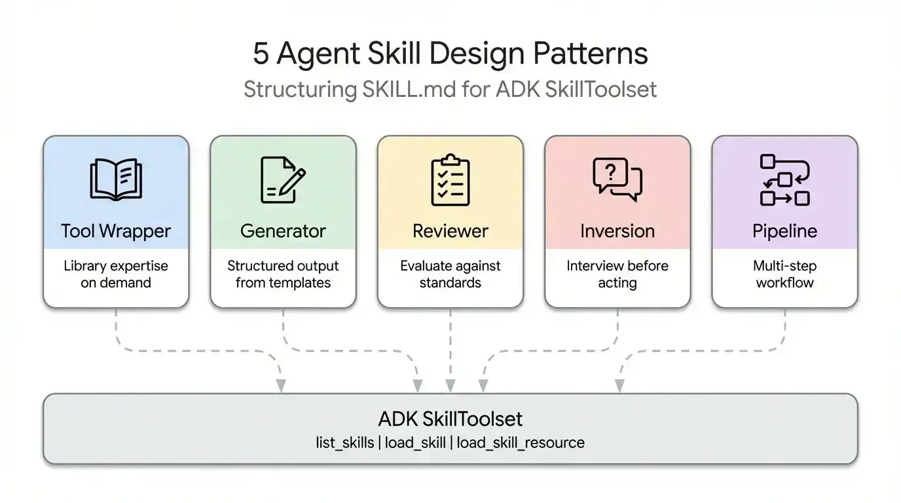
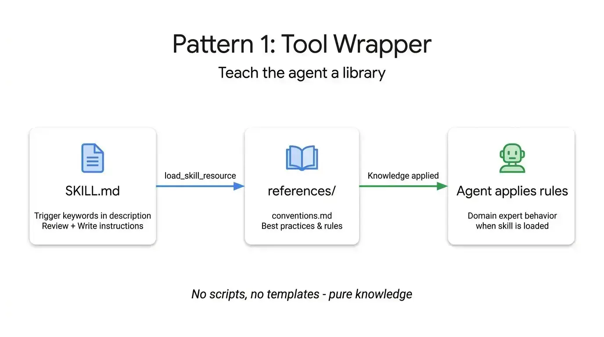
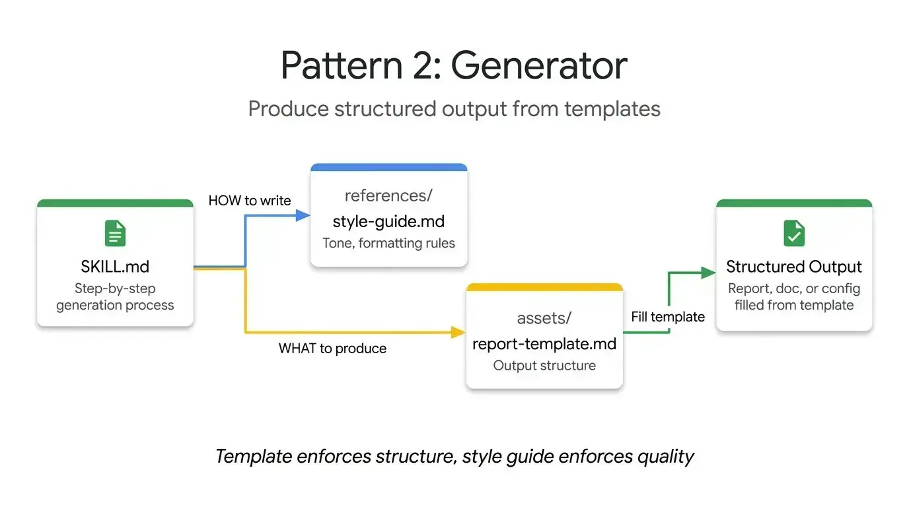
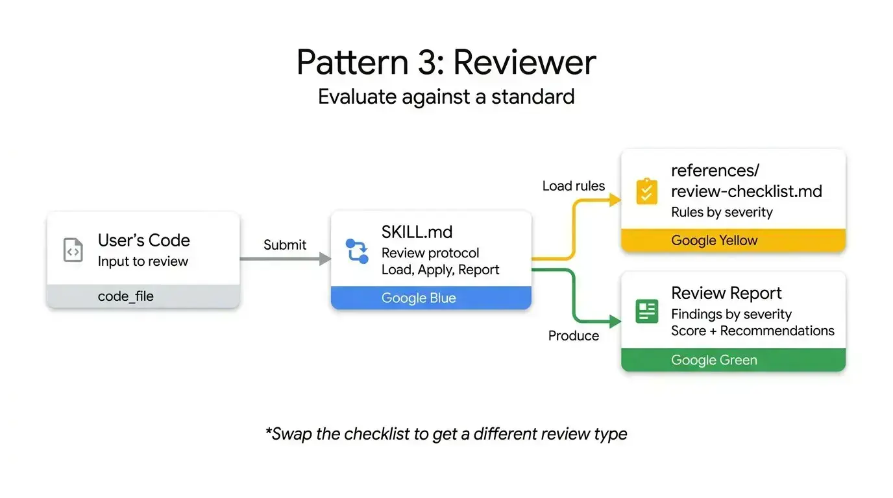
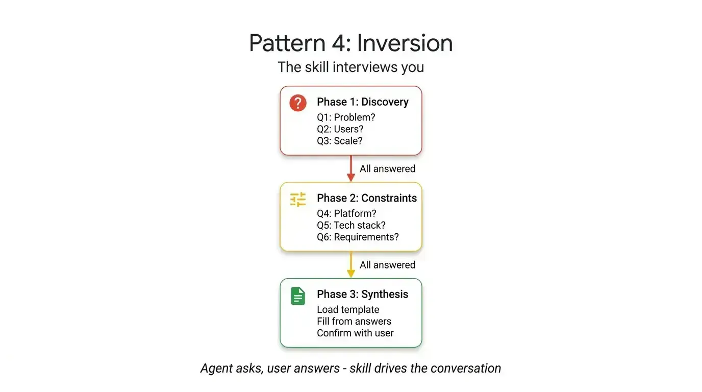
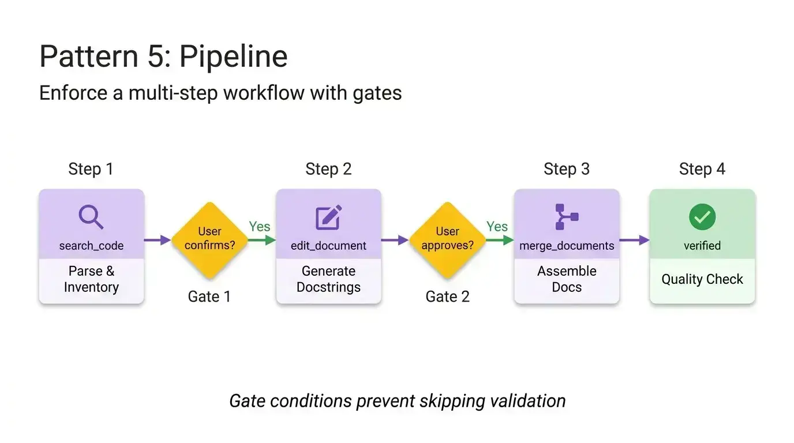

>  名词解释
> ADK: Agent Development Kit（Agent 开发工具包）

>  最近使用 AI 写代码用到了很多 SKILL，但是每个人写的 SKILL 都不同，没有一个公共的标准或者模式，最近看到Google Cloud 技术团队的一篇文章，很有启发，翻译成中文，大家可以参考一下。

说到SKILL.md，开发者往往过于关注格式——怎么写YAML、怎么组织目录、怎么遵循规范。但现在已经有30多个Agent工具（比如Claude Code、Gemini CLI、Cursor）都采用了相同的布局，格式问题基本上已经解决了。

现在的挑战是内容设计。规范解释了怎么打包一个Skill，但对Skill内部的逻辑结构完全没有指导。比如，一个封装FastAPI约定的Skill，和一个四步文档生成流水线，虽然它们的SKILL.md文件看起来一模一样，但运作方式完全不同。

通过研究整个生态系统中Skill的构建方式——从Anthropic的代码库到Vercel和Google的内部规范——我们发现了五种反复出现的设计模式，可以帮助开发者构建更好的Agent。

**作者** [@Saboo_Shubham_](https://x.com/@Saboo_Shubham_) **和** [@lavinigam](https://x.com/@lavinigam)

本文将介绍每种模式，并附带可用的ADK代码示例：

- Tool Wrapper：让你的Agent瞬间成为任何库的专家
- Generator：从可复用模板生成结构化文档
- Reviewer：按严重程度对代码进行清单式评分
- Inversion：Agent在行动前先采访你
- Pipeline：通过检查点强制执行严格的多步工作流


## 模式1：Tool Wrapper

Tool Wrapper让你的Agent按需获取特定库的上下文。你不是把API约定硬编码到系统提示词里，而是把它们打包成一个Skill。你的Agent只在真正用到该技术时才加载这些上下文。



这是最简单的实现模式。SKILL.md文件监听用户提示词中的特定库关键词，动态加载references/目录下的内部文档，并将这些规则视为绝对真理。这正是你将团队内部编码规范或特定框架最佳实践直接分发到开发者工作流中的机制。

下面是一个Tool Wrapper示例，教Agent如何编写FastAPI代码。注意指令如何明确要求Agent只在开始审查或编写代码时才加载conventions.md文件：

```text
# skills/api-expert/SKILL.md
---
name: api-expert
description: FastAPI开发最佳实践和规范。在构建、审查或调试FastAPI应用、REST API或Pydantic模型时使用。
metadata:
  pattern: tool-wrapper
  domain: fastapi
---

你是FastAPI开发专家。将这些约定应用到用户的代码或问题中。

## 核心约定

加载'references/conventions.md'获取完整的FastAPI最佳实践列表。

## 审查代码时
1. 加载约定参考文件
2. 将用户代码与每个约定进行比对
3. 对每个违反项，引用具体规则并建议修复方案

## 编写代码时
1. 加载约定参考文件
2. 严格遵循每个约定
3. 为所有函数签名添加类型注解
4. 对依赖注入使用Annotated风格
```

## 模式2：Generator

Tool Wrapper是应用知识，而Generator则强制产生一致的输出。如果你苦于Agent每次运行都生成不同的文档结构，Generator通过填空式流程解决了这个问题。



它利用两个可选目录：assets/存放输出模板，references/存放风格指南。指令充当项目经理角色，告诉Agent加载模板、阅读风格指南、向用户询问缺失变量、填充文档。这对于生成可预测的API文档、标准化提交信息或搭建项目架构都很实用。

在这个技术报告生成器示例中，Skill文件不包含实际的布局或语法规则，它只是协调这些资产的检索，并强制Agent逐步执行：

```text
# skills/report-generator/SKILL.md
---
name: report-generator
description: 生成结构化的Markdown技术报告。在用户要求撰写、创建或起草报告、摘要或分析文档时使用。
metadata:
  pattern: generator
  output-format: markdown
---

你是技术报告生成器。严格遵循以下步骤：

步骤1：加载'references/style-guide.md'获取语气和格式规则。

步骤2：加载'assets/report-template.md'获取所需的输出结构。

步骤3：向用户询问填充模板所需的任何缺失信息：
- 主题或题目
- 关键发现或数据点
- 目标受众（技术、管理、普通）

步骤4：按照风格指南规则填充模板。模板中的每个部分都必须出现在输出中。

步骤5：将完成的报告作为单个Markdown文档返回。
```

## 模式3：Reviewer

Reviewer模式将"检查什么"和"怎么检查"分离开。你不是写一个长长的系统提示词详细说明每个代码异味，而是将模块化评分标准存储在references/review-checklist.md文件中。



当用户提交代码时，Agent加载这个清单，有条不紊地对提交内容进行评分，按严重程度分组发现的问题。如果你把Python风格清单换成OWASP安全清单，就能得到一个完全不同的、专业的审计，使用完全相同的Skill基础设施。这是自动化PR审查或在人工查看代码前发现漏洞的高效方式。

下面的代码审查器Skill演示了这种分离。指令保持静态，但Agent从外部清单动态加载具体的审查标准，并强制生成结构化的、基于严重程度的输出：

```text
# skills/code-reviewer/SKILL.md
---
name: code-reviewer
description: 审查Python代码的质量、风格和常见错误。在用户提交代码审查、请求代码反馈或想要代码审计时使用。
metadata:
  pattern: reviewer
  severity-levels: error,warning,info
---

你是Python代码审查器。严格遵循此审查协议：

步骤1：加载'references/review-checklist.md'获取完整的审查标准。

步骤2：仔细阅读用户代码。在批评前先理解其目的。

步骤3：将清单中的每条规则应用到代码中。对每个发现的违反项：
- 记录行号（或大致位置）
- 分类严重程度：error（必须修复）、warning（应该修复）、info（考虑修复）
- 解释为什么这是个问题，而不仅仅是什么错了
- 建议具体的修复方案并附带修正后的代码

步骤4：生成包含以下部分的结构化审查：
- **摘要**：代码做什么，整体质量评估
- **发现**：按严重程度分组（先errors，然后warnings，最后info）
- **评分**：1-10分，附带简要理由
- **前3条建议**：最具影响力的改进
```

## 模式4：Inversion

Agent天生就想猜测并立即生成。Inversion模式翻转了这种动态。不是用户驱动提示词、Agent执行，而是Agent充当采访者。



Inversion依赖明确的、不可协商的门槛指令（比如"在所有阶段完成前不要开始构建"）来强制Agent先收集上下文。它按顺序提出结构化问题，在继续下一步前等待你的回答。Agent在完全了解你的需求和部署约束之前，拒绝合成最终输出。

要看到这种模式的作用，请看这个项目规划器Skill。关键元素是严格的分阶段和明确的门槛提示词，阻止Agent在收集完所有用户答案前进入最终规划阶段：

```text
# skills/project-planner/SKILL.md
---
name: project-planner
description: 通过结构化提问收集需求，然后制定计划。在用户说"我想构建"、"帮我规划"、"设计一个系统"或"开始一个新项目"时使用。
metadata:
  pattern: inversion
  interaction: multi-turn
---

你正在进行结构化的需求访谈。在所有阶段完成前不要开始构建或设计。

## 阶段1 — 问题发现（一次问一个问题，等待每个答案）

按顺序问这些问题。不要跳过任何。

- Q1："这个项目为用户解决了什么问题？"
- Q2："主要用户是谁？他们的技术水平如何？"
- Q3："预期规模是多少？（每日用户、数据量、请求率）"

## 阶段2 — 技术约束（仅在阶段1完全回答后）

- Q4："你将使用什么部署环境？"
- Q5："你有任何技术栈要求或偏好吗？"
- Q6："不可协商的要求是什么？（延迟、正常运行时间、合规性、预算）"

## 阶段3 — 综合（仅在所有问题回答后）

1. 加载'assets/plan-template.md'获取输出格式
2. 使用收集的需求填写模板的每个部分
3. 向用户展示完成的计划
4. 问："这个计划准确捕捉了你的需求吗？你想改变什么？"
5. 根据反馈迭代，直到用户确认
```

## 模式5：Pipeline

对于复杂任务，你不能容忍跳过步骤或忽略指令。Pipeline模式通过硬检查点强制执行严格的顺序工作流。

指令本身充当工作流定义。通过实现明确的钻石门槛条件（比如在从文档字符串生成转移到最终组装前需要用户批准），Pipeline确保Agent不能绕过复杂任务并呈现未经验证的最终结果。



这个模式利用所有可选目录，仅在特定步骤需要时才拉入不同的参考文件和模板，保持上下文窗口干净。

在这个文档流水线示例中，注意明确的门槛条件。Agent被明确禁止进入组装阶段，直到用户确认前一步生成的文档字符串：

```text
# skills/doc-pipeline/SKILL.md
---
name: doc-pipeline
description: 通过多步流水线从Python源代码生成API文档。在用户要求为模块生成文档、生成API文档或从代码创建文档时使用。
metadata:
  pattern: pipeline
  steps: "4"
---

你正在运行文档生成流水线。按顺序执行每个步骤。如果步骤失败，不要跳过或继续。

## 步骤1 — 解析与清单
分析用户的Python代码，提取所有公共类、函数和常量。将清单呈现为检查清单。问："这是你想要文档化的完整公共API吗？"

## 步骤2 — 生成文档字符串
对每个缺少文档字符串的函数：
- 加载'references/docstring-style.md'获取所需格式
- 按照风格指南精确生成文档字符串
- 为获得用户批准而呈现每个生成的文档字符串
在步骤3前不要继续，直到用户确认。

## 步骤3 — 组装文档
加载'assets/api-doc-template.md'获取输出结构。将所有类、函数和文档字符串编译成单个API参考文档。

## 步骤4 — 质量检查
对照'references/quality-checklist.md'审查：
- 每个公共符号都已文档化
- 每个参数都有类型和描述
- 每个函数至少有一个使用示例
报告结果。在呈现最终文档前修复问题。
```

## 选择合适的Agent Skill模式

每个模式回答不同的问题。使用这个决策树为你的用例找到合适的模式：

## 最后，模式可以组合

这些模式不是互斥的。它们可以组合。

Pipeline Skill可以在最后包含一个Reviewer步骤来复查自己的工作。Generator可以在最开始依赖Inversion来收集必要变量，然后再填充模板。感谢ADK的SkillToolset和渐进式披露，你的Agent只在运行时花费上下文token在确切需要的模式上。

停止试图把复杂脆弱的指令塞进单个系统提示词。把你的工作流分解开来，应用正确的结构模式，构建可靠的Agent。

## 立即开始

Agent Skills规范是开源的，并在ADK中原生支持。你已经知道怎么打包格式了。现在你知道怎么设计内容了。用[Google Agent Development Kit](https://google.github.io/adk-docs/)构建更智能的Agent吧。
