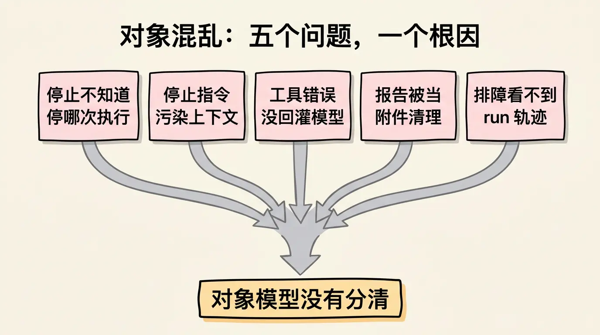
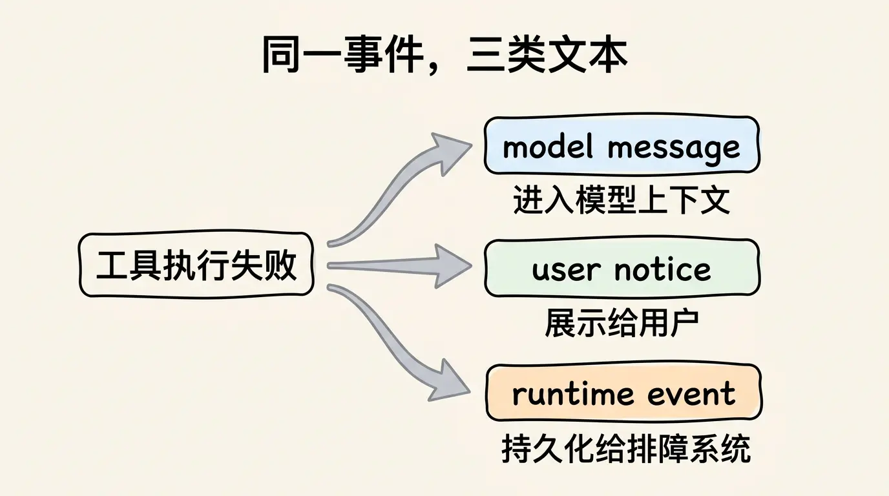
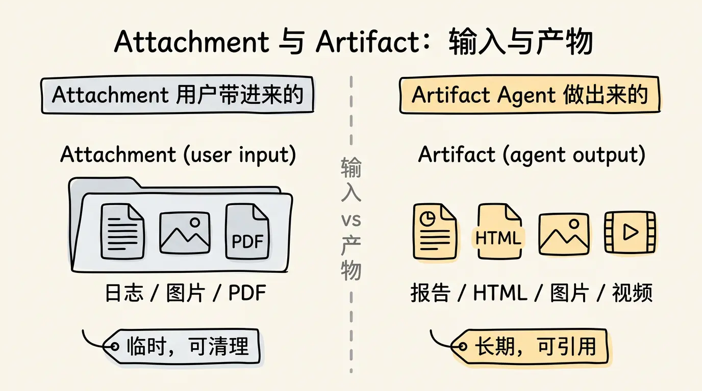
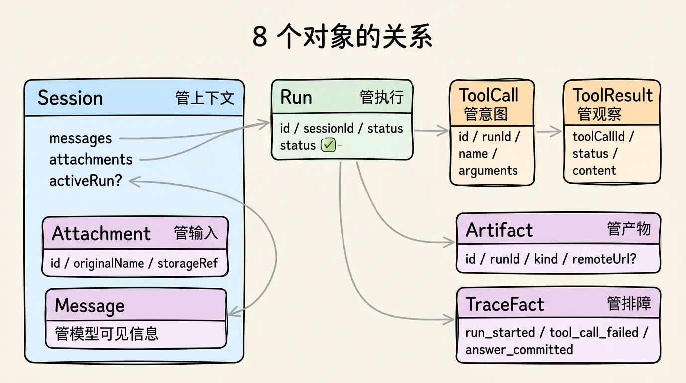
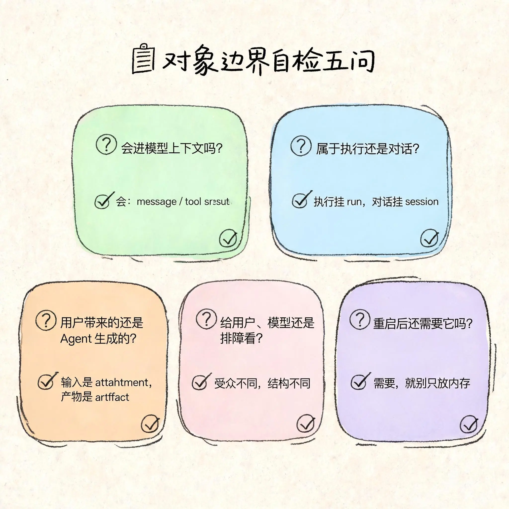

# 04. 你的 Agent 越改越乱？先把这 8 个对象分开

> 系列来源：本文属于 Agent 开发系列，内容来自 [gusibi/molibot](https://github.com/gusibi/molibot) 的真实开发记录与项目文档整理。这是系列第四篇，前三篇分别讲了 Agent 的四层分类、runtime 整体架构和最小 run 闭环——没看过不影响理解本篇。


你有没有过这种经历——

Agent demo 跑通以后，你开始往上加功能。文件上传、图片生成、记忆、停止命令、trace 页面。

然后系统开始变乱。

加个「停止」功能，不知道该停哪一次执行。工具失败了，模型却看不到错误。清理临时文件，把用户要的报告一起删了。排查线上问题，只能翻聊天记录猜。

你以为是代码写得不好。其实不是。

是对象混在了一起。

- Session 和 run 混了，停止命令不知道该停哪次执行。
- Tool result 和 assistant answer 混了，模型看不到真实工具结果。
- UI notice 和 message 混了，临时控制污染后续上下文。
- Artifact 和 attachment 混了，用户上传的文件和 Agent 生成的产物一起被清理。
- Trace fact 和业务消息混了，排障记录又被回灌给模型。

这些问题，demo 阶段一个都看不出来。因为只有一条消息、一个工具、一次执行，混了也能跑。

但系统只要长期运行，边界就会反过来找你。

这篇不画漂亮的类图，只回答一个问题：**Agent runtime 里，哪些东西必须分开？**

## 一个对象混乱的事故

先看一个真实场景。

用户发来：

```text
帮我分析这个日志文件，如果里面有异常，生成一份报告。
```

系统做了四件事：读日志、调模型分析、生成 HTML 报告、把链接发给用户。

这时用户又补了一句：

```text
先停一下，我发现上传错文件了。
```

如果对象边界不清，这里会同时出现五个问题。

第一，系统不知道「停一下」要停哪次执行。它只有 session，没有 run。session 里有很多消息，但没有一个明确的 active run。

第二，「先停一下」被当成普通消息写进模型上下文。下一轮用户重新上传文件后，模型仍然看到上一轮的停止指令，可能继续误以为不能调用工具。

第三，读取日志的工具失败了，但错误只展示给用户，没有作为 tool result 回灌给模型。模型最后生成了一份看似完整的报告，其实没有真实分析日志。

第四，HTML 报告和用户上传的日志放在同一个文件列表。系统清理上传附件时，把 Agent 生成的报告也删了。

第五，排障时开发者只看到一堆聊天消息，看不到这次 run 调用了哪个工具、哪个工具失败、最终是否提交。

这不是五个独立 bug。

它们本质上来自同一个问题：**对象模型没有分清。**



## Message：模型上下文里的基本单元

Message 是最容易被滥用的对象。

很多系统一开始会把所有文字都塞进 messages：

- 用户发来的话
- 助手回答
- 工具结果
- 系统运行提示
- 用户可见的进度
- 调试错误
- 临时控制指令

短期看很方便。长期看一定会污染上下文。

Message 服务的是模型上下文。它回答的问题是：**模型下一次请求时，需要看到哪些信息？**

用户消息是 message。最终提交的助手回答也可以是 message。工具结果如果会影响模型下一步判断，也应该作为 tool message 进入上下文。

但下面这些内容，不应该随便进 message：

```text
任务已排队，前面还有 2 个任务。
本轮不要再调用工具。
沙箱命令失败，正在请求 Host Bash 审批。
Trace recorder 写入失败。
Telegram 消息编辑失败，已改为发送新消息。
```

它们不是同一种东西。

「任务已排队」是给用户看的进度。「本轮不要再调用工具」是给模型看的临时控制，只属于当前 run。「Trace recorder 写入失败」是给开发者看的排障信息。「Telegram 消息编辑失败」是渠道发送状态。

如果这些都被当成 message 写进 session，后面模型会看到很多不该看到的东西。

更稳的做法，是先区分三类文本：

```text
model message：进入模型上下文
user notice：展示给用户
runtime event：持久化给排障系统
```

它们可能来自同一个运行事件，但不应该是同一个对象。



## Session：一段可以连续对话的上下文

Session 不是一次执行，是一段连续上下文。

用户今天说「帮我生成一张海报」，过一会儿说「把刚才那张改成黑白风格」。

这两句话属于同一个 session。因为第二句依赖第一句的上下文。

Session 保存的是这段对话的可延续性。它通常包含：

- 用户和助手的历史消息
- 已提交的工具结果摘要
- 最近产生的 artifact 引用
- 当前 active run 的引用
- 上下文压缩后的摘要

但 session 不应该承担所有运行状态。

一个 run 当前是否在等审批，不能只靠 session 里一段文字表示。session 可以引用 activeRunId，但 run 的状态属于 run。

否则用户发 `/stop` 时，系统只能在 session 里翻历史，猜当前是不是有任务在跑。

这个边界非常关键：

```text
Session 回答：这段对话是什么上下文？
Run 回答：这次执行跑到哪里了？
```

把这两个问题混在一起，停止、恢复、队列、审计都会变复杂。

## Run：一次用户输入触发的执行过程

Run 是 Agent 服务里最重要的对象之一。

它表示一次从用户输入开始，到最终完成、失败或停止为止的执行过程。

一个 run 至少应该有这些字段：

```text
Run
  id
  sessionId
  status
  startedAt
  finishedAt
  stopReason
  activeToolCallId?
  errorCode?
```

status 可以很简单：

```text
queued
running
waiting_approval
completed
failed
stopped
```

run 的价值在异常路径里最明显。

用户问「这个任务还在跑吗」，你查 run。用户说「停一下」，你停 active run。审批通过后要恢复执行，你找 waiting approval 的 run。服务重启后要清理半截任务，你扫 running run。后台要展示最近失败，你查 failed run。

没有 run，系统只能靠内存变量和聊天历史拼凑事实。

demo 里够用，真实服务里不够。

## ToolCall：模型的调用意图

模型不会真的执行工具。它只是输出一个调用意图。

这个意图应该被单独记录成 ToolCall：

```text
ToolCall
  id: "call_123"
  runId: "run_456"
  name: "readFile"
  arguments:
    path: "./logs/app.log"
```

ToolCall 的重点是稳定 id。

为什么？

因为模型一次可能请求多个工具。

比如它同时要读两个文件：

```text
call_1: readFile("./a.log")
call_2: readFile("./b.log")
```

runtime 执行完以后，必须把结果分别回填给正确的调用。

没有 toolCallId，模型看到两个工具结果时，很难知道哪个结果对应哪个请求。

工具 id 还有另一个作用：排障。

用户问「刚才那个读取失败是为什么」，你不能只回答「某个工具失败了」。你要知道是哪次 run、哪个 tool call、什么参数、什么错误。

所以 ToolCall 不是临时变量。

它是模型意图进入真实世界前的一张凭证。

## ToolResult：工具执行后的观察结果

ToolResult 是 ToolCall 的另一半。

它回答的是：runtime 执行后，真实世界返回了什么？

```text
ToolResult
  toolCallId: "call_123"
  status: "failed"
  content: "permission denied"
  errorCode: "tool_policy_denied"
```

ToolResult 最容易被误放。

有些系统只把它展示给用户。有些系统只写日志。有些系统把它混进 assistant answer。

都不稳。

ToolResult 至少有三个去处。

第一，进入模型上下文。模型需要看到工具结果，才能继续推理。

第二，进入 run detail。开发者需要知道这次 run 中发生了哪些工具调用。

第三，必要时展示给用户。用户需要知道任务进度或失败原因。

但这三个去处的内容可以不同。

给模型看的内容要简洁、结构化，能帮助下一步判断。给用户看的内容要可读，别暴露内部细节。给 trace 的内容要方便查询，但要脱敏和截断。

同一个工具结果，可以派生出三种视图。

但不要把三种视图混成一个字符串。

## Artifact：Agent 生成的产物

Artifact 是 Agent 生成出来的东西：

- 图片
- 视频
- HTML 报告
- PDF
- 临时分析文件
- 代码补丁

Artifact 和 message 不一样。message 是上下文单元，artifact 是产物。

Artifact 和 attachment 也不一样。attachment 通常是用户上传的输入，artifact 是 Agent 生成的输出。

两者都可能是文件，但生命周期不同。

用户上传的日志文件，可能只用于本次分析，过一段时间就可以清理。Agent 生成的报告，可能要保留给用户下载，或者作为后续追问的引用。

如果混在一个目录或一个对象里，清理策略会很危险。比如系统清理「上传附件」时，把生成报告一起删了。或者系统以为某个 artifact 是用户输入，错误地送回模型。

一个 artifact 至少要记录：

```text
Artifact
  id
  runId
  kind
  localPath?
  remoteUrl?
  createdAt
  retentionPolicy
```

localPath 给本地 runtime 用，remoteUrl 给外部服务或用户访问。这两个字段不能混用。

尤其是图片和视频工具，本地路径经常不能被云端 provider 访问。要传给外部服务的，通常应该是 remoteUrl。

## Attachment：用户带进来的输入

Attachment 是用户给系统的输入材料：一张图片、一段音频、一个 PDF、一个日志文件。

Attachment 进入系统后，不应该直接全部塞进模型上下文。

原因很简单：

- 文件可能很大
- 内容可能敏感
- 二进制不能直接给文本模型
- 后续工具需要的是受控引用，而不是整段内容

更稳的做法是：

```text
Attachment
  id
  sessionId
  originalName
  mediaType
  storageRef
  summary?
```

模型上下文里可以放摘要和 attachment id。真正需要读取内容时，由工具通过受控接口读取。既控制 token，也保留后续定位能力。

Attachment 和 Artifact 的区别用一句话记：

```text
Attachment 是用户带进来的。
Artifact 是 Agent 做出来的。
```

它们都可能被引用，但不要混为一谈。



## Trace Fact：给排障和统计看的事实

Trace Fact 不是业务消息。这一点很重要。

Trace 的作用，是让开发者和运营知道系统发生了什么：

```text
run_started
model_call_started
model_call_finished
tool_call_started
tool_call_failed
approval_requested
memory_retrieved
subagent_finished
answer_committed
```

这些事实对排障很有用，但不应自动进入模型上下文。

模型不需要看到「trace recorder flushed 15 events」。用户也不需要看到一堆内部事件。

Trace Fact 应该进入可查询的事实表或事件日志。

它服务的问题是：

- 这次 run 为什么失败？
- 哪个工具失败最多？
- 哪个 provider 空响应最多？
- 某个用户的任务卡在哪一步？
- 最近 token 成本为什么变高？

把 trace 当成 message，模型上下文会被污染。把 message 当成 trace，排障又缺少结构化字段。

这就是为什么 trace 要单独成体系。

## 这 8 个对象怎么连起来？

关系可以这样看：

```text
Session
  -> messages
  -> attachments
  -> activeRun?

Run
  -> sessionId
  -> toolCalls
  -> toolResults
  -> artifacts
  -> traceFacts

ToolCall
  -> toolResult

Artifact
  -> producedBy run

TraceFact
  -> observedFrom run/tool/model/runtime
```

这张图不用记字段，记住方向就行：

Session 管上下文。
Run 管执行。
Message 管模型可见信息。
ToolCall 管模型意图。
ToolResult 管真实观察。
Attachment 管用户输入材料。
Artifact 管 Agent 产物。
TraceFact 管排障事实。

每个对象只回答自己的问题。



## 判断对象边界对不对：五个问题

设计对象时，可以用几个问题自检。

第一，这个东西会不会进入模型上下文？

会，它可能是 message 或 tool result。不会，就不要强塞进 message。

第二，这个东西属于一次执行，还是属于一段对话？

属于一次执行，多半挂 run。属于一段对话，多半挂 session。

第三，这个东西是用户带来的，还是 Agent 生成的？

用户带来的是 attachment。Agent 生成的是 artifact。

第四，这个东西是给用户看的、给模型看的，还是给排障看的？

三个受众不同，结构也应该不同。

第五，服务重启后还需要它吗？

需要，就不要只放内存。

这些问题比「应该建几个表」更重要。

表结构可以调整。对象边界一旦错了，后面每个功能都会被拖下水。



## 最小版本怎么做？

你不需要一开始就把所有对象做得很复杂。

最小版本可以很朴素：

```text
sessions.json
runs.json
artifacts/
trace-events.jsonl
```

或者用 SQLite：

```text
sessions
messages
runs
tool_calls
tool_results
artifacts
trace_facts
```

重点不是选文件还是数据库。

重点是不要把所有东西都塞进一个 messages 数组。

因为 messages 数组一旦承担所有职责，就会变成系统垃圾桶。模型上下文、UI 状态、运行状态、排障事实、文件引用都往里放，短期方便，长期灾难。

## 下一篇讲什么？

这一篇把核心对象拆开了。下一篇进入工具调用。

前面说过，ToolCall 是模型的调用意图，ToolResult 是 runtime 的真实观察。但工具系统还要继续回答四个问题：

- 模型怎么知道工具该怎么用？
- runtime 怎么判断这个工具能不能执行？
- 工具结果怎么回到模型、用户和 trace？
- 工具失败后，系统怎么恢复？

这四个问题对应下一篇的四个关键词：**Schema、Policy、Result、Recovery。**
