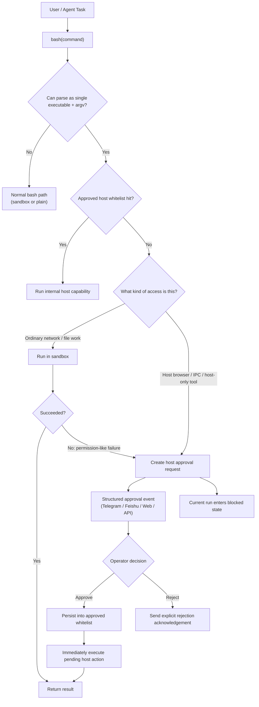
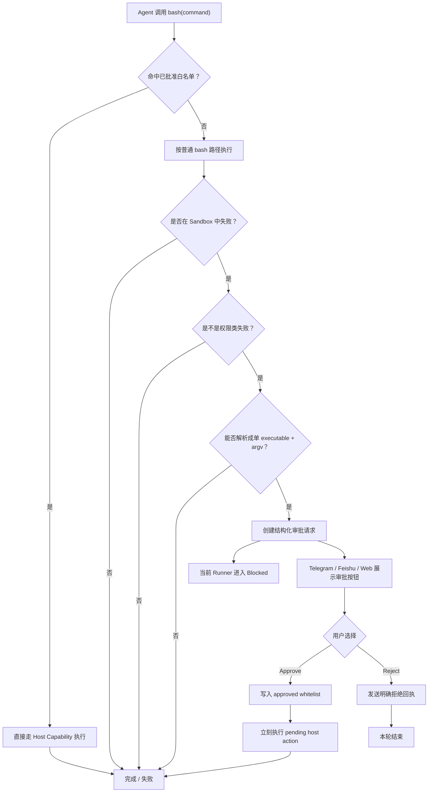
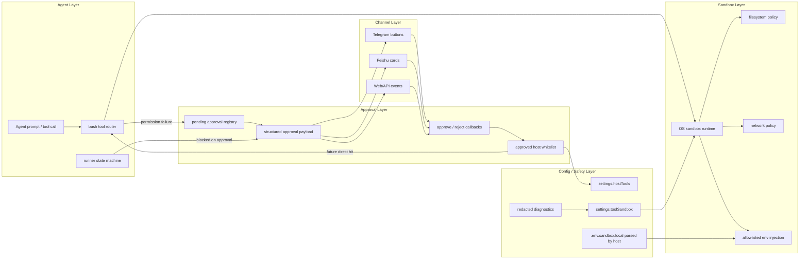

我一开始以为，给 Agent 加 Sandbox 这件事并不复杂：

- 把 bash 套进隔离层
- 限一下文件系统
- 限一下网络
- 再处理一下环境变量

但真把它放进一个真实产品里，问题马上就不是“能不能隔离”，而是：

**既要让 Agent 真能干活，又不能让它顺手把宿主机掀了。**

这次我在自己的 Agent Runtime 里，先后被两个非常具体的场景逼着重构权限模型：

- curl 在沙箱里访问网络，一直报错
- agent-browser 要打开网页并截图，但它本质上不是普通网络请求，而是宿主浏览器能力

最后我做出来的，不只是一个 Shell Sandbox，而是一整套：

- bash 执行边界
- Host Capability 审批
- 白名单复用
- 自动续跑
- 配置脱敏
- 多渠道结构化审批

这篇文章，我就完整讲讲这套东西是怎么从真实问题里长出来的。

---

# 我在真实 Agent 产品里落地 Sandbox 的全过程  
## 从 `curl` 报错，到 `agent-browser` 审批升级，我是怎么把权限、审批、配置安全真正做成产品能力的

如果你最近在做 Agent，而且这个 Agent 不是纯聊天，而是真的会：

- 调 `bash`
- 装依赖
- 读写文件
- 连网
- 调本机工具
- 打开网页、截图、控制浏览器

那你迟早会遇到一个问题：

**“让 Agent 能干活”和“让 Agent 不乱来”之间，根本不是加一个开关就能解决的。”**

一开始我也以为，所谓 Sandbox，无非就是：

- 把 `bash` 套进一个 OS-level sandbox
- 限文件系统
- 限网络
- 再处理一下环境变量

听上去很合理。  
但真把它放进一个真实产品里，你很快就会发现：

- Agent 需要 `pip install`，你不能把它锁死
- Agent 需要读工作区文件，但不能顺手把 `.env`、`~/.ssh` 也看了
- 有些能力沙箱里天然做不了，比如浏览器 IPC、本机 App、宿主浏览器状态
- 如果用户批准了一次“越权”，这次要怎么继续执行？下次还要不要再批？
- 如果审批只是一段文本，Telegram、飞书、Web/API 根本没法优雅渲染按钮
- 更现实的是：**配置本身也是高风险面**，你不能一边做 Sandbox，一边把密钥泄漏在 env、诊断页和子进程里

所以我这次在 Molibot 里做的，不是一个“演示版 Sandbox”，而是一套真正能跑在 Agent runtime 里的权限体系。

这篇文章我想讲的重点，不是某个库怎么调，而是：

> 在一个真实 Agent 产品里，怎么把 Sandbox、权限升级、审批、白名单、配置安全、用户体验，真正收敛成一套可落地的系统。

---

# 一、我不是先想到审批的，而是先被两个真实场景逼出来的

很多技术文章喜欢从架构图开始。  
但我这次做这套东西，实际顺序完全不是这样。

它不是我先画了一张完整蓝图，然后照着实现的。  
它其实是被两个非常具体、非常真实的使用场景逼出来的。

---

## 场景一：我想让 Agent 用 `curl` 访问网络，结果它一直报错

这是我最先撞到的坑。

我把 Agent 的 `bash` 放进 OS-level sandbox 之后，最先出问题的不是复杂工具，而是一个最普通的命令：

```bash
curl https://example.com
```

按我的直觉，这类命令应该属于 Agent 的基础能力：

- 拉个网页
- 打个接口
- 下载一个公开文件
- 做服务连通性验证
- 抓一段公开数据

但现实情况是，只要 sandbox 网络策略没有正确放开，它就会一直失败。

这件事给我的第一个提醒非常直接：

**真实 Agent 的 `bash` 不能被做成一个“默认什么都做不了”的死沙箱。**

因为联网对 Agent 不是附加能力，而是基础能力。  
如果你默认把网络全砍掉，那表面上很安全，实际上产品会非常难用。

所以我后来没有把问题简单理解成“要不要允许联网”，而是把它拆成两类：

1. **普通网络访问**，是不是应该属于 sandbox policy 的可配置范围  
2. **如果某个能力不是普通网络请求，而是更高等级的宿主能力**，是不是应该走审批升级链路

这两个问题看起来接近，实际上是完全不同的系统设计方向。

---

## 场景二：我自己的 `agent-browser` 工具，要打开网页并截图，但它走进了沙箱

另一个更典型的场景，是我自己的 `agent-browser` 工具。

这个工具的用途很直接：

- 打开网页
- 控制浏览器
- 截图
- 有时候还要复用浏览器进程、本机状态或者 IPC 通道

表面上看，它也像是在“访问网页”。  
但它和 `curl` 根本不是一类能力。

`curl` 本质上是：

- 普通网络请求
- 无状态
- 无桌面依赖
- 无浏览器会话依赖

而 `agent-browser` 背后涉及的是：

- 宿主浏览器进程
- 本机 IPC
- 可能的用户会话状态
- 本机交互环境
- 截图、页面控制等 host-only 能力

这时候我如果还试图靠“给 sandbox 多开几个网络权限”去解决，方向就已经错了。

因为它真正需要的不是“域名白名单”，而是：

> **宿主能力升级**

也正是因为这两个场景，我后来才真正意识到一件事：

> 不是所有“访问网页”的行为，都属于同一个权限层级。

这句话几乎决定了我后面整套设计怎么长出来。

---

# 二、同样是“访问网页”，`curl` 和 `agent-browser` 根本不是一回事

为了把这个问题说清楚，我后来自己把这两类场景明确分层了。

| 场景 | 本质 | 适合的开放方式 |
|---|---|---|
| `curl https://...` | 普通网络请求 | sandbox network policy |
| `wget` / API 拉取 / 拉公开页面 | 普通网络请求 | sandbox network policy |
| `agent-browser open + screenshot` | 浏览器/IPC/宿主能力 | host approval + whitelist |
| 读 `.env` / `~/.ssh` | 敏感配置/敏感文件 | 默认拒绝 |
| 本机 App / 浏览器控制 | host-only capability | 审批升级 |

这个分层对我后来整个系统很重要。

因为它让我避免了两个常见错误：

### 错误一：把所有联网能力都当成高危 host 能力
这样产品会很难用，普通联网都要审批，用户很快就会烦。

### 错误二：把所有“像联网”的能力都塞进 sandbox policy
这样边界会越来越糊，最后你根本分不清：
- 哪些是普通网络
- 哪些已经是宿主机权限

所以真正的做法不是继续堆规则，而是：

- **普通网络访问**：交给 sandbox policy
- **宿主浏览器 / IPC / 本机工具能力**：交给审批和白名单

---

# 三、我先定了一条边界：Sandbox 只覆盖 Agent Shell，不碰整个系统

在这两个真实场景把问题暴露出来之后，我做的第一件事不是接库，而是先定边界。

我的选择是：

**第一版 OS-level sandbox 只覆盖 Agent Shell。**

具体来说，只覆盖：

- 主 Agent `bash`
- 内置 subagent `bash`

明确不进入这个 sandbox 的是：

- Browser
- Computer Use
- ACP
- MCP
- Channel 消息收发

为什么这么做？

因为真实产品里，不同能力的边界本来就不一样。

- `bash` 是最通用、最危险、也最容易被模型滥用的执行面
- Browser / Computer Use 天然就是 host-access surface
- ACP / MCP 是协议型能力，不适合混进 shell 沙箱语义
- Channel transport 属于 runtime 基础设施，不应该被 shell 级规则干扰

如果你一开始不切清楚这层边界，最后很容易得到一种看起来“统一”、实际非常脆弱的设计：

> 所有能力都混在一个权限模型里，结果每新增一个渠道、一个工具、一个运行模式，你都得补一层特判。

我不想要那种系统。  
所以我的原则很明确：

> `bash` 进 sandbox，其他 host-access 能力保持显式、独立的执行面。

---

# 四、我最终落地的，不是“有无沙箱”，而是一条三段式路由

后来真正写实现的时候，我发现最自然的结构不是“开关”，而是**路由**。

现在这套系统里，`bash` 进入 runtime 后，大致会按这三步走。

---

## 第一步：先看是不是已批准的 host capability

如果命令能被解析成：

- 一个 executable
- 一组结构化 argv

那先查一遍已批准白名单。

如果命中，就**不再先进 sandbox**，而是直接走内部 host capability 执行器。

这是我后来很重要的一个收敛：

- 已经批准过的能力，不该每次都先失败一次再弹审批
- 用户既然已经明确授权，就应该复用这个决策
- 但复用的对象不是“host shell”，而是受控的 capability

---

## 第二步：没命中白名单，就按普通 bash 路径执行

如果没命中已批准 host capability：

- sandbox 开启：走 OS-level sandbox
- sandbox 关闭或初始化失败软降级：走普通 bash

这一步保证大多数正常工作流根本不需要审批。  
比如：

- `pip install`
- `npm install`
- 普通 `curl`
- `git clone`
- 数据处理脚本
- 报告导出
- 文件转换

这些都应该默认顺畅，而不是动不动打断用户。

---

## 第三步：如果是 sandbox 权限失败，再自动升级为审批流

如果同时满足这几个条件：

- 当前确实在 sandbox 中执行
- 错误看起来像权限类错误
- 命令能表示成单 executable + argv

那 runtime 会自动创建 host approval request。

这个 request 不是一段文本，而是一个结构化审批事件。  
后面 Telegram / 飞书 / Web/API 都靠这个统一协议消费。

---

## 整条路由的伪代码

```ts
function executeBash(command, options) {
  const parsed = tryParseSingleExecutable(command);

  if (parsed) {
    const approved = findApprovedHostCapability(parsed.executable);
    if (approved) {
      return runApprovedHostCapability(approved, parsed.args);
    }
  }

  const execMode = resolveBashMode({
    sandboxEnabled: options.sandboxEnabled,
    sandboxAvailable: options.sandboxAvailable
  });

  const result = runBash(command, execMode);

  if (result.ok) {
    return result;
  }

  if (
    execMode === "sandbox" &&
    looksLikePermissionFailure(result.error) &&
    parsed
  ) {
    const approval = createHostApprovalRequest({
      executable: parsed.executable,
      args: parsed.args,
      reason: inferReasonFromFailure(result.error),
      pendingAction: {
        kind: "run_approved_host_tool",
        originalCommand: command,
        args: parsed.args,
        timeout: options.timeout
      }
    });

    emitStructuredApprovalEvent(approval);
    blockCurrentRunUntilApproval();
    return blocked("waiting_for_host_approval");
  }

  throw result.error;
}
```

这段逻辑里，顺序很关键：

1. **先看白名单**
2. **再跑 sandbox**
3. **权限失败才升级审批**

如果顺序反了，整个体验和边界都会变形。

---

# 五、整体架构图：这不是一个 bash 开关，而是一条权限编排链

这张图是我最后收敛出来的整体结构。



这张图里最重要的一点不是“画得好不好”，而是它表达了一件非常真实的事情：

> Approve 不是“写白名单然后结束”，而是“写白名单 + 立刻继续执行这次挂起动作”。

如果不做自动续跑，整个系统很容易变成技术上说得过去、体验上很别扭的半成品。

---

# 六、为什么我没有把“批准”理解成“开放 host bash”

这是我这次设计里最坚持的一条。

很多系统做到一半，最后都会滑向一个危险但省事的方案：

> 只要 sandbox 里干不了，就给一条 host shell 通道。

短期很爽，长期一定失控。

所以我这里把“开放权限”定义成：

**批准 capability，不批准 shell。**

批准后得到的不是：

- 一整个 unsandboxed shell
- 任意命令执行权

而是：

- 一个固定 executable 的受控宿主执行面
- 一组结构化 argv
- 可持久化、可审计、可复用的 capability grant

---

## 这部分的数据模型大致是这样的

```ts
type HostToolApprovalRequest = {
  id: string;
  toolId: string;
  command: string;
  reason: string;
  permissions: {
    filesystem: "none" | "scratch-only" | "workspace-read" | "workspace-write";
    network: "none" | "loopback" | "internet";
    envAllowlist: string[];
  };
  pendingAction?: {
    kind: "run_approved_host_tool";
    originalCommand: string;
    args: string[];
    stdin?: string;
    timeout?: number;
  };
  status: "pending" | "approved" | "rejected";
};

type ApprovedHostTool = {
  toolId: string;
  command: string;
  approvedAt: string;
  approvedFromRequestId: string;
  permissions: {
    filesystem: string;
    network: string;
    envAllowlist: string[];
  };
  enabled: boolean;
};
```

背后的核心思想是：

- 审批对象是“能力”
- 不是“本轮 shell 特权”
- 更不是“把整台机器交给模型”

---

# 七、我为什么限制只有“单 executable + argv”才能进入审批链

这点我刻意做得很严格。

为了保证审批后的自动执行是等价、可控的，我只允许进入 host approval 的命令满足：

- 一个 executable
- 一组结构化 argv
- 不能有 pipe
- 不能有 redirect
- 不能有 `&&`、`;`
- 不能有 shell expansion
- 不能是 `bash` / `sh` / `zsh` / `node` / `python` 这类通用解释器入口

为什么？

因为如果你允许审批的是：

```bash
foo | bar && baz > out.txt
```

那你其实根本定义不清：

- 批准的是 `foo`？
- 还是整个 shell pipeline？
- 还是这次重定向副作用之后的所有行为？

这时候所谓“审批”已经不是 capability grant，而变成了：

> 请用户为一段自由 shell 背书

这件事一旦做了，前面的边界几乎就失去意义了。

所以我宁可自动审批支持范围窄一点，也不愿意把边界做糊。

---

# 八、自动审批为什么必须是结构化事件，而不是一段文字

这是我后来很明确的一次协议层纠偏。

一开始，审批请求其实只是返回一段给人看的说明，大概类似：

- 需要审批
- 回复 approve
- 回复 reject

在本地 CLI 里勉强可用。  
但一旦进入真实渠道，这种设计马上就不够了。

因为：

- Telegram 想要 inline button
- 飞书想要 card action
- Web/API 想要结构化事件流
- 后面新增渠道，也不可能都去解析自然语言

所以后来我把审批消息改成了结构化 payload。

大概像这样：

```ts
type HostToolApprovalPrompt = {
  type: "host_tool_approval";
  requestId: string;
  title: string;
  body: string;
  options: [
    { id: "approve", label: "Approve", style: "primary" },
    { id: "reject", label: "Reject", style: "danger" }
  ];
  request: {
    toolId: string;
    displayName: string;
    command: string;
    args: string[];
    reason: string;
    permissions: {
      filesystem: string;
      network: string;
      envAllowlist: string[];
    };
    requestedAt: string;
  };
};
```

这样一来：

- Web/API 可以直接消费 `host_tool_approval`
- Telegram 渲染按钮
- 飞书渲染卡片
- Approve / Reject 都有统一 callback 语义

这一步不是“UI 美化”，而是：

> 审批从“提示词”升级成了“系统事件”。

这两者的差别非常大。

---

# 九、我踩过的最大坑之一：自动提审一开始没有阻塞当前 run



这是这套系统里我后来专门修的一次逻辑错误。

一开始我的自动审批链是这样的：

- sandbox 权限失败
- runtime 自动创建审批请求
- tool 返回“我已经帮你发起审批了”

从局部看没问题。  
但从系统状态机看，这其实是错的。

因为这样 Agent 会把这次工具调用理解成“成功返回了结果”，然后继续往下推理，甚至继续生成最终回复。

于是就会出现一种非常糟糕的状态：

- 审批还没通过
- 真正动作还没执行
- 但用户已经看到了像“已经处理完”的回答

这个坑在真实产品里非常危险，因为它不是单纯的错误，而是**状态错乱**。

---

## 正确做法：发起审批后，本轮必须进入 blocked 状态

后来我把这条链收紧成：

- 只要工具失败结果里带 `hostToolApproval` payload
- runner 就把当前轮标记成 blocked
- 立刻 abort 当前 agent run
- 最终停在一条明确消息上：
  `Host tool approval requested. Waiting for your decision.`

---

## 这部分状态机伪代码

```ts
onToolExecutionEnd(event) {
  const approval = extractHostToolApproval(event.result);

  if (event.isError && approval) {
    runnerState.blockedOnHostApproval = true;
    runnerState.stopReason = "aborted";
    runnerState.errorMessage = undefined;
    agent.abort();
  }
}
```

然后在 prompt 主循环里：

```ts
await agent.prompt(userMessage);

flushUiQueue();

if (runnerState.blockedOnHostApproval) {
  finalText = "Host tool approval requested. Waiting for your decision.";
  break;
}
```

这个改动很小，但它决定了系统是“逻辑自洽的”，还是“表面能跑、状态错乱的”。

---

# 十、批准之后为什么必须自动续跑，而不是“写白名单就停”

这是另一个很容易做成半成品的地方。

用户点击 Approve 的真实心智不是：

> 我授权你记录一下，以后再说。

而是：

> 我就是让你把刚才那件事继续做完。

所以如果审批通过后只是：

- 把结果写进配置
- 然后结束

用户就还得再补一句“继续”。

这个体验非常怪。

后来我改成：

1. Approve
2. 把结果写进 `settings.hostTools.approvedTools`
3. 取出 `pendingAction`
4. 立刻执行这次挂起的 host action
5. 把结果返回到当前聊天线程里

---

## 这部分的伪代码

```ts
function approveHostTool(input, approvalId) {
  const approved = approveHostToolRequest(settings.hostTools, input.scopeId, approvalId);

  updateSettings({
    hostTools: approved.settings
  });

  if (approved.request.pendingAction) {
    return executeApprovedHostTool(
      approved.approved,
      approved.request.pendingAction
    );
  }

  return "Approved, no pending action.";
}
```

到这一步，链路才真正闭环：

- 这次继续执行
- 下次直接命中白名单
- 不需要第二个 host-run tool
- 不需要用户再说一次“继续”

---

# 十一、Reject 为什么也要有明确回执

这看上去像个小细节，其实是典型的真实交互问题。

一开始我只做了：

- 点击 Reject
- 更新卡片/原消息状态

逻辑没错，但用户感知不够明确。  
用户容易出现一个疑问：

> 我点了，系统到底有没有接住？

后来我补成：

- 更新卡片状态
- 再发一条普通文本消息  
  比如：`Rejected host tool approval ...`

这一步看似很小，但它解决的是操作闭环。

在按钮交互系统里，最怕的不是失败，而是“点了没反应”。

---

# 十二、真正的安全关键，不只是命令隔离，而是配置安全

很多人做 Sandbox，只盯着：

- 文件系统
- 网络
- 进程

但真实产品里，**配置本身就是高风险面**。

尤其是：

- `.env`
- workspace secret
- `~/.ssh`
- 云服务密钥
- 诊断输出
- 子进程环境注入

所以我这次专门把配置安全单独做成了一层。

---

## 1. sandboxed bash 不允许直接读 env 文件

我没有采用“让子进程自己去读 `.env`”的方式，而是：

- 宿主进程解析 workspace 的 `.env.sandbox.local`
- 只按 allowlist 注入必要 key
- 同时在 sandbox 文件系统策略里显式 deny 读取这个 env 文件本身

这样做的好处是：

- 子进程拿到的是最小必要配置
- 它看不到完整 env 文件
- 它没法通过 `cat .env.sandbox.local` 反向把所有 secret 全拖出来
- 诊断页面可以展示“哪些 key 可用”，但不泄漏 value

---

## 这部分的伪代码

```ts
function buildSandboxEnv(settings, envFileValues) {
  const source = mergeAllowedSources(process.env, envFileValues);

  const env = {};
  for (const key of Object.keys(source)) {
    if (matchesDeny(key, settings.env.deny)) continue;
    if (!matchesAllow(key, settings.env.allow)) continue;
    env[key] = source[key];
  }

  return env;
}
```

以及文件系统策略：

```ts
filesystemPolicy = {
  denyRead: [
    "~/.ssh",
    "~/.aws",
    "~/.gnupg",
    ".env",
    ".env.*",
    ".env.sandbox.local"
  ],
  denyWrite: [
    ".env",
    ".env.*",
    "*.pem",
    "*.key"
  ]
};
```

---

## 2. 设置页诊断只显示 key，不显示 value

这是一个很容易为了“调试方便”做错的地方。

如果你不小心把诊断做成：

- 列出 env 内容
- 列出注入值
- 列出原始 secret
- 原样吐错误信息

那“调试页”很快就会变成最大泄漏面。

所以我这里专门做了 redacted diagnostics：

- 显示 env 文件是否存在
- 是否可读
- 哪些 key 可用
- 哪些被注入
- 哪些被 deny
- sandbox 初始化是否成功
- 当前网络/文件系统策略是什么

但**不显示 value**。

---

## 诊断模型大致是这样

```ts
type ToolSandboxDiagnostics = {
  envFilePath: string;
  envFileExists: boolean;
  envFileReadable: boolean;
  envKeysAvailable: string[];
  envKeysInjected: string[];
  envKeysDenied: string[];
  sandboxInitialized: boolean;
  sandboxError?: string;
  effectiveNetwork: {...};
  effectiveFilesystem: {...};
};
```

我觉得这一步特别重要。  
因为现实里很多系统不是死在“核心安全逻辑”，而是死在“为了方便调试，多打印了一点东西”。

---

# 十三、整体权限架构图：运行时、审批、配置三层如何配合

这张图比前面那张更完整，能看到 Agent、Sandbox、审批、配置、渠道几层是怎么配合的。



这张图里还有一个我很看重的原则：

> Channel 层只负责平台适配，不负责公共权限逻辑。

也就是说：

- Telegram / 飞书只负责按钮、卡片、原始消息转换
- 审批状态机、白名单写入、自动续跑、runner 阻塞，都放在共享 runtime / settings / agent 层

这样未来新增渠道，不需要把审批系统重写一遍。

---

# 十四、我踩过的几个真实坑

我觉得这部分很值得写进文章，因为它最像真实工程，而不是说明书。

---

## 坑 1：一开始我把 host approval 做成了单独的 tool

最初的思路是：

- `bash`
- `hostToolApproval`
- `hostToolRun`

看起来很工整，但实际很别扭。

问题在于：

- Agent 需要理解三种入口
- prompt 要解释三套工具语义
- 用户心智上也不自然
- 系统结构上多了一层人为路由

后来我把它收口成：

- `bash` 是唯一入口
- 审批与 host exec 都变成 runtime 内部行为

整个系统一下子清晰很多。

---

## 坑 2：审批一开始只是文本，不是结构化 payload

CLI 里勉强能用，一到 Telegram / 飞书 / Web 就不够了。  
后面必须改成结构化事件协议。

---

## 坑 3：自动提审一开始没有阻塞当前 run

这会导致“其实还没执行，但看起来像执行完了”。  
后来改成 blocked 状态，runner 收口成“等待审批”。

---

## 坑 4：Reject 一开始没有明确回执

逻辑结束了，但用户感知不完整。  
后来补了显式文本回复。

---

## 坑 5：白名单粒度其实非常难设计

这块我现在还没有完全定死。

目前实现按 executable 级别匹配，优点是：

- 简单
- 顺手
- 复用性高

但代价是：

- 一次批准可能覆盖同 executable 的更多 argv 场景

这恰恰说明了真实问题：

> 权限系统里最难的部分通常不是“能不能实现”，而是“粒度怎么定”。

我反而觉得，这种没被假装成“已经完美解决”的部分，恰恰是最真实的工程内容。

---

# 十五、如果你也在做 Agent 的 Sandbox，我建议你先回答这 6 个问题

## 1. 你到底在保护什么执行面？
不要一上来就说“全系统 sandbox”。  
先定义边界。

## 2. 你的默认能力是什么？
如果默认能力太弱，用户迟早会把安全关掉。

## 3. 你的升级路径是 capability 还是 shell？
如果是 shell，后面一定会失控。

## 4. 审批协议是不是结构化的？
如果不是，后面接渠道、接 API、接客户端都会越来越痛苦。

## 5. 自动提审之后当前 run 会不会停住？
如果不停住，状态就一定会错。

## 6. 配置和诊断会不会泄漏 secret？
如果会，前面的隔离做得再漂亮也不完整。

---

# 结尾

如果要用一句话总结我这次做 Sandbox 的心得，那就是：

**真正的 Sandbox，不是把命令关起来，而是把“默认能力、升级路径、审批协议、配置边界、用户感知”一起设计清楚。**

否则你做出来的要么是：

- 过于严格，Agent 根本不好用  
要么是：
- 看起来有隔离，实际上随时能被绕过去

而一个真实的 Agent 产品，最后一定要走向那条更难但更对的路：

- 平时尽量顺滑
- 边界尽量明确
- 升级尽量可审计
- 配置尽量不泄漏
- 用户尽量始终知道系统现在处于什么状态

这才是我这次做这套 Sandbox 时，真正想解决的问题。

---

如果你下一步要继续，我建议我直接帮你做这三个后续之一：

1. **给这篇文章配一个更强的公众号标题 + 导语 + 封面文案**
2. **把这篇整理成微信 Markdown 最终发布版**
3. **再加一张“状态机图”**，专门画 Approve / Reject / Blocked / Auto-continue 的完整流程图
