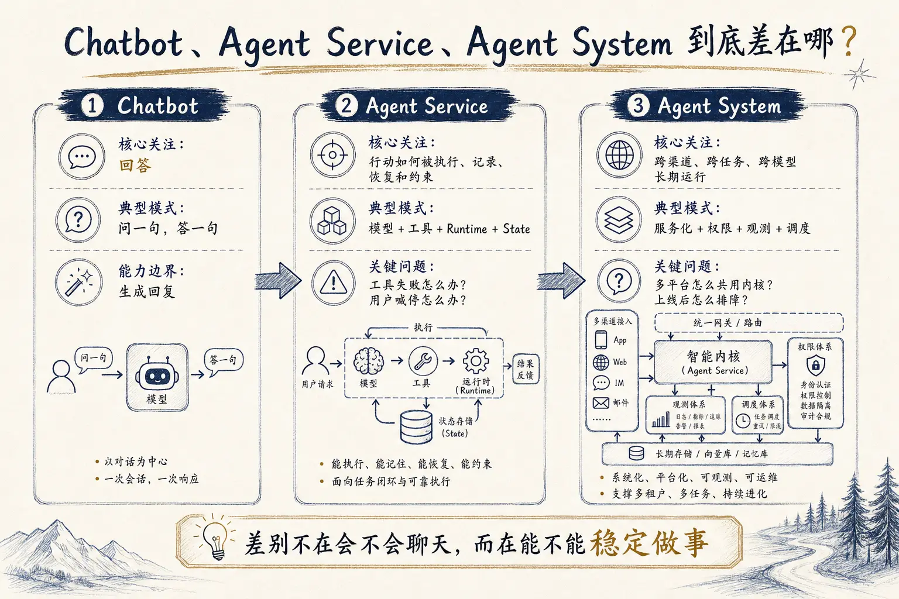
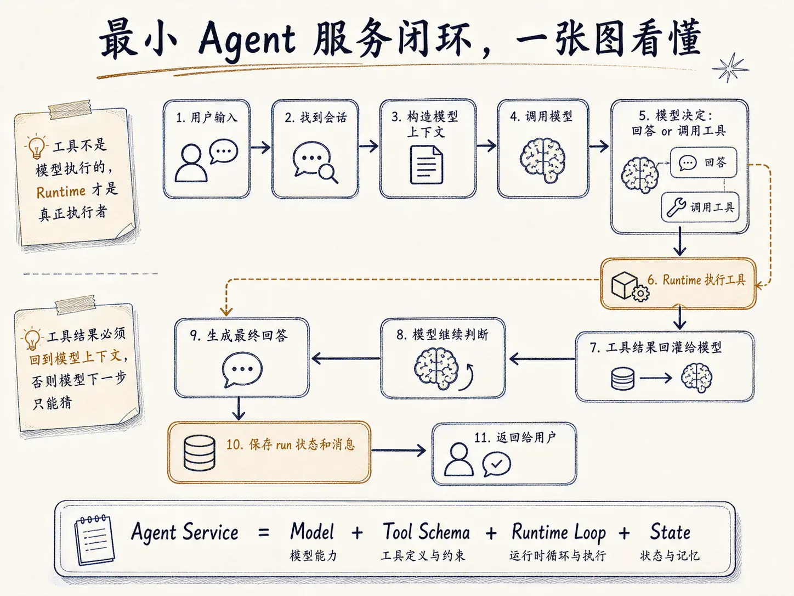
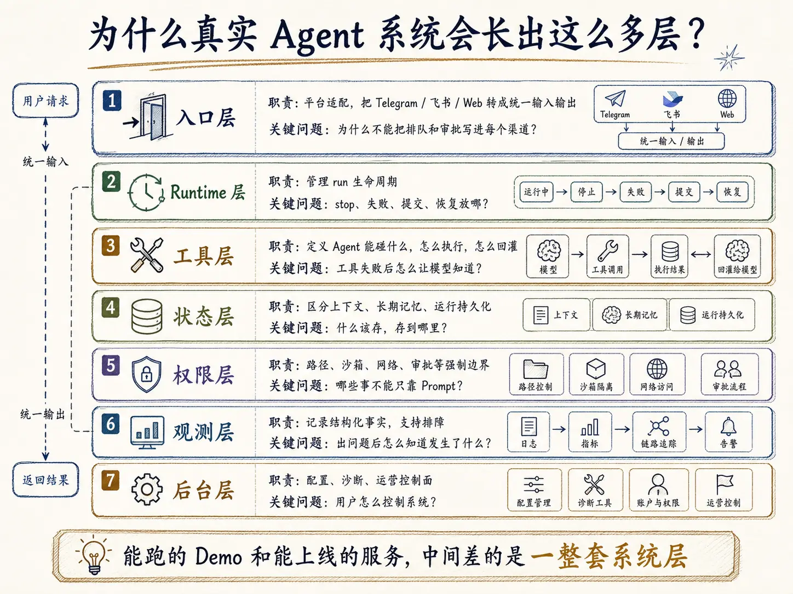
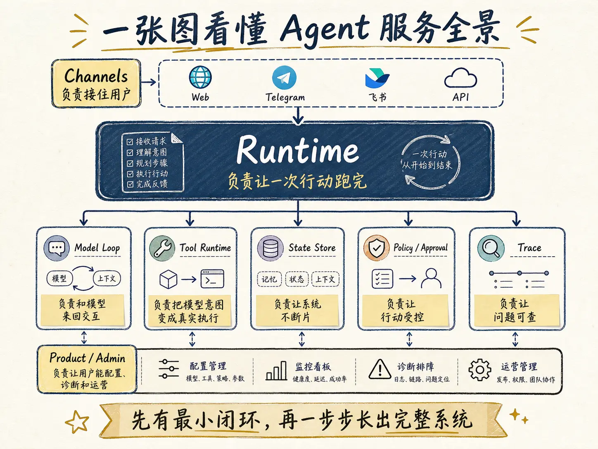

> 系列来源：本文属于 Agent 开发系列，内容来自 [gusibi/molibot](https://github.com/gusibi/molibot) 的真实开发记录与项目文档整理。
> 原文：02-内容创作/02-图文长文/agent-dev-series/01-course-map.md
> 重写说明：本文是 `01-course-map.md` 的重写版，保留原有核心观点，调整了结构和表达，并更换了标题。

# 为什么很多 Agent Demo 能跑却不能上线？一张图讲清 Agent 服务全景

你可能见过这样的 Agent demo：能聊天，能调用工具，能读文件，甚至还能生成图片。看着很厉害。

但真把它接给用户，问题立刻就来。

用户刷新页面，刚才那个任务还在不在？工具执行失败了，模型还知不知道失败原因？用户发了一句"停一下"，后台命令真的停了吗？如果同一个 Bot 同时接 Telegram、飞书和 Web，排队、审批、记忆和上下文到底写在哪里？

这些都不是"模型聪不聪明"的问题。

它们是另一件事：你有没有把 Agent 做成一个**服务**。

这组文章要讲的就是这件事。不是怎么调大模型 API，不是怎么写一句神奇的 prompt，也不是把几个工具函数绑到模型后面就叫 Agent。我想从一个真实系统的角度拆开看：一个 Agent 服务从最小闭环走到完整系统，中间到底要补哪些层。

这一篇你不用记住所有细节，但读完应该手里有一张地图。后面每篇文章，都能在这张地图上找到自己的位置。

## 为什么"能聊天"不等于 Agent 服务？



普通聊天机器人只做一件事：用户问一句，模型答一句。

它也能有多轮上下文，但本质还是"生成回复"。只要回答看起来合理，这一轮就结束了。

Agent 不一样。它的关键不是"会说"，而是"会做"。它可能要读文件、查网页、执行命令、生成图片、创建定时任务、写入记忆、等待审批、把结果发回不同平台。

只要开始做事，系统就不再只是一次模型调用了。

因为做事会带来后果。

比如用户让 Agent 改一个配置文件。聊天机器人会告诉你"应该这么改"；工具增强的聊天机器人可能真的去写文件；但一个 Agent 服务还得继续回答这些问题：

- 写之前确认过路径在允许范围内吗？
- 写坏了，旧内容有没有留底？
- 工具失败了，模型能看到失败原因吗？
- 用户中途喊停，文件写入会不会被打断？
- 最终结果有没有存进这次 run 的记录？
- 过几天排查，能不能还原当时发生了什么？

这些问题没有答案，系统也许还能 demo，但很难交给真实用户长期用。

所以这组文章的第一条判断是：

```text
Chatbot 关心回答。
Agent Service 关心一次行动如何被执行、记录、恢复和约束。
Agent System 关心这些能力如何跨渠道、跨任务、跨模型长期运行。
```

这三者不是名字的区别，是工程边界的区别。

## 最小的 Agent 服务长什么样？



先把所有复杂功能拿掉，只看最小闭环。

一个最小 Agent 服务，至少要跑通下面这条链路：

```text
用户输入
-> 找到会话
-> 构造模型上下文
-> 调用模型
-> 模型决定回答或调用工具
-> runtime 执行工具
-> 工具结果回灌给模型
-> 模型继续判断
-> 生成最终回答
-> 保存 run 状态和消息
-> 返回给用户
```

看着平平无奇，但里面藏着两个关键点。

**第一，工具不是模型执行的。** 模型只输出一个调用意图，比如"我要读取某个文件"。真正去检查路径、读文件、截断输出、处理错误的，是 runtime。

**第二，工具结果必须回到模型上下文。** 如果工具失败了，你只把错误发给用户、不告诉模型，模型下一步就只能猜。它可能假装已经成功，也可能给出没有证据的总结。

所以最小 Agent 服务的核心，不是"LLM + Tools"这么简单。更准确的写法是：

```text
Agent Service = Model + Tool Schema + Runtime Loop + State
```

少了 Tool Schema，模型不知道怎么稳定地产出调用参数。少了 Runtime Loop，模型没法连续行动。少了 State，服务一重启、用户一追问、任务一失败，全断。

这也是后面几篇先讲最小闭环、对象模型、工具调用和上下文持久化的原因。地基没打好，后面接多少渠道、加多少工具，都在补洞。

## 真实系统为什么会长出这么多层？



很多人第一次做 Agent，会觉得层次太多。

入口层、runtime 层、工具层、状态层、权限层、观测层、后台层——看着像过度设计。

但这些层不是拍脑袋设计出来的，是被真实问题一个个逼出来的。

### 入口层：用户从哪来？

一开始你可能只有一个 Web 页面。

后来想接 Telegram，再后来想接飞书、微信、QQ。每个平台都有自己的消息格式、文件上传方式、长度限制和交互组件。

但用户要的能力是同一套：发消息、排队、停止、审批、追问、看结果。

所以入口层只该做一件事——平台适配。把 Telegram 消息、飞书卡片、Web 表单都转成统一输入，再把统一输出渲染回各个平台。

如果你把队列、审批、会话推进写进每个渠道，那每加一个平台，就复制一套 bug。

### Runtime 层：一次任务怎么跑？

Runtime 是 Agent 服务的心脏。

它管一轮 run 的整个生命周期：开始、执行、工具回灌、停止、失败、提交、清理。

用户说"帮我查资料并写一份总结"，这不是一次模型调用。模型可能先搜索，再读结果，再调工具，再整理答案。每一步都可能失败，也都可能留下中间状态。

Runtime 要回答这些问题：

- 当前 run 还活着吗？
- 有没有并发 run 在冲突？
- 用户 stop 时，停在哪一步？
- 工具失败后，继续还是中断？
- 最终回答什么时候算提交？
- 服务重启后，半截任务怎么处理？

这些逻辑要是全散在模型调用函数里，代码很快会变成一个谁都不敢动的大函数。

### 工具层：模型能碰什么？

工具层不是一堆 API wrapper，它是 Agent 的**行为边界**。

工具 schema 告诉模型"可以怎么调用"；工具 policy 告诉 runtime"能不能执行"；工具 result 告诉模型"刚才发生了什么"；工具 trace 告诉开发者"事后怎么查"。

就拿文件读取来说，看着只是读个文件，真实系统至少得考虑：

- 路径在允许范围内吗？
- 文件是不是二进制？
- 内容是不是太大？
- 要不要带行号？
- 要不要截断？
- 失败原因怎么回给模型？

这就是后面要单独讲文件工具加固、沙箱、Host Bash 审批、Web Search、图片视频生成工具链的原因。

工具一旦能产生现实副作用，就必须有边界。

### 状态层：什么东西该留下？

Agent 服务里有几类状态特别容易混。

**当前上下文**是一类——模型这一轮能看到的内容。

**长期记忆**是一类——跨 session 保存的用户偏好、项目事实、稳定知识。

**运行持久化**又是一类——它记录某一次 run 发生了什么：模型调用、工具调用、审批、失败、停止、最终回答。

这三类都像"记住"，但用途完全不同。混在一起，就会冒出很难排查的怪问题。比如你把"本轮别再调工具"这种临时控制写进了普通会话历史，下一轮模型还会看到它——用户明明发了新任务，模型却被上一轮的控制信息绑住了。

所以状态层的核心不是"存下来"，是"存到正确的地方"。

### 权限层：哪些事不能只靠 prompt？

你可以在系统提示词里写：

> 不要访问工作区外的文件。

但这只是提醒，不是安全边界。

真正的边界必须由 runtime 来执行。路径白名单、沙箱、环境变量策略、网络策略、Host Bash 审批，都得在代码层面强制。

道理很简单：模型会犯错，用户也可能输入诱导内容。只靠 prompt，等于把刹车写在说明书里，而不是装在车上。

这也是 Agent 系统和聊天机器人的一个重要差别。聊天机器人说错一句话，最多是回答质量问题；Agent 执行错一个命令，可能改坏文件、泄露密钥、污染记忆，或者触发一连串外部副作用。

### 观测层：出了问题怎么知道发生了什么？

Agent 的运行过程比普通 Web 请求复杂得多。

一次 run 里可能有多次模型调用、多次工具调用、一次审批、一次上下文压缩、一个 subagent，外加若干平台消息更新。

只靠 console log，线上排障会很痛苦。

观测层要记录的是**结构化事实**：

```text
run started
model called
tool requested
tool approved
tool failed
memory retrieved
subagent started
answer committed
run stopped
```

这些事实不是给模型看的，也不一定原样给用户看。它们是给开发者和运营看的，用来回答一句话：这次到底发生了什么。

后面讲 HookManager 和 Trace Facts 时，会把这个问题展开。

### 后台层：用户怎么控制系统？

只靠配置文件，系统能开发，但很难产品化。

用户需要配置模型、provider、搜索、MCP、插件、沙箱、记忆、任务。配置错了，还得有 live test 和诊断信息，否则他只能翻日志、猜 API key 到底生效没有。

后台层的目标不是"做一个设置页"，而是 Agent 系统的**控制面**。

一个真能用的 Agent 产品，迟早要回答：

- 现在用的是哪个模型？
- 搜索工具为什么不可用？
- 某个任务为什么没触发？
- 最近哪些工具失败最多？
- 哪个 Bot 的 profile 真正生效了？
- 这个 API key 有没有泄露在 trace 里？

这些问题都和模型能力无关，但都和产品能不能长期运行有关。

## 这组文章会怎么展开？

我会按从小到大的顺序写。

**第一部分先讲地基**：Chatbot 和 Agent Service 的差别、最小 run 闭环、对象模型、工具调用、上下文和持久化。目标是让你先搞清楚"一个 run 到底是什么"。

**第二部分进入 runtime**：多渠道为什么要共享内核，runner 为什么会膨胀，停止、排队、插队、追问和压缩该放在哪一层。目标是把 Agent 从单次调用，变成能持续运行的服务。

**第三部分讲工具和安全**：文件工具为什么不能全靠 shell，沙箱为什么不是一个开关，Host Bash 审批为什么要进入工具执行链路，Web Search 和图片视频生成为什么要设计失败路径。

**第四部分讲模型治理和能力治理**：模型路由、provider 抽象、system prompt 边界、profile 优先级、skill 使用追踪、subagent 委派。目标是让模型行为不靠"祈祷"，而靠结构化约束。

**第五部分讲任务、多模态和平台体验**：定时任务、图片语音附件、Telegram 长消息、飞书卡片。这里你会看到一个现实——平台限制会反过来塑造 runtime 的设计。

**第六部分讲长期运行**：token 成本、本地数据布局、长期记忆。Agent 跑一天和跑半年，是两种系统。

**第七部分讲扩展和测试**：MCP、插件、skill 自进化，以及怎么测试一个输出不确定的系统。

**最后一部分讲产品化和交付**：设置后台、运营面、健康检查、迁移、备份和重启恢复。

原理篇会穿插在中间。工具调用讲完，补一篇 API 层原理；运行控制讲完，讲 Agent loop 为什么会停；可观测性之后，讲控制信息为什么必须区分模型、用户和排障三个受众；成本治理附近，讲 prompt 缓存为什么会被击穿。

这样安排的原因很朴素：先遇到问题，再讲原理，读起来更容易记住。

## Molibot 在这里是什么角色？

这组文章会借用 Molibot 的真实经验，但它不是一份源码讲解。

我不会让你打开某个具体文件，也不会拿一堆路径当论据。公开文章的读者通常看不到项目仓库，也不该为了读懂文章去翻源码。

所以涉及实现时，我会尽量用伪代码、流程图和对象关系来表达。比如讲工具调用，会写成这样：

```text
Model output tool call
-> Runtime validate input
-> Policy check
-> Execute tool
-> Save tool result
-> Feed result back to model
```

这比贴一个内部文件路径有用得多。文件路径只适合开发者自己排查，不适合当出版文章的主要论据。

## 读这组文章需要什么基础？

你不需要先做过完整的 Agent 系统。

但最好对几个概念有点感觉：

- HTTP API 是怎么工作的。
- 大模型的 messages 大概是什么。
- JSON Schema 是什么。
- 后端服务为什么需要持久化。
- 前端或 IM 平台为什么会有消息格式限制。

会一点 TypeScript、Node、SQLite，理解例子会更轻松。但这组文章不会把重点放在某个语言或框架上。

真正重要的是工程问题本身。换成 Python、Go、Java，Agent 服务照样要面对 run 生命周期、工具结果回灌、权限、记忆、trace、任务和成本。

语言会变，问题不会变。

## 先记住这一张图



如果只用一张图概括这组文章，可以这样看：

```text
Channels
  -> Runtime
    -> Model Loop
    -> Tool Runtime
    -> State Store
    -> Policy / Approval
    -> Trace
  -> Product / Admin
```

Channels 负责接住用户。Runtime 负责让一次行动跑完。Model Loop 负责和模型来回交互。Tool Runtime 负责把模型意图变成真实执行。State Store 负责让系统不断片。Policy / Approval 负责让行动受控。Trace 负责让问题可查。Product / Admin 负责让用户能配置、诊断和运营。

这不是一开始就要全部写完的架构。

更合理的路径是：先做最小闭环，再补状态；先让工具能跑，再加策略；先支持一个入口，再抽共享 runtime；先能看到日志，再沉淀 trace；先本地可用，再考虑部署和维护。

一步一步做，系统会自己长出来。

## 下一篇讲什么？

这一篇只是地图。地图的作用不是让你立刻到终点，而是让你知道自己在哪里。

下一篇先解决第一个关键问题：Chatbot、Tool-using Chatbot、Agent Service、Agent System 到底有什么区别。这个问题讲清楚了，后面所有设计才有落点。
