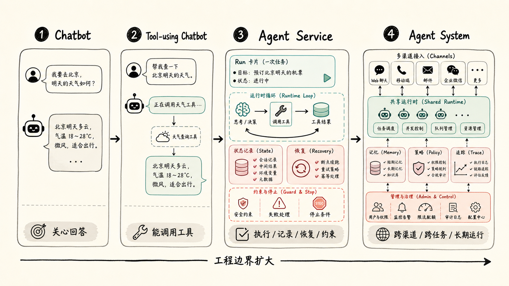
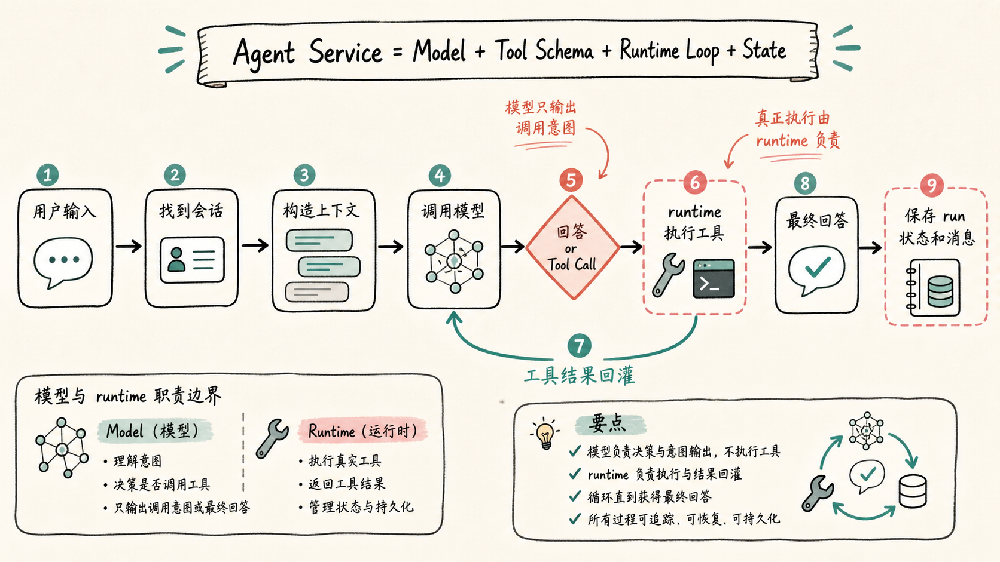
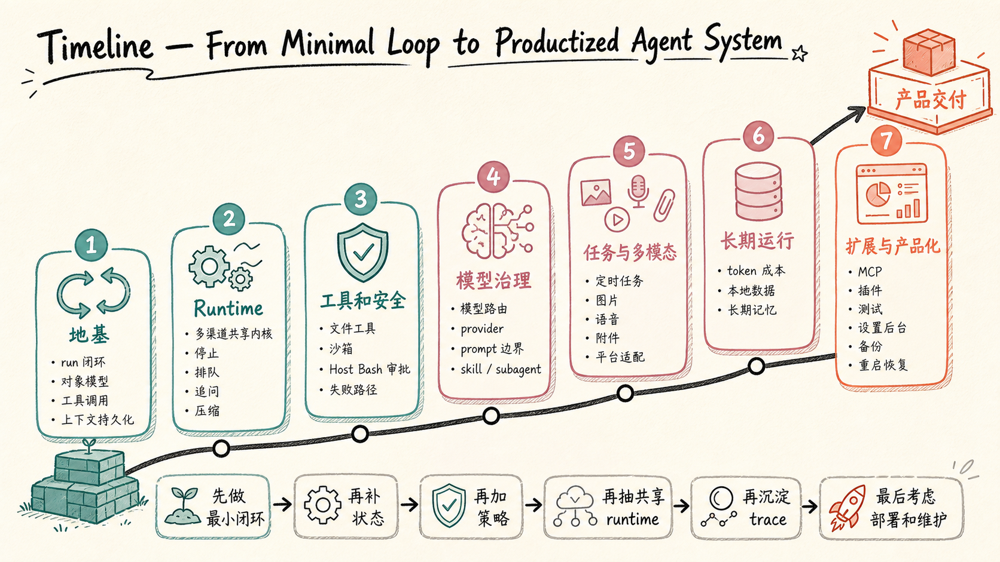
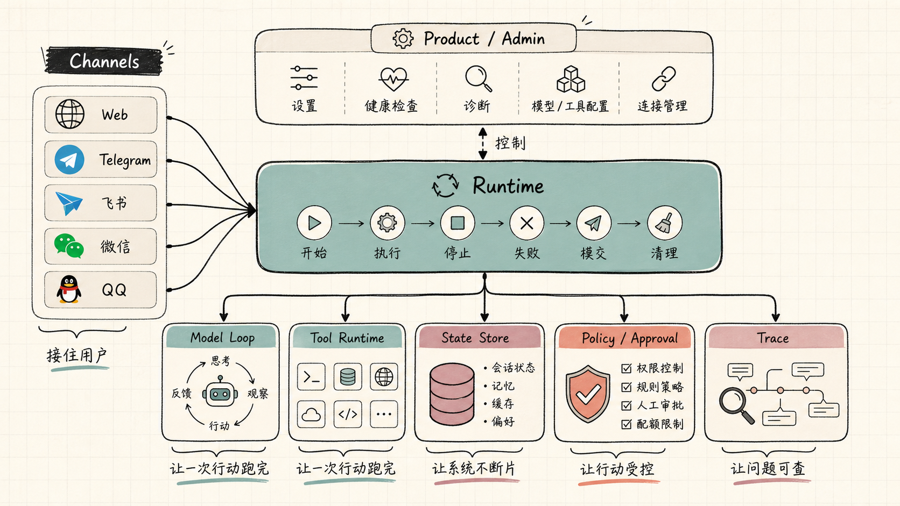

# 01. 课程导读：Agent 服务和 Agent 系统的全景图


你是不是也遇到过：
- 看了一堆教程，写了一个能调用工具的 Agent demo，自己跑起来样样都好
- 真接给用户用，刷新就丢状态，工具错了模型不知道，用户喊停了后台命令还在跑
- 想接第二个渠道，发现 80% 代码要重写

这些问题，**从来都不是模型聪不聪明的问题**。

它们属于另一件事：你有没有把 Agent 做成一个**服务**。

**一句话记住：Demo 拼模型能力，服务拼工程边界。**

这组文章要讲的，就是这件事。

不是怎么调一个大模型 API。不是怎么写一句神奇 prompt。也不是把几个工具函数绑到模型后面，然后说"这就是 Agent"。

我想从一个真实系统的角度，拆开看：一个 Agent 服务从最小闭环走到完整系统，中间到底要补哪些层。你读完这一篇，先不需要记住所有细节，但应该有一张地图。后面每篇文章，都能在这张地图上找到位置。

## 为什么"能聊天"不等于 Agent 服务？

普通聊天机器人只需要完成一件事：用户问一句，模型答一句。

它也可以有多轮上下文，但本质上还是"生成回复"。只要回答看起来合理，这一轮就结束了。

Agent 不一样。

Agent 的关键不是"会说"，而是"会做"。它可能要读文件、查网页、执行命令、调用图片生成服务、创建定时任务、写入记忆、等待用户审批、把结果发回不同平台。

只要开始"做事"，系统就不再只是模型调用了。

因为做事会带来后果。

比如用户让 Agent 修改一个配置文件。一个聊天机器人可以告诉你"应该这么改"。一个工具增强聊天机器人可能会真的写文件。但一个 Agent 服务还要继续回答：

- 写之前有没有确认路径在允许范围内？
- 写坏了有没有记录旧内容？
- 工具失败后，模型能不能看到失败原因？
- 用户中途停止时，文件写入有没有被打断？
- 最终结果有没有保存到这次 run 的记录里？
- 过几天排查问题时，能不能知道当时发生了什么？

这些问题如果没有答案，系统可能仍然能 demo，但很难交给真实用户长期使用。

所以这组文章的第一条判断是：

```text
Chatbot 关心回答。
Agent Service 关心一次行动如何被执行、记录、恢复和约束。
Agent System 关心这些能力如何跨渠道、跨任务、跨模型长期运行。
```

这三者不是名字上的区别，而是工程边界的区别。



## 最小 Agent 服务长什么样？

先把所有复杂功能拿掉，只看最小闭环。

一个最小 Agent 服务至少要做下面这几件事：

```text
用户输入
-> 找到会话
-> 构造模型上下文
-> 调用模型
-> 模型决定回答或调用工具
-> runtime 执行工具
-> 工具结果回灌给模型
-> 模型继续判断
-> 生成最终回答
-> 保存 run 状态和消息
-> 返回给用户
```

这段流程看起来普通，但里面有两个关键点。

**第一个关键点：工具不是模型执行的。**

模型只是输出一个调用意图。比如它说"我要读取某个文件"，真正检查路径、读取文件、截断输出、处理错误的，是 runtime。

**第二个关键点：工具结果必须回到模型上下文。**

如果工具执行失败，只把错误发给用户，不告诉模型，模型下一步就只能猜。它可能会假装已经成功，也可能给出没有证据的总结。

所以，一个最小 Agent 服务的核心不是"LLM + Tools"这么简单。更准确一点，可以写成：

```text
Agent Service = Model + Tool Schema + Runtime Loop + State
```



少掉 Tool Schema，模型不知道怎么稳定地产生调用参数。

少掉 Runtime Loop，模型不能连续行动。

少掉 State，服务重启、用户追问、失败恢复都会断。

这也是后面几篇文章要先讲最小闭环、对象模型、工具调用和上下文持久化的原因。地基没打好，后面接多少渠道、加多少工具，都会变成补洞。

## 为什么真实系统会长出这么多层？

这些层不是一开始拍脑袋设计出来的。它们都是被真实问题"逼出来"的。

### 入口层：用户从哪里来？

一开始你可能只有 Web 页面。后来你想接 Telegram，再后来想接飞书、微信、QQ。每个平台消息格式都不一样。

但用户要的能力是同一套：发消息、排队、停止、审批、追问、查看结果。

所以入口层只做平台适配：把各种消息都转换成统一输入，输出再渲染回各个平台。如果你把队列、审批、会话推进写进每个渠道，新增一个平台就复制一套 bug。

### Runtime 层：一次任务怎么跑？

Runtime 是 Agent 服务的心脏，负责一轮 run 的生命周期：开始、执行、工具回灌、停止、失败、提交、清理。

它必须回答：

- 当前 run 是否还活着？
- 是否有并发 run 冲突？
- 用户 stop 时停到哪里？
- 工具失败后是否继续？
- 最终回答什么时候算提交？
- 服务重启后怎么处理半截任务？

如果这些逻辑都散在模型调用函数里，代码很快会变成一个谁都不敢动的大函数。

### 工具层：模型能碰什么？

工具层不是一堆 API wrapper。它是 Agent 行为边界。

- 工具 schema 告诉模型"可以怎么调用"
- 工具 policy 告诉 runtime"能不能执行"
- 工具 result 告诉模型"刚才发生了什么"
- 工具 trace 告诉开发者"事后怎么查"

比如文件读取工具，核心不是读文件，而是要回答：路径允许吗？是不是二进制？内容太大怎么办？失败原因能正确回给模型吗？

工具一旦能产生现实副作用，就必须有边界。

### 状态层：什么东西要留下？

Agent 服务里有三类状态很容易混：
1. **当前上下文**：模型这一轮能看到的内容
2. **长期记忆**：跨 session 保存的用户偏好、稳定知识
3. **运行持久化**：记录某一次 run 发生了什么

这三类都是"记住"，但用途完全不同。混在一起就会出奇怪问题——比如把"本轮不要再调工具"这种临时控制写进普通会话历史，下一轮模型还被它绑住。

所以状态层的核心不是"存下来"，而是"存到正确的地方"。

### 权限层：哪些事不能只靠 prompt？

你可以在系统提示词里写"不要访问工作区外的文件"，但这只是提醒，不是安全边界。

真正的边界必须由 runtime 执行：路径白名单、沙箱、环境变量策略、网络策略、Host Bash 审批，都得在代码层面强制。

原因很简单：模型会犯错，用户也可能输入诱导性内容。只靠 prompt，相当于把刹车写在说明书里，而不是装在车上。

这也是 Agent 系统和普通聊天机器人的重要差异：聊天机器人说错一句话，最多是回答质量问题；Agent 如果执行错一个命令，可能会改坏文件、泄露密钥。

### 观测层：出问题后怎么知道发生了什么？

一次 run 里可能有多次模型调用、多次工具调用、一次审批、一次上下文压缩、一个 subagent。如果你只靠 console log，线上排障会很痛苦。

观测层要记录结构化事实：`run started` / `model called` / `tool requested` / `tool failed` / `answer committed`... 这些是给开发者看的，用来回答"这次到底发生了什么"。

### 后台层：用户怎么控制系统？

只靠配置文件，系统可以开发，但很难产品化。

后台层是 Agent 系统的控制面，它迟早要回答：
- 当前用的是哪个模型？
- 搜索工具为什么不可用？
- 最近哪些工具失败最多？
- 这个 API key 有没有泄露在 trace 里？

这些问题都和模型能力无关，但和产品能不能长期运行有关。

## 这组文章会怎么展开？

我会按从小到大的顺序写。

**第一部分：地基** → 最小 run 闭环、对象模型、工具调用、上下文和持久化。先搞懂"一个 run 到底是什么"。

**第二部分：runtime** → 多渠道共享内核、runner 为什么膨胀、停止排队插队追问压缩该放哪一层。把 Agent 从单次调用变成可持续运行的服务。

**第三部分：工具和安全** → 文件工具加固、沙箱、Host Bash 审批、Web Search 和图片视频生成失败路径设计。

**第四部分：模型治理和能力治理** → 模型路由、provider 抽象、system prompt 边界、skill 使用追踪、subagent 委派。让模型行为不靠"祈祷"，靠结构化约束。

**第五部分：任务、多模态和平台体验** → 定时任务、图片语音附件、各平台消息适配。平台限制会反过来塑造 runtime 设计。

**第六部分：长期运行** → token 成本、本地数据布局、长期记忆。Agent 跑一天和跑半年，是两种系统。

**第七部分：扩展和测试** → MCP、插件、skill 自进化，如何测试输出不确定的系统。

**最后：产品化和交付** → 设置后台、健康检查、迁移、备份和重启恢复。



原理篇会穿插在中间：先遇到问题，再讲原理，读起来更容易记住。

## Molibot 在这里扮演什么角色？

这组文章会借用 Molibot 的真实经验，但它不是一份源码讲解。

我不会要求你打开某个具体文件，也不会用一堆路径当论据。公开文章的读者通常看不到项目仓库，也不应该为了理解文章去读源码。

所以文章里如果需要讲实现，会尽量用伪代码、流程图和对象关系来表达。这比贴一个内部文件路径更有用。

## 读这组文章需要什么基础？

你不需要先做过完整 Agent 系统。

但最好知道几件基础概念：
- HTTP API 是怎么工作的
- 大模型 messages 大概是什么
- JSON Schema 是什么
- 后端服务为什么需要持久化

如果你会一点 TypeScript、Node、SQLite，会更容易理解例子。但这组文章不会把重点放在某个语言或框架上。

**真正重要的是工程问题本身。** 换成 Python、Go、Java，Agent 服务仍然要面对 run 生命周期、工具结果回灌、权限、记忆、trace、任务和成本。语言会变，问题不会变。

## 先记住这一张图

如果只用一张图概括这组文章，可以这样看：

```text
Channels
  -> Runtime
    -> Model Loop
    -> Tool Runtime
    -> State Store
    -> Policy / Approval
    -> Trace
  -> Product / Admin
```

- **Channels**：接住用户
- **Runtime**：让一次行动跑完
- **Model Loop**：和模型来回交互
- **Tool Runtime**：把模型意图变成真实执行
- **State Store**：让系统不断片
- **Policy / Approval**：让行动受控
- **Trace**：让问题可查
- **Product / Admin**：让用户能配置、诊断和运营



这不是一个一开始就要全部写完的架构。更合理的路径是：先做最小闭环，再补状态；先让工具能跑，再加策略；先支持一个入口，再抽共享 runtime；先能看到日志，再沉淀 trace；先本地可用，再考虑部署和维护。一步一步做，系统会自然长出来。

## 下一篇讲什么？

这一篇只是地图。

地图的作用不是让你立刻到达终点，而是让你知道自己在哪里。

下一篇我们先解决第一个关键问题：Chatbot、Tool-using Chatbot、Agent Service、Agent System 到底有什么区别。

这个问题说清楚了，后面所有设计才有落点。
