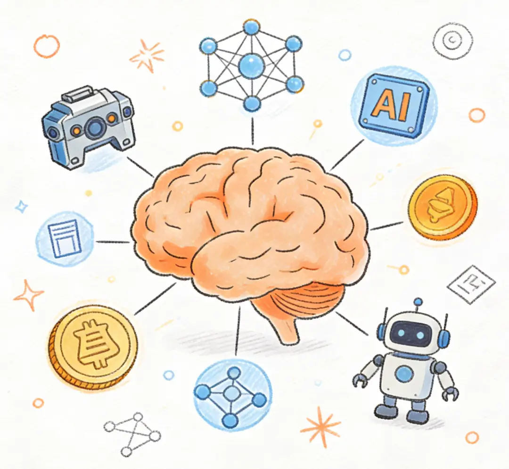
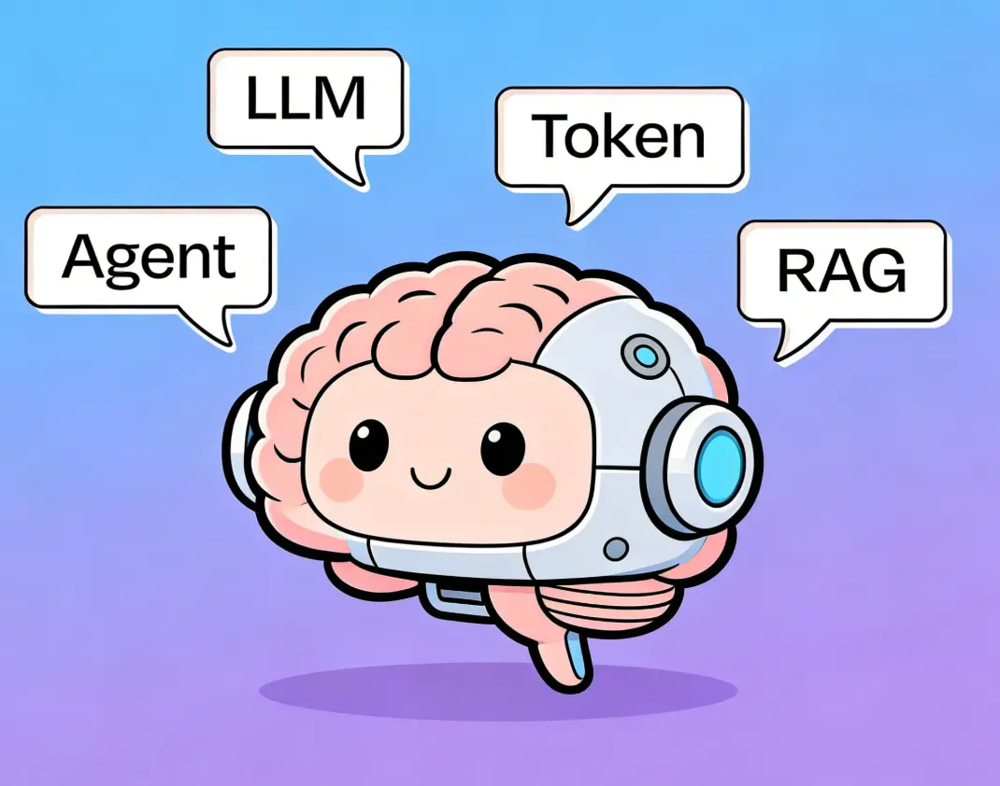

> 原文：/Users/zongxiaocheng/Library/Mobile Documents/iCloud~md~obsidian/Documents/AI 常见名词解释.md
> 重写说明：基于原文重写，去掉了学术和翻译腔。梳理了从基础概念、模型训练到 Agent 工程化的逻辑线，用大白话解释了这些常见的 AI 术语，让内容更易读。

# 用大白话解释常见的 AI 术语

你最近肯定听过很多 AI 词汇。你大概知道它们是什么意思，但可能又没那么确定。

这篇文章用最通俗的话，把这些满天飞的 AI 黑话解释清楚。下次开会再听到这些词，你就不用一头雾水了。

## 基础与核心概念

### 什么是模型（Model）？

AI 模型就像一个模仿人脑工作的计算机程序。你给它一个输入，它处理一下，然后给你一个输出。

模型像小孩子一样，通过看大量例子来“学习”。看得多了，它就能认出模式、理解语言，并给出合理的回答。

模型有很多种。处理文字的叫大语言模型（LLM），比如 ChatGPT。处理视频的叫视频模型，比如 Sora。还有传统的用来推荐内容和识别垃圾邮件的模型。

### 大语言模型（LLM）

全称是大语言模型（Large Language Model）。它专门用来理解和生成人类能看懂的文字。

现在大多数 LLM 已经不只懂文字了。它们变成了“多模态”模型，可以同时看懂图片、听懂声音，甚至直接用语音和你对话。

### Transformer 架构

这是 Google 在 2017 年发明的一种算法，也是现代 AI 爆发的基础。

它引入了“注意力机制”。以前的 AI 只能挨个看句子里的词，而 Transformer 可以同时看完所有词，并理解词和词之间的关系。这就让它能更好地把握上下文和细微差别。

它还能“并行处理”。这意味着只要堆算力和数据，就能训练出更大、更聪明的模型。如今几乎所有主流 AI 模型都是基于它构建的。

### Token（词元）

Token 是 AI 理解文字的最小单位。

对于英文来说，一个 Token 有时是一个词，有时只是词的一部分。比如“ChatGPT”可能会被切成“Chat”和“GPT”两个 Token。把它切碎，是为了让模型处理起来更高效。

> 现在还都在争论 Token 怎么翻译的问题，暂时可以先忽略这个中文翻译

## 模型是怎么变聪明的？

### 训练（Training / Pre-training）

训练就是让模型看海量的数据，比如整个互联网的网页、所有的书。这个过程可能要花几个月，烧掉几亿美金。

训练语言模型最核心的方法叫“预测下一个词”。你给模型看半句话，让它猜最后一个词。猜对了强化记忆，猜错了调整参数。经过千锤百炼，它就学会了事实、语法和逻辑。

### 监督学习 vs 无监督学习

监督学习就是用“打好标签”的数据教模型。比如给几万封邮件打上“垃圾邮件”标签，模型看完就知道垃圾邮件长什么样了。

无监督学习则是给模型一堆没有标签的数据，让它自己去找规律。比如自动把相似的新闻聚拢在一起。

现代语言模型大多用一种变体——“自监督学习”。它自己把句子最后一个词藏起来作为标签，不需要人工去标注海量数据。

### 后训练（Post-training）

基础训练做完后，模型懂很多，但还不一定好用。这就需要后训练（Post-training），让它变成一个听话的助手。这主要包括微调和 RLHF 两种方法。

### 微调（Fine-tuning）

微调就是给模型“开小灶”。

拿公司的客服聊天记录去训练它，它就会带上你们公司的语气。拿医学资料去训练，它就变成了医学小专家。它保留了基础的通用知识，但在特定领域变得更强。

### RLHF（基于人类反馈的强化学习）

光懂知识不够，模型还得懂礼貌、不乱说话。RLHF 就是用来对齐人类意图的。

具体做法是让人类来评判模型给出的答案哪个更好，以此训练出一个打分系统。模型再根据这个系统不断调整自己的行为，努力拿高分。

## 怎么用好模型？

### 提示词工程（Prompt Engineering）

同样一个模型，你怎么问，决定了它怎么答。提示词工程就是研究怎么提问，才能让 AI 给出最优质的回答。说白了，就是教你怎么给 AI 出题。

### RAG（检索增强生成）

RAG 就是给 AI “开卷考试”的权利。

当问它一个不知道的问题时，程序会先去你的数据库里搜索相关信息，然后把这些信息和问题一起喂给 AI。这样 AI 就能根据最新、最准的资料来回答，而不是瞎编。这是防止 AI 产生幻觉最有效的方法。

### 评估（Evals）

你怎么知道 AI 表现好不好？这就需要评估（Evals）。

它就像是 AI 的单元测试。你准备好一堆输入和期望的输出，让模型跑一遍，看看准确率、语气、安全性是否达标。很多产品经理认为，写好 Evals 是做 AI 产品最重要的一环。

### 推理（Inference）

推理就是模型真正工作的那一刻。你发一句问候，模型计算后给你回了一句，这个生成回答的计算过程就叫推理。

### 合成数据（Synthetic Data）

好数据快用光了怎么办？用 AI 自己生成数据。

合成数据就是让模型模仿真实世界造出来的数据。比如让它生成几万条假的客服聊天记录。只要结构和规律对，这些假数据一样能用来训练更强大的新模型。

### 幻觉（Hallucination）

AI 很多时候并不“知道”事实，它只是在推测下一个最可能出现的词。当它没这方面的知识，又得强行回答时，就会一本正经地胡说八道，这就叫幻觉。用 RAG 或者把提示词写好，能大大减少幻觉。

## Agent 与工程化

### 智能体（Agent）不是魔法，是一个循环

很多人觉得 Agent（智能体）像是一个有自我意识的数字生命。其实剥掉外衣，它在代码里就是一个朴素的循环。

聊天机器人是你问一句，它答一句，然后停在那里。而 Agent 是在模型外面包了一层程序，让它可以不断经历“思考 -> 行动 -> 观察 -> 再思考”的循环。

比如你让它写个功能：它先看一眼目录（行动并观察），决定要修改哪个文件（思考），调用写文件的工具（行动），然后运行测试看有没有报错（观察），如果有错就继续改（再思考）。只要任务没完成，这个循环就不会停。

要让这个循环稳稳地跑起来，靠的是一套精密的工程设计。这就引出了下面几个重要的概念。

### 提示词、上下文与驾驭工程

现在搞 AI 开发，已经不只是“写提示词”这么简单了。随着 Agent 越来越复杂，工程手段也分成了三层：

**1. 提示词工程（Prompt Engineering）——“怎么问”**
这是最基础的，决定了你对 AI 下的指令清不清楚。就像你教实习生怎么回答特定的问题，或者用什么格式输出。

**2. 上下文工程（Context Engineering）——“给它看什么”**
AI 的表现很大程度上取决于那一刻它拿到了什么信息。如果提示词是“怎么问”，上下文工程就像是“考试时允许它带哪些资料进考场，按什么顺序放在桌上”。

给少了它干瞪眼，给多了它抓错重点。把最相关的代码、文档、错误日志在对的时机推给它，这就是上下文工程。

**3. 驾驭工程（Harness Engineering）——“怎么管住它”**
给 AI 套上缰绳。AI 就像一匹跑得很快的马，工程团队真正要设计的，是缰绳、轨道、护栏和检查站。

驾驭工程关注的是：怎样把 Agent 放进一个可控的系统里。比如设定代码架构的底线，加上自动化的语法检查，限制高风险的操作权限。AI 一旦犯错，马上被护栏拦下，而不是把系统搞崩。

### 拆解 Agent 的能力背包：Rules、Skills、Tools 与 Subagents

为了不让 Agent 的大脑被各种信息塞爆，我们会把它的能力拆解成几个部分，按需调用：

- **规则（Rules）**：给 Agent 设定的常驻规范。比如“所有测试必须独立”、“代码风格要一致”。这就像是写给 AI 看的员工手册，给它一个基本的行为边界。
- **技能（Skills）**：特定任务的专属说明书。不需要每次都带着，只有遇到相关任务才临时加载。比如“如何写 E2E 测试”就是一个技能。遇到了才翻开看，看完就合上。
- **工具（Tools）**：AI 真正动手做事的手脚。光靠大脑想是不够的，必须给它提供外部接口。比如读取文件、执行 Shell 命令、搜索代码库。
- **子代理（Subagents）**：干活的小分队。当任务太复杂时，主 Agent 会派子代理去处理。一个负责写代码，一个负责审查，一个专门跑测试。它们各带各的上下文，互不干扰，主会话也就不会被多余的信息弄乱。

### MCP（模型上下文协议）

以前让 AI 调用外部工具（比如日历、代码库、Slack），得一个个写代码对接。MCP 是一个开源标准。有了它，AI 就能统一、安全地连接各种外部工具并执行操作。

## 热门行业标签

### Gen AI（生成式 AI）

生成式 AI 是指能生成新内容（文字、图片、声音、代码等）的 AI 系统。这与以前那些只用来做分类或数据分析的 AI 完全不同。

### GPT（生成式预训练 Transformer）

这是 ChatGPT 名字的由来，它包含了三个核心点：
- Generative（生成式）：能生成新内容。
- Pre-trained（预训练）：看了海量数据，学会了通用语言规律。
- Transformer：理解上下文的底层架构。

### Vibe coding（氛围编程）

指不用自己手写代码。你用大白话向 Cursor、Windsurf 等 AI 编程工具描述需求，让 AI 帮你把应用写出来。你甚至连一行代码都不用看。

### AGI（通用人工智能）

指 AI 在绝大多数领域都比普通人聪明。它不仅能写代码、做数学题，还能自己学习解决完全陌生的新问题。这是目前所有 AI 公司都在追求的终极目标。

AI 常见名词解释
