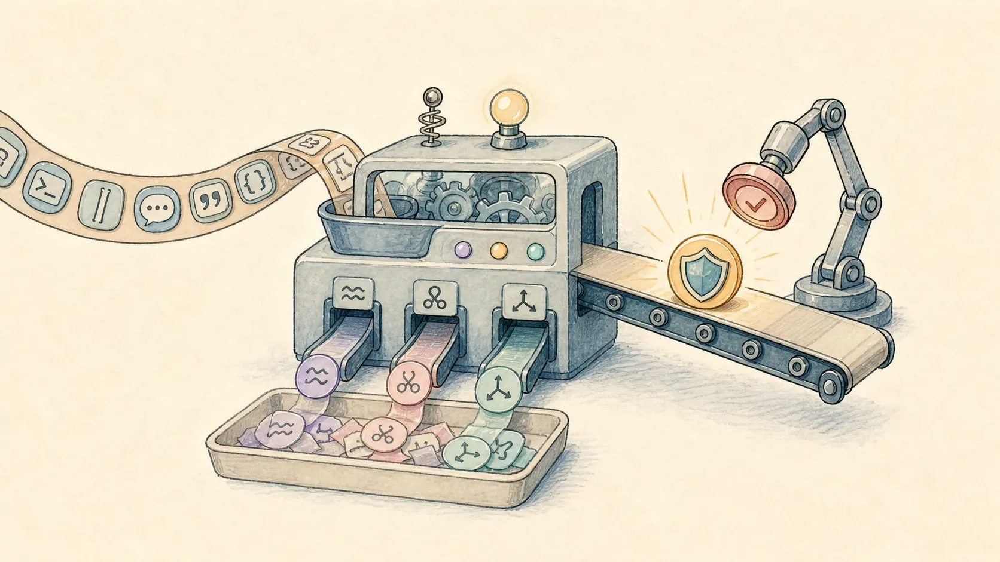

上一篇我写过，为什么我最后选了 Anthropic 的 `sandbox-runtime`。

当时想得很简单。

我不想为了一个个人 AI 助手，一上来就搞 Docker、远程 VM、完整容器平台。

那套当然更强，但成本也更高。

我真正想要的是一个轻量边界：Agent 还能在本机干活，但不能随便摸到宿主机所有东西。

所以我选了 Anthropic 的 runtime。

但真正接进去以后，我很快发现一件事：

> 沙箱不是一个开关。它更像 Agent runtime 里的一条执行边界。


尤其是 Molibot 这种形态。

它不只是一个网页里的聊天框。

它同时服务 Web、Telegram、飞书、微信、QQ。

里面还有 subagent、工具调用、审批恢复、长任务、会话持久化。

这时候真正难的，已经不是“怎么把命令放进沙箱跑”。

真正难的是：

> 当沙箱挡住 Agent 时，runtime 接下来应该怎么办？

这篇就记录一下，我把 `sandbox-runtime` 接进 Molibot 时踩过的几个坑。

## 我一开始只想给 bash 套一层沙箱

Molibot 是我自己做的本地优先 AI 助手。

它的核心不是某个聊天入口，而是一套共享 runtime：

- Web Chat 可以对话、传文件、看运行状态；
- Telegram、飞书、微信、QQ 都接到同一套 Agent；
- Agent 可以调用 bash、MCP、图片生成、搜索、subagent；
- 会话、设置、审批记录、任务记录都落在本地 JSON/SQLite。

所以我最开始的目标很克制：

1. 先只管 Agent 和内置 subagent 的 `bash`；
2. Browser、MCP、渠道收发先不进沙箱；
3. 普通 shell 默认在 sandbox 里跑；
4. 文件系统、网络、环境变量从设置页控制；
5. 真要用宿主机能力，再走人工审批。

听起来是一个挺正常的工程任务。

但做完第一版以后，我发现它牵一发动全身。

因为 Agent 的 shell 不是普通 shell。

普通 shell 执行失败就结束了。

Agent 的 shell 执行失败后，模型还会继续推理、重试、换路径、换命令。

它有一种“我再试试”的冲动。

如果 runtime 没把边界说清楚，沙箱反而会诱导 Agent 做一些更糟糕的事。

比如重复试错、尝试绕限制、把等待审批理解成停止。

更麻烦的是，它还可能把内部控制提示写进长期上下文。

所以这件事最后不是“包一层命令执行”。

它变成了 Agent runtime 的状态设计问题。

## 第一层：先把 sandbox 变成一个 Provider


我没有把 Anthropic SDK 直接散到业务代码里。

落地时，我先抽了一层 `SandboxProvider`：

```ts
interface SandboxProvider {
  name: string;
  checkDependencies(): boolean;
  initialize(config, callback?): Promise<void>;
  reset(): Promise<void>;
  wrapWithSandbox(command, options?): Promise<string>;
  isInitialized(): boolean;
  getLastError(): string | undefined;
}
```

默认实现叫 `AnthropicSandboxProvider`。

真正调用 `@anthropic-ai/sandbox-runtime` 的地方，只在这里。

这样做有两个好处。

第一，上层只知道“我要准备一次 sandbox 执行”。

它不用关心底层是 Anthropic runtime、Docker、Bubblewrap，还是以后别的东西。

第二，沙箱不是一个孤立模块。

它会影响 bash、subagent、审批、设置页、诊断页、系统提示词。

如果 SDK 细节散得到处都是，以后替换会非常痛。

现在这条边界比较清楚：

- `sandbox-runtime` 负责 OS 级约束；
- Molibot runtime 负责权限策略、审批、恢复、上下文管理；
- channel 只负责展示按钮或文字提示。

这点后来证明很重要。

因为真正复杂的地方，不在 provider 里面。

复杂的是“沙箱拒绝以后怎么办”。

## 沙箱挡住以后，不能只返回失败


最早的问题出在 Host Bash。

有些命令天然需要宿主机能力。

比如控制本机浏览器、访问本地 IPC、调用外部 CLI。

或者做一些不适合放进沙箱的系统操作。

沙箱挡住它们是对的。

但如果只是把错误丢给模型，模型经常会继续试。

```text
Operation not permitted
Permission denied
socket / IPC failed
```

模型看到这些错误，可能会换个命令再跑一次。

但这不是命令写错了。

这是权限边界挡住了。

所以我把 bash 的失败路径改成了一个明确分支：

1. 命令先在 sandbox 里跑；
2. 如果失败，并且像权限、IPC、socket、sandbox 限制；
3. runtime 尝试归类成可审批的 Host Bash capability；
4. 能归类，就创建审批请求；
5. 当前 turn 返回 `waiting_for_approval`；
6. 用户批准后，runtime 自动执行原命令；
7. stdout/stderr 回填到原工具上下文；
8. Agent 从这个工具结果继续推理。

这一步让体验从“Agent 卡住了”，变成了“Agent 等我点一次，然后自己继续”。

这里的关键不是审批按钮。

关键是恢复。

如果用户批准后，命令结果只是作为一条普通聊天消息发出去，Agent 其实不知道命令已经成功了。

在模型上下文里，它看到的仍然是“工具失败，等待审批”。

所以我做了自动恢复。

审批完成后，把原来那条工具调用的 result 改写成真实 stdout/stderr。

然后再触发 runner 继续执行。

这样最终回答仍然是 Agent 总结出来的，而不是系统在旁边插一句“命令执行成功”。

这个细节很小。

但产品质感差很多。

## 等待审批不是 stopped


第二个坑更隐蔽。

最开始 Host Bash 审批会让 runner 中断。

表面上看没问题。反正要等用户点按钮，先停下来也合理。

但后来我发现，这会污染整个运行语义。

用户看到的是“等待审批”。

系统内部却把它当成了 `aborted` 或 `Stopped.`。

后果很快就出来了：

- Telegram 可能在审批卡片后面多发一条 `Stopped.`；
- Web Chat 可能把临时等待提示写进普通 assistant 历史；
- subagent 等审批时，父 Agent 以为子任务失败；
- chain 模式还可能继续执行下一步，把 `{previous}` 建在一个没完成的结果上。

这就很危险。

因为“等我批准”和“我取消了任务”，完全不是一回事。

后来我把 `waiting_for_approval` 变成独立 stop reason。

它要贯穿 runner、subagent、channel、run summary、stream API。

现在规则很简单：

- 真正取消才是 `aborted`；
- 审批挂起就是 `waiting_for_approval`；
- 临时等待提示不进模型上下文；
- subagent 等审批时，父 runner 也保留这个状态；
- chain/parallel 不会在等待审批时继续往下跑。

这件事让我更确定一点：

> 做 Agent runtime 时，状态命名不是小事。

一个状态如果偷懒复用，后面的恢复、归档、上下文都会跟着变形。

## 审批不能太吵



沙箱接上以后，还有一个很现实的问题：审批太频繁。

比如用户已经批准过 `longbridge` 这个外部 CLI。

但 Agent 实际跑的是：

```bash
longbridge news FIG.US 2>&1 | head -30
```

如果系统把管道、`head`、`2>&1` 都看成新的复杂 shell，那每次都会要求 one-time approval。

安全上是保守了。

但用起来很烦。

所以我补了 Host Bash command classifier。

它不是想把所有复杂 shell 都判成安全。

它只做一件事：把“真实 host capability”和“无害 shell 装饰”分开。

比如：

- `longbridge news FIG.US` 是真正的能力；
- `2>&1` 只是合并输出流；
- `| head -30` 只是截断输出；
- 静态 `cd <path>`、简单 `echo DONE` 可以当受限 helper；
- 重定向写文件、命令替换、heredoc、动态 shell 仍然降级为 one-time approval；
- `python -c`、`node -e` 这类动态执行也一样。

这套规则的产品目标很明确：

> 批准能力，而不是批准每一种命令排版。

否则用户批准一次工具以后，还要被输出裁剪、管道过滤这种小事反复打断。

这不是安全。

这是噪音。

## `/sandbox off` 不能只是“不进沙箱”

一开始我把 `/sandbox off` 理解成“不开沙箱”。

听起来没毛病。

但到了 Host Bash 体系里，它还有另一层含义。

既然当前作用域已经明确关闭沙箱，普通 `bash` 就应该直接跑在宿主机。

它不应该再弹 Host Bash 审批。

否则用户会很困惑：

> 我都关沙箱了，为什么还要批准 Host Bash？

所以后来我把语义改清楚：

- sandbox on：普通 bash 进沙箱，host-only 能力需要审批；
- sandbox off：当前作用域进入 Host Bash full access；
- session override 优先级最高，然后才是 bot、agent、global default。

优先级现在是这样：

```text
Session Override
> Bot Instance Override
> Agent Override
> Global Default
```

也就是说，我可以在某个会话里临时 `/sandbox off`，处理安装依赖、浏览器控制、本地调试。

开新会话或切换 bot 后，它会回到默认策略。

这比全局开关更符合真实使用。

## 环境隔离不能只隔离文件系统

接沙箱时还有一个细节：工具环境。

Agent 经常会跑 Python、Go、npm、测试命令。

如果每个 skill、每个会话都自己建 `.venv`，很快就会留下一堆机器相关路径。

也容易污染项目目录。

后来我把内置工具环境收敛到统一目录：

```text
MOLIBOT_TOOLING_DIR
```

默认放在 Molibot 自己的数据目录里。

Python venv、pip cache、uv cache、Go 的 `GOPATH`、`GOCACHE` 都归进去。

沙箱写入 allowlist 也同步包含这个 tooling 根目录。

这样 Agent 还能安装和复用工具依赖。

但它不会把缓存、虚拟环境、临时构建文件撒到项目源码里。

这也是我后来对“沙箱”的理解变化：

> 沙箱不只是限制危险行为，也要给正常工作留一条稳定路径。

只拦不放，Agent 干不了活。

完全放开，又失去边界。

真正好用的是中间那条路线。

## 提示词里不要塞太多沙箱实现细节

我一开始很想把 sandbox 的各种规则都写进系统提示词。

比如底层用了什么 OS 机制、文件系统怎么 deny/allow、网络怎么过滤。

还有哪个目录是 venv、哪些命令会触发审批。

后来发现，这会让 prompt 又长又脆。

模型真正需要知道的是决策边界：

- 普通 shell 工作走 `bash`；
- 不要尝试绕过 sandbox；
- 已知需要 host-only 能力时，用 `bash.hostApproval.reason` 请求受控 host access；
- sandbox 权限失败后，不要重复用 plain bash 试同一件事。

至于底层是 `sandbox-exec`、`bubblewrap`，还是 Anthropic SDK 怎么包命令，不该塞进主提示词。

这些是 runtime 诊断和工程实现。

不是模型每一轮都要背的操作手册。

所以后面我做了一轮 System Prompt Boundary Refactor。

把 sandbox 实现描述收回到代码和诊断里，只在 prompt 里保留最小决策规则。

提示词变短以后，模型也更少“学着绕实现细节”。

## 现在这套链路长什么样

现在 Molibot 的沙箱执行链路，大概是这样：

```text
用户请求
  ↓
Agent / Subagent
  ↓
bash 工具
  ↓
解析当前 sandbox 策略
  ↓
SandboxProvider 包装命令
  ↓
Anthropic sandbox-runtime 执行
  ↓
如果权限失败：
    → Host Bash 分类
    → 创建审批
    → 返回 waiting_for_approval
    → 用户批准
    → 自动执行 pending action
    → stdout/stderr 回填工具上下文
    → Runner 自动恢复
```

用户能感受到的变化是：

1. Agent 默认不会随便拿宿主机 full access；
2. 常规 shell 工作仍然能跑；
3. 需要宿主机能力时，聊天里会出现明确审批；
4. 可以选择长期批准、仅本 session 批准、拒绝；
5. 批准后 Agent 会自动继续，不用再说“继续”；
6. subagent 等审批时不会被误判为停止；
7. `/sandbox off` 可以临时进入 Host Bash full access；
8. 设置页能看 sandbox、Host Bash、审批历史和诊断；
9. 提示词里不再堆满底层 sandbox 实现细节。

所以这已经不是“接入一个 SDK”了。

更准确地说，是把沙箱接成了 Agent runtime 的底层执行边界。

## 我现在对 Agent 沙箱的几个判断

第一，沙箱不能替代权限系统。

Anthropic 的 `sandbox-runtime` 很适合作为底层强制层。

但它不负责业务审批、subagent 权限继承、channel 展示、run 恢复、审计记录。

这些都要 runtime 自己做。

第二，审批的核心不是按钮，而是恢复。

如果批准后，Agent 不能带着真实工具结果继续推理，审批就只是外挂流程。

体验会断。

第三，不要让 channel 承担权限逻辑。

Telegram、飞书、微信、QQ 只应该负责展示按钮或文字指令。

队列、审批、恢复、session 状态，都应该在共享 runtime 层。

否则每加一个渠道，就要重写一套安全逻辑。

第四，状态语义一定要干净。

`waiting_for_approval`、`aborted`、`failed`、`completed` 必须分开。

Agent runtime 最怕“差不多”的状态。

因为恢复、归档、提示词上下文都会依赖它。

第五，沙箱策略要允许临时例外。

完全不让出沙箱，Agent 做不了真实工作。

完全 full access，又失去边界。

比较好的体验是默认收紧，但允许 session 级别临时授权，并且自动过期。

## 下一步我想补 Policy Profile 和 Run Ledger


现在这套已经能用了。

但还不是终点。

下一步我更想补的是 Policy Profile 和 Run Ledger。

也就是把底层一堆 allow/deny 配置，包装成用户更容易理解的模式：

- Observe：只读观察；
- Build：允许工作区写入和测试；
- Strict：默认拒绝网络和敏感路径；
- Host-Assisted：保留沙箱，但允许明确的 Host Bash 审批路径。

同时，每次 Agent run 都应该形成一份可读账本。

里面记录用了哪个 profile、哪些工具、哪些 subagent。

还要记录触发了什么审批、产出了哪些文件，最后为什么完成或挂起。

因为真正可用的 Agent，不只是能执行任务。

它还要让用户知道：它刚刚到底做了什么，为什么这么做。

哪里越过了边界，哪里被批准过。

## 总结

这次接入 `sandbox-runtime` 后，我最大的体感是：

- 沙箱是底层强制层，不是完整权限系统；
- Agent 被沙箱挡住后，要进入审批和恢复，而不是继续乱试；
- `waiting_for_approval` 必须是独立状态，不能偷懒复用 stopped；
- 审批要按能力授权，不要被 shell 排版噪音拖垮；
- 提示词只保留决策规则，底层实现细节放回 runtime。

说得再直白一点：

> 不是给 AI 套一个笼子，而是给它一条能认真工作的安全路线。

如果你也在做本地 Agent，我现在更建议从第二种策略开始：

> 默认允许工作区写入和本地测试，但禁止网络、敏感路径和宿主机高危能力。

原因很简单。

Agent 如果连项目文件都不能改、测试命令都不能跑，就很难完成真实任务。

但如果一上来就给 full access，它又很容易把 runtime 的安全边界打穿。

所以比较稳的默认值不是“什么都不让做”，也不是“什么都放开”，而是先给它一个能认真工作的工作区，再把网络、系统目录、凭证文件、宿主机 shell 这些能力放到审批路径里。

这个选择会直接决定后面 runtime 怎么长：

- 你要不要设计 Policy Profile；
- 你要不要记录 Run Ledger；
- 你要不要区分 workspace command 和 host command；
- 你要不要让 subagent 继承权限；
- 你要不要在用户批准后自动恢复 run。

最后留个问题：

如果你现在要给一个本地 Agent 设计默认权限，你会怎么选？

- 默认只读，所有写操作都要审批；
- 默认允许工作区写入和测试，但禁止网络和敏感路径；
- 默认 full access，只在高危命令前确认；
- 按任务类型切换不同的 Policy Profile。

我现在更倾向第二种。

让 Agent 能做事，但每一次越界都要被看见、被批准、被记录。

你会怎么选？欢迎在评论区聊聊。
