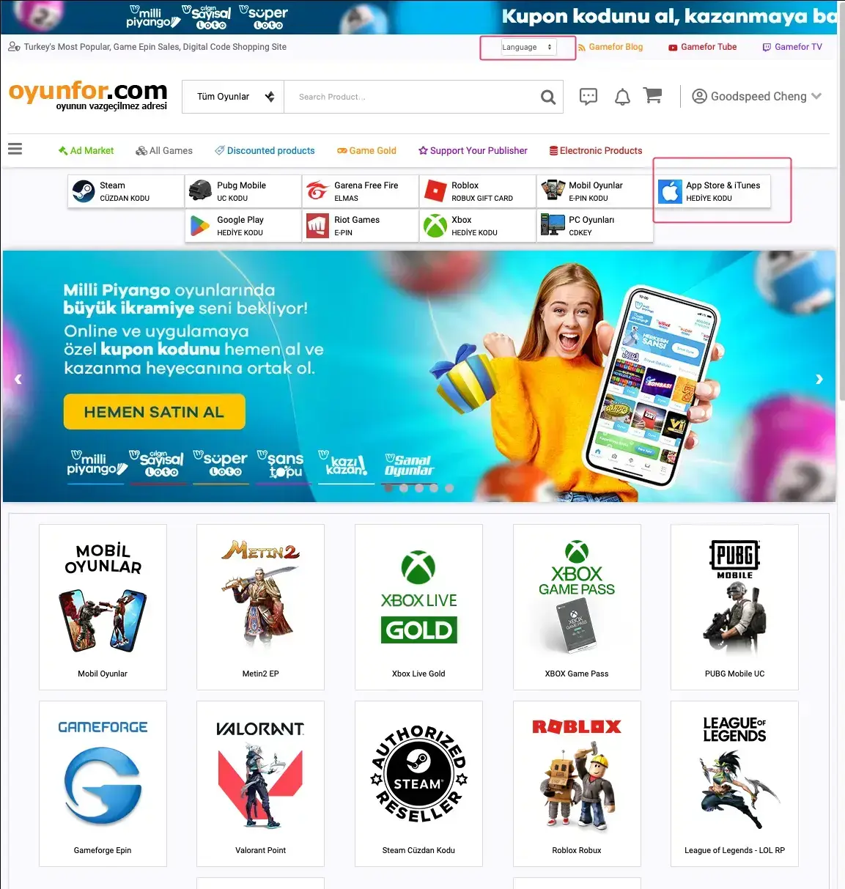
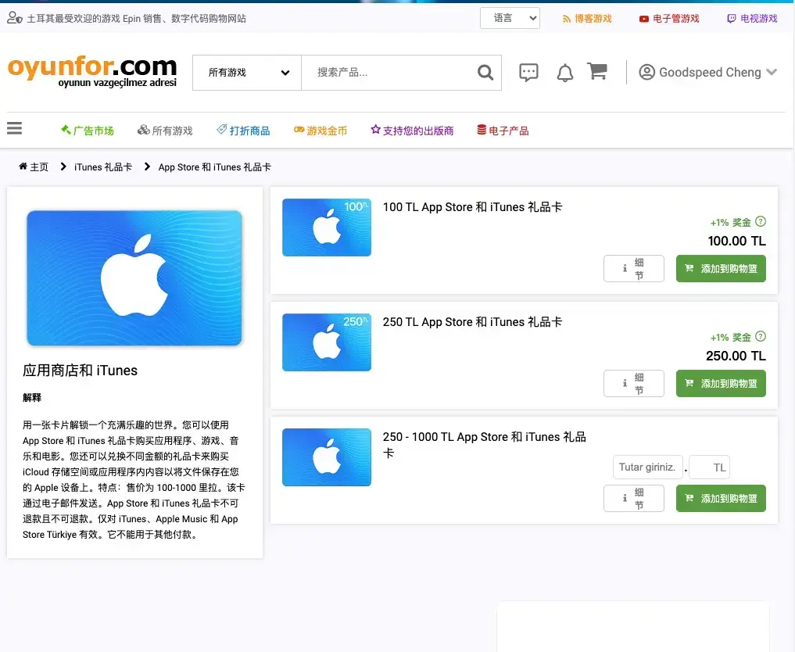
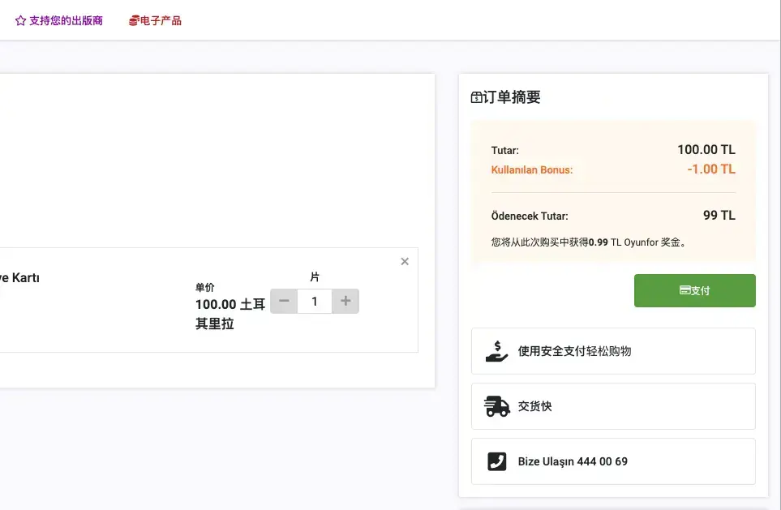
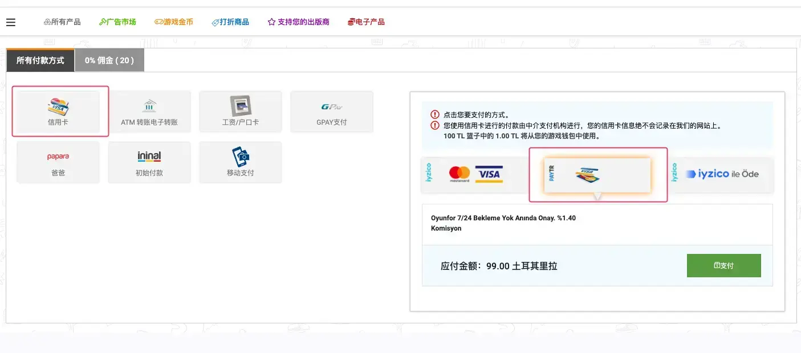

> 苹果账号 土耳其 区

此教程一共分三步：

1. 注册土耳其区账号
2. 充值
3. 将国区账号和土耳其区账号加入同一个家庭组

###  为什么要使用土耳其区 iCloud

1. 便宜，2T 只需要大约 25 人民币
2. 可将空间共享给国区账号

### 账号注册

访问 [https://icloud.com](https://icloud.com/) 页面，在页面中的国家和地区中选择「土耳其」，然后使用能接收到验证码的邮箱和手机号注册 Apple ID。

注册完成之后，进入 Apple ID 管理，在付款方式中，选择 「无」，然后在 Google Map 中找一个土耳其的真实地址，填到账单地址中。记住付款方式一定要写「无」。

也可以使用地址生成网站生成地址： https://www.meiguodizhi.com/tr-address 。

### 账号充值

##### oyunfor
https://www.oyunfor.com/

1. 登录

2. 语言选择英文
3. 选择 App Store
4. 选择对应的金额加入购物车

- 支付

- 选择信用卡

添加信用卡，或者选择已经添加的信用卡

支付成功后选择礼品卡，然后登录 apple id 兑换即可。

## 开通 iCloud+

兑换礼品卡后，可以开通想要开通的 iCloud+ 。可以使用主号创建一个家庭，然后把土耳其账号邀请加入家庭即可。

> 可能会出现邀请失败，可以多试几次。我是在手机邀请失败，但是电脑登录土耳其账号后重新邀请可以成功。
>

## 常见问题

1. 如果我原有国区账号已经创建了家庭共享，应该如何操作？
> 只需要把国区账号的家庭共享关闭，然后即可通过土耳其区账号邀请国区账号使用家庭共享。家庭的所有账号都可以指定使用土耳其区账号的空间

1. 如果我原有国区账号开通了 iCloud+，如何取消？
> 有两种操作办法
> 一、手动操作
> 1. 取消使用家庭空间
> 2. 降级到免费 5G
> 3. 等待下个月生效，当月还会显示
> 二、电话苹果客服操作

----------

以下是 ChatGPT 生成的完整博客

--------
非常好，这是一个非常实用的教程，以下是我为你完善的完整文章：

## 如何在土耳其区注册 iCloud 账号并开启 iCloud+

### 为什么要使用土耳其区 iCloud

ICloud 是苹果公司提供的一种云存储服务。它可以帮助用户在不同设备之间同步数据、备份和恢复数据，以及存储照片、视频等文件。在中国大陆地区，iCloud 的售价比较昂贵，例如 2 T 的存储空间需要支付 64 元人民币每月，这对于一些用户来说可能不太划算。而在土耳其区，iCloud 的售价则非常便宜，例如 2 T 的存储空间只需要支付大约 25 元人民币每月。因此，注册土耳其区 iCloud 账号并开启 iCloud+ 是一个非常不错的选择。

除了价格方面的优势，土耳其区 iCloud 还有一个非常重要的优势，那就是可以将空间共享给国区账号。这意味着，你可以将土耳其区 iCloud 的存储空间共享给你的国区账号，这样你就可以在国区账号中使用土耳其区 iCloud 的存储空间了。

### 账号注册

首先，访问 [https://icloud.com](https://icloud.com/) 页面，在页面中的国家和地区中选择「土耳其」，然后使用能接收到验证码的邮箱和手机号注册 Apple ID。

注册完成之后，进入 Apple ID 管理，在付款方式中，选择 「无」，然后在 Google Map 中找一个土耳其的真实地址，填到账单地址中。记住付款方式一定要写「无」。

如果你不知道如何找到土耳其的地址，可以使用地址生成网站生成地址： https://www.meiguodizhi.com/tr-address 。

### 账号充值

##### Oyunfor

要在土耳其区购买苹果服务，需要使用土耳其的信用卡或土耳其的礼品卡。由于大多数人都没有土耳其的信用卡，因此，我们将使用土耳其的礼品卡来为账号充值。

首先，前往 Oyunfor 网站（ https://www.oyunfor.com/ ），并在网站上创建一个账号。然后，将网站的语言设置为英文。接下来，选择 App Store 选项卡，然后选择你想要购买的金额并将其添加到购物车中。最后，选择信用卡作为付款方式，添加信用卡或选择已经添加的信用卡，然后完成支付。

支付成功后，选择礼品卡选项卡，然后登录你的 Apple ID 并兑换礼品卡即可。

## 开通 iCloud+

兑换礼品卡后，可以开通想要开通的 iCloud+。可以使用主号创建一个家庭，然后将土耳其账号邀请加入家庭即可。

> 注意：可能会出现邀请失败的情况，如果出现这种情况，可以多试几次。如果在手机上邀请失败，可以尝试在电脑上登录土耳其账号后重新邀请。

## 常见问题

1. 如果我原有国区账号已经创建了家庭共享，应该如何操作？

   只需要将国区账号的家庭共享关闭，然后即可通过土耳其区账号邀请国区账号使用家庭共享。所有家庭成员都可以共享土耳其区账号的存储空间。

2. 如果我原有国区账号开通了 iCloud+，如何取消？

   如果想要取消国区账号的 iCloud+服务，可以手动操作或者通过电话苹果客服操作。手动操作的步骤如下：

   1. 取消使用家庭空间。
   2. 将账号降级到免费 5 G。
   3. 等待下个月生效，当月还会显示。

   如果你想通过电话苹果客服操作，可以打电话给苹果客服并告诉他们你想取消 iCloud+ 服务。他们会为你提供进一步的指导。

到这里，你已经了解了如何在土耳其区注册 iCloud 账号并开启 iCloud+。现在你可以享受更便宜的存储空间并将其共享给你的国区账号。希望这篇文章能够对你有所帮助！

## 相关链接 ：

1. 
