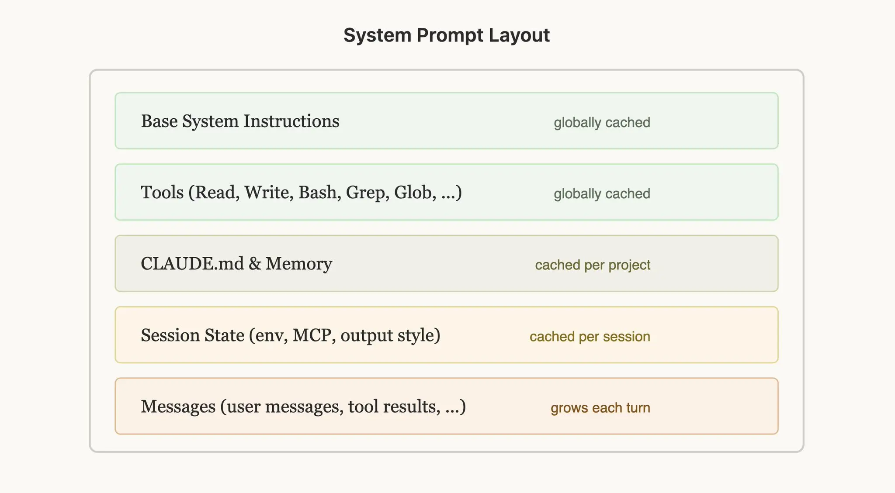
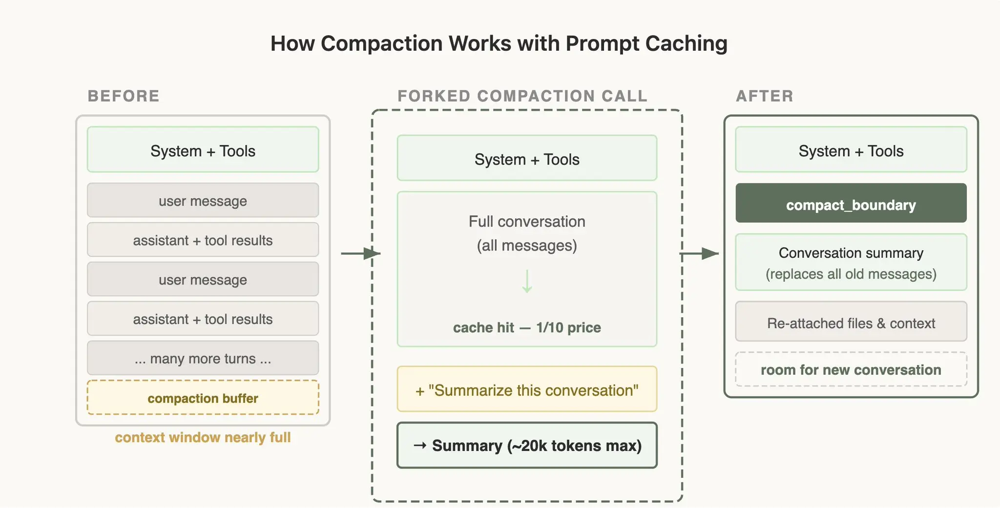

.webp)

工程界有句老话：“缓存统治一切（Cache Rules Everything Around Me）”。在开发 AI 智能体（Agent）时，这句话同样适用。

像 Claude Code 这样需要长时间运行的智能体产品，之所以具有可行性，很大程度上归功于 **Prompt 缓存（Prompt Caching）**。它允许我们复用之前的计算结果，从而大幅降低延迟和成本。

关于 Prompt 缓存的原理和技术实现，这里不展开。在 Claude Code 团队，我们整个底层架构都是围绕 Prompt 缓存设计的。如果缓存命中率高，成本就能降下来，我们也能为订阅用户提供更宽松的使用限制。为此，我们甚至对缓存命中率设置了告警，一旦低于某个阈值，就会触发紧急故障（SEV）处理。

在优化大规模 Prompt 缓存的过程中，我们学到了很多经验。有些经验甚至有点反直觉，下面就和大家分享。

## 一、合理安排提示词的结构

Prompt 缓存的工作原理是“前缀匹配”（prefix matching）。API 会从请求的开头开始，一直缓存到你设置的断点。这意味着，内容的排列顺序至关重要。你希望尽可能多的请求，能够共享相同的前缀。

最好的做法是：**把静态内容放在前面，动态内容放在后面。** 在 Claude Code 里，我们的排列顺序是这样的：

1. **静态系统提示词与工具定义**（全局缓存）
2. **Claude.md 文件**（在项目级别缓存）
3. **会话上下文**（在单个会话内缓存）
4. **当前对话的具体消息**

通过这种方式，我们能让更多的会话共享缓存命中。

但要注意，这种顺序出乎意料地脆弱！我们曾经踩过坑，破坏了这种顺序。比如：把详细的时间戳放进了静态系统提示词里、工具的排列顺序变成随机的、或者动态修改了工具的参数。这些都会导致前缀改变，缓存失效。

## 二、用消息来传递状态更新

有时候，你放在提示词里的信息会过期。比如，时间变了，或者用户修改了某个文件。你可能会想，那我去更新一下系统提示词吧。千万别这么做。这会导致缓存未命中，让用户付出高昂的成本。

更好的做法是：**在下一轮对话中，通过“消息”来传递这些更新。**

在 Claude Code 中，如果信息有更新（比如“现在是星期三了”），我们会在下一条用户消息或工具结果中插入一个 `<system-reminder>` 标签。这样既告诉了模型新情况，又保住了前面的缓存。

## 三、不要在对话中途切换模型

Prompt 缓存是和特定模型绑定的。这就导致了一个很反直觉的成本计算。

假设你正在用最强大的 Opus 模型聊天，已经积累了 10 万 token 的上下文。这时，你想问一个非常简单的问题。你可能觉得切换到便宜的 Haiku 模型会更省钱。错了。切换到 Haiku 反而更贵，因为你需要为 Haiku 重新建立那 10 万 token 的缓存。

如果你确实需要切换模型，最好的办法是使用子代理（subagents）。让当前对话的 Opus 模型准备一条“交接”消息，派发给另一个模型去处理特定的任务。在 Claude Code 的“探索”功能里，我们就经常用这种方式调用 Haiku。

## 四、永远不要在中途添加或删除工具

在对话进行到一半时，改变工具集，是大家最常犯的破坏缓存的错误。

直觉上，你可能觉得：我应该只给模型提供它现在需要的工具。但是，因为工具定义是缓存前缀的一部分，所以无论你增加还是删除工具，都会导致整个对话的缓存失效。

**计划模式（Plan Mode）的设计逻辑**

“计划模式”是围绕缓存约束来设计功能的一个绝佳例子。直觉的做法是：当用户开启计划模式时，把工具集替换掉，只保留“只读”的工具。但这会破坏缓存。

我们怎么做呢？我们始终在请求中保留所有的工具，同时把 `EnterPlanMode`（进入计划模式）和 `ExitPlanMode`（退出计划模式）本身也做成工具。

当用户打开计划模式时，系统会给 Agent 发送一条消息，告诉它：“现在进入计划模式，你的任务是探索代码库，不要修改文件，计划完成后调用 `ExitPlanMode`。” 在这个过程中，工具定义根本没有变。

这还有一个额外的好处：既然 `EnterPlanMode` 也是一个工具，模型在遇到难题时，甚至可以自己决定调用它，自动进入计划模式，而且全程不会破坏缓存。

**工具搜索的延迟加载**

同样的原则也适用于我们的工具搜索功能。Claude Code 可能会加载几十个外部工具（MCP 工具）。如果每次请求都把它们全带上，成本太高；如果中途删除它们，又会破坏缓存。

我们的解决方案是：延迟加载（defer_loading）。我们不删工具，而是发送轻量级的占位符（只包含工具名和 `defer_loading: true` 标记）。模型需要时，可以通过 `ToolSearch` 工具来“发现”它们。只有当模型选中某个工具时，才会加载完整的工具结构。

这样一来，每次发送的占位符都是一样的，顺序也没变，缓存前缀就稳稳地保住了。

## 五、处理上下文压缩（Compaction）

当上下文窗口快满时，我们需要进行“压缩”（Compaction）。也就是把之前的对话总结一下，带着这个总结开启新的对话。

没想到，压缩过程也隐藏着很多破坏缓存的陷阱。

在压缩时，我们需要把整个对话发给模型，让它生成总结。如果你简单粗暴地发起一个全新的 API 请求，换个系统提示词，不带工具，那么这个请求的前缀和原对话完全不匹配。你将不得不为所有那些输入 token 支付全价，用户的成本会瞬间飙升。

**缓存安全的处理方案**

正确的做法是：在进行压缩时，使用和父对话**完全相同**的系统提示词、用户上下文、系统上下文和工具定义。你先把父对话的历史消息放在前面，然后把“请生成总结”这条指令，作为一条新的用户消息追加在最后。

在 API 看来，这个请求和父对话的上一个请求几乎一模一样——相同的前缀，相同的工具，相同的历史。于是，缓存前缀被成功复用。你需要支付的新 token，仅仅是最后那句“请总结”的指令而已。

这意味着，你需要预留一个“压缩缓冲区”，确保上下文窗口里有足够的空间，放得下最后这条压缩指令和它生成的总结。

为了让大家少走弯路，我们已经把 Claude Code 的这套经验，直接内置到了 API 的[原生压缩功能](https://platform.claude.com/docs/en/build-with-claude/compaction#prompt-caching)中。

## 总结

1. **Prompt 缓存看的是前缀匹配。** 前面任何一点改变，都会让后面的缓存失效。你的系统设计必须围绕这个约束展开。只要顺序排对了，很多时候缓存会自动生效。
2. **用消息传递更新，不要改系统提示词。** 不要试图通过修改系统提示词来更新日期或切换状态，把这些信息作为对话消息发给模型。
3. **对话中途不要更改工具或模型。** 用工具来管理状态过渡（比如进入计划模式），而不是改变工具列表。用延迟加载代替移除工具。
4. **像监控服务器宕机一样监控缓存。** 我们会为缓存断裂报警，并把它们当成事故来处理。哪怕缓存命中率只掉了几个百分点，成本和延迟也会大受影响。
5. **分支操作必须共享父级的前缀。** 如果你需要运行旁路计算（比如压缩、总结、执行技能），请使用相同的、缓存安全的参数，这样你就能白嫖父级对话的缓存。

Claude Code 从第一天起就是围绕 Prompt 缓存构建的。如果你也在开发 Agent，建议你也这么做。

（完）
