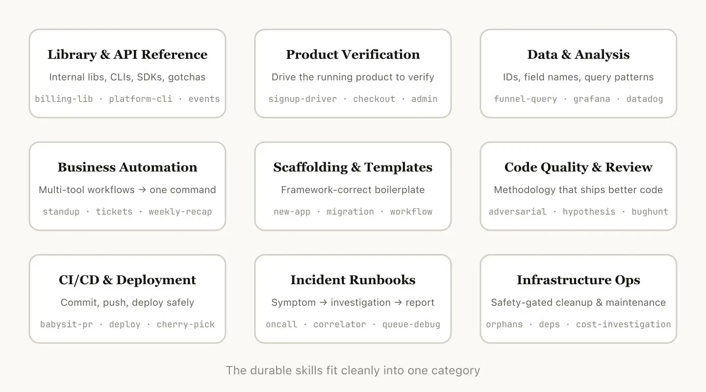
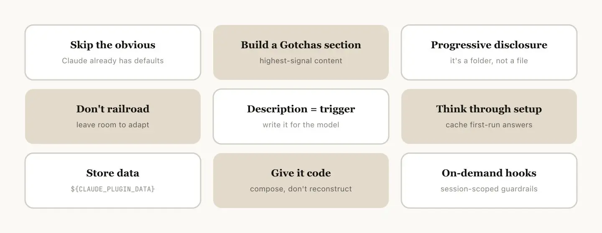
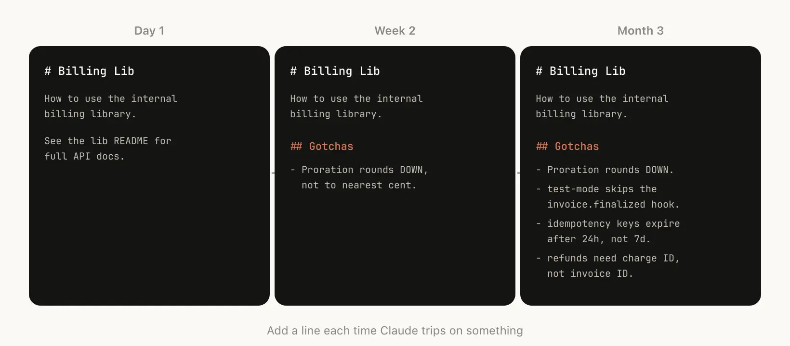
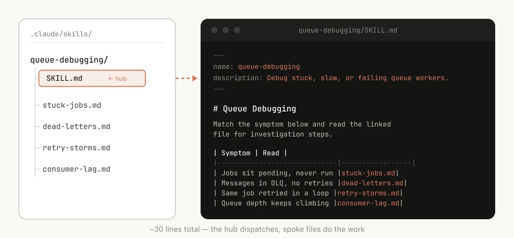
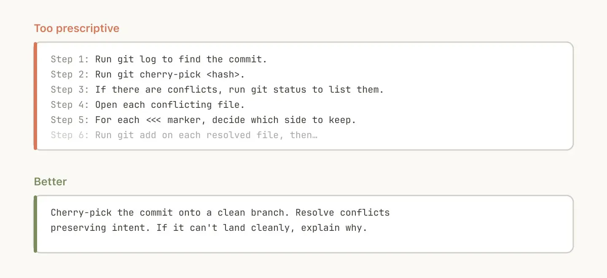
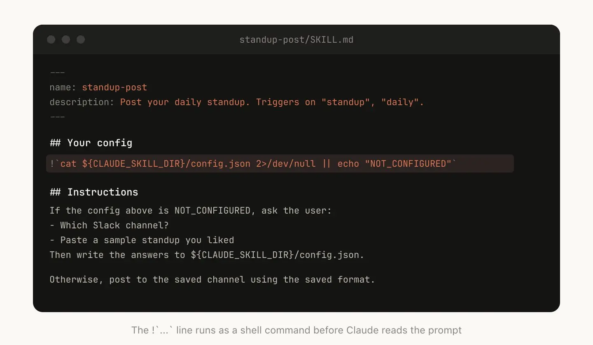
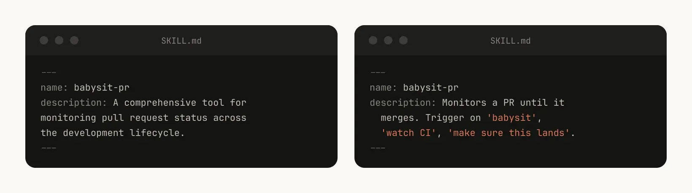
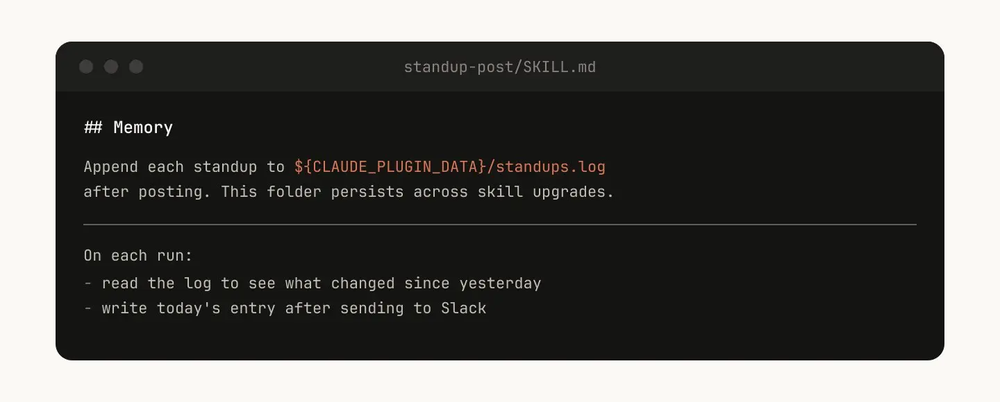
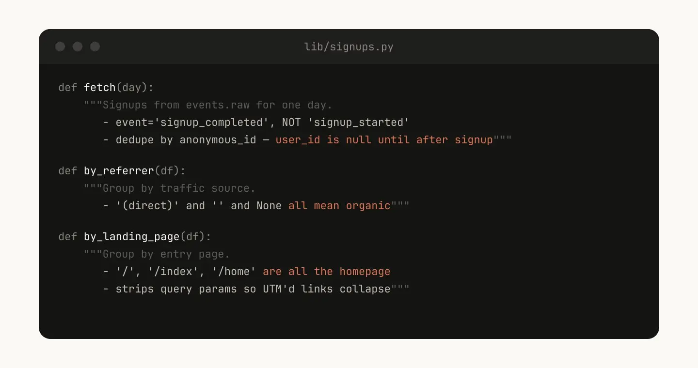
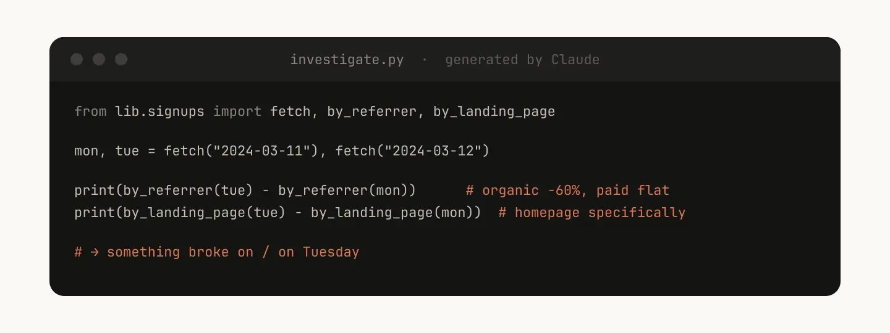

前几天，Anthropic 团队分享了一篇文章，总结了他们内部使用 Claude Code 的经验，特别是关于 "Skills"（技能）的使用心得。我觉得这篇文章非常有启发性，不仅介绍了 Skills 的各种类型，还给出了很多编写好 Skill 的建议。

下面是这篇文章的中文翻译（略有删改）。

---

在 Claude Code 中，Skills 已经成为最常用的扩展方式。它们非常灵活、容易制作，分发起来也很简单。

但是，这种灵活性也带来了一个问题：不知道怎么用才是最好的。什么样的 Skill 值得开发？写好一个 Skill 的秘诀是什么？什么时候该把它们分享给其他人？

在 Anthropic 内部，我们在大规模使用 Claude Code 的 Skills，目前有数百个在活跃使用中。下面就是我们在开发中总结出的一些经验。

## 什么是 Skills？

如果你对 Skills 还不熟悉，建议先阅读[官方文档](https://code.claude.com/docs/en/skills)，或者观看我们的[最新教程](https://anthropic.skilljar.com/introduction-to-agent-skills)。本文假设你已经对它有所了解。

关于 Skills，最常见的一个误解是：它们"只是 Markdown 文件"。但其实最有趣的地方在于，它们不仅是纯文本，还是一个完整的文件夹，可以包含脚本、静态资源、数据等等。AI 代理（agent）可以发现、探索并操作这些内容。

在 Claude Code 中，Skills 还有[非常丰富的配置选项](https://code.claude.com/docs/en/skills#frontmatter-reference)，甚至可以注册动态的 hook（钩子）。

我们发现，最有趣的一些 Skills，正是创造性地结合了这些配置选项和文件夹结构。

## Skills 的常见类型

我们把内部的所有 Skills 梳理了一遍，发现它们基本上可以归为以下几类。最好的 Skills 通常只专注于其中一类，而那些让人困惑的 Skills 往往跨越了多个类别。

这并不是一个绝对的列表，但如果你想看看团队内部还缺什么工具，它是一个很好的参考。

### 1. 库与 API 参考指南（Library & API Reference）

这类 Skill 主要向 Claude 解释如何正确使用某个代码库、CLI 或 SDK。它们既可以针对内部私有库，也可以针对 Claude 容易出错的一些公共库。这类 Skill 通常包含一个参考代码片段的文件夹，以及一份列出各种"坑"的清单，让 Claude 在写代码时避开。

**例子：**
- `billing-lib`：内部计费库的边缘情况、常见陷阱等。
- `internal-platform-cli`：内部 CLI 包装器的每一个子命令及使用示例。
- `frontend-design`：让 Claude 更好地使用你们的设计系统。

### 2. 产品验证（Product Verification）

这类 Skill 描述如何测试和验证代码是否正常工作，通常会配合外部工具（如 Playwright、tmux 等）一起使用。

为了保证 Claude 的输出是正确的，验证类 Skill 非常有用。有时候，甚至值得让一个工程师花整整一周时间，只为了把验证代码的 Skill 写到完美。

你可以考虑一些高级技巧：比如让 Claude 录制它输出结果的视频，这样你就能清楚看到它测试了什么；或者在每一步强制进行断言。这些通常可以通过在 Skill 文件夹里放一些测试脚本来实现。

**例子：**
- `signup-flow-driver`：在无头浏览器中运行注册、验证邮件和初始引导流程，并在每一步加上断言 hook。
- `checkout-verifier`：用 Stripe 的测试卡驱动结账 UI，并验证发票确实处于正确的状态。
- `tmux-cli-driver`：用于需要终端交互的 CLI 测试。

### 3. 数据获取与分析（Data Fetching & Analysis）

这类 Skill 连接了你的数据和监控系统。里面可能会包含获取数据的脚本（甚至带上凭证）、特定的仪表盘 ID，以及关于如何获取数据的常见工作流指南。

**例子：**
- `funnel-query`："我需要关联哪些事件来查看从注册到付费的漏斗？" 以及哪个表包含真正的 `user_id`。
- `cohort-compare`：比较两个群组的用户留存或转化率，标记出有统计学意义的差异，并链接到群组的定义。
- `grafana`：数据源的 UID、集群名称，以及问题与仪表盘的对照表。

### 4. 业务流程与团队自动化（Business Process & Team Automation）

把一些重复性的工作流变成一行命令。这类 Skill 的说明往往很简单，但可能会对其他 Skill 或 MCP（模型上下文协议）有复杂的依赖。对于这类任务，把之前的运行结果存到日志文件里，能帮助模型保持一致，并在后续执行时参考历史记录。

**例子：**
- `standup-post`：汇总工单追踪器、GitHub 活动和 Slack 的记录，生成一份每日站会汇报，并且只报告增量变化。
- `create-ticket`：强制执行工单的数据结构（比如只允许特定的枚举值和必填字段），并包含创建后的自动化流程（比如艾特审核人，把链接发到 Slack）。
- `weekly-recap`：合并的 PR + 关闭的工单 + 部署记录，生成一篇排版好的周报。

### 5. 代码脚手架与模板（Code Scaffolding & Templates）

为代码库生成某种框架或模板。你可以把说明文档和组合脚本结合起来。当脚手架的生成需求涉及自然语言，无法纯粹通过代码完成时，这种方式特别有用。

**例子：**
- `new-workflow`：根据你的注释，生成一个新的服务、工作流或处理程序的脚手架。
- `new-migration`：你们团队的数据库迁移文件模板，附带常见陷阱的说明。
- `create-app`：创建一个新的内部应用，提前把鉴权、日志和部署配置全部搞定。

### 6. 代码质量与审查（Code Quality & Review）

这类 Skill 用来强制执行代码质量规范，并辅助代码审查。为了保证极高的稳定性，里面通常会包含确定性的脚本工具。你也可以把这些 Skill 作为 hook 的一部分，或者放到 GitHub Action 里自动运行。

**例子：**
- `adversarial-review`：启动一个专门的“挑刺”子代理（subagent）来批评代码，然后实施修复，循环往复，直到找不出大问题。
- `code-style`：强制执行代码风格，特别是那些 Claude 默认做得不够好的规范。
- `testing-practices`：说明该如何写测试，以及重点测试什么。

### 7. CI/CD 与部署（CI/CD & Deployment）

帮助你获取代码、推送代码和部署系统。这类 Skill 可能会调用其他 Skill 来收集数据。

**例子：**
- `babysit-pr`：监控 PR 的状态，重试失败的 CI 测试，解决合并冲突，最后开启自动合并。
- `deploy-service`：构建 -> 冒烟测试 -> 流量灰度发布并对比错误率 -> 如果出现退化自动回滚。
- `cherry-pick-prod`：在一个独立的工作树中提取代码提交（cherry-pick），解决冲突，并套用模板提交 PR。

### 8. 运行手册（Runbooks）

根据一个症状（比如一段 Slack 对话、一个警报或错误签名），执行多工具的排查，最后生成一份结构化的报告。

**例子：**
- `debugging`：高流量服务专属，将"症状"映射到对应的排查工具和查询模式。
- `oncall-runner`：获取警报信息，检查常见嫌疑项，最后生成一份排查结论。
- `log-correlator`：给定一个 Request ID，从所有相关系统中提取对应的日志。

### 9. 基础设施运维（Infrastructure Operations）

执行日常维护和运维任务。由于有些操作具有破坏性，加入护栏（guardrails）就非常有必要了。它能让工程师在做关键操作时更容易遵循最佳实践。

**例子：**
- `orphans-cleanup`：找出孤立的 Pod 或存储卷，发到 Slack 提醒，经过一段缓冲期后，让用户确认，最后进行级联清理。
- `dependency-management`：你们组织内部的依赖审批工作流。
- `cost-investigation`："为什么我们的存储或网络出口账单飙升了？"，并提供特定的存储桶和查询模式。

## 开发 Skills 的建议

确定了要做什么 Skill 之后，应该怎么写呢？这里有几个最佳实践。

（顺便提一句，我们最近发布了 [Skill Creator](https://claude.com/blog/improving-skill-creator-test-measure-and-refine-agent-skills) 工具，能让你在 Claude Code 里更容易地创建 Skills。）

### 不要说废话

Claude Code 已经非常了解你的代码库了，Claude 本身也很懂编程，内置了很多默认的代码观点。如果你发布的 Skill 只是在提供知识，尽量专注于那些能打破 Claude 默认思维方式的信息。

比如前端设计 Skill 就是一个好例子。它是 Anthropic 的一位工程师通过和客户不断迭代出来的，主要目的是为了提升 Claude 的"设计品味"，防止它总是使用 Inter 字体和紫色渐变等烂大街的设计模式。

### 建立一个"踩坑"指南（Gotchas Section）

任何 Skill 里，最有价值的内容就是"踩坑"指南（Gotchas）。这个部分应该由 Claude 在实际使用该 Skill 时最常犯的错误组成。最理想的状态是，你随着时间不断更新这个 Skill，把新遇到的坑加进去。

### 利用文件系统进行渐进式呈现（Progressive Disclosure）

前面提到过，Skill 是一个文件夹，而不只是一个 Markdown 文件。你应该把整个文件系统看作是一种"上下文工程"和"渐进式呈现"。告诉 Claude 这个 Skill 里有哪些文件，它就会在合适的时候去读它们。

最简单的渐进式呈现，就是指向其他的 Markdown 文件。比如，你可以把详细的函数签名和使用示例单独放在 `references/api.md` 里。

另一个例子：如果最终的输出结果需要是一个 Markdown 文件，你可以在 `assets/` 里放一个模板文件，让 Claude 复制使用。

你可以建很多文件夹放参考资料、脚本、示例等等，这能帮助 Claude 变得更高效。

### 避免给 Claude 铺设死板的轨道

Claude 通常会尽量遵守你的指令，但因为 Skills 是高度可复用的，你不能把指令写得太死板。给它需要的信息，但同时留出适应具体情况的灵活度。

### 考虑配置环节（Setup）

有些 Skill 需要用户的上下文才能运行。比如，如果你写了一个把站会内容发到 Slack 的 Skill，你可能需要 Claude 先问一下用户："发到哪个频道？"

一个好的模式是，把这些配置信息存在 Skill 目录下的 `config.json` 文件里。如果配置不存在，Agent 就会主动问用户要。如果你希望给用户提供结构化的单选/多选题，你可以指示 Claude 使用 `AskUserQuestion` 工具。

### "描述"字段是给模型看的

当 Claude Code 启动一个会话时，它会拉取所有可用 Skills 的列表和它们的描述（Description）。Claude 是通过扫这个列表来决定："有对应的 Skill 能处理用户的这个请求吗？"

这意味着，描述字段不是用来写总结的，它是用来告诉模型触发这个 Skill 的时机。

### 记忆与数据存储

Skill 可以通过在内部存储数据，获得一种"记忆"能力。你可以存为最简单的纯文本追加日志、JSON 文件，甚至是复杂的 SQLite 数据库。

比如，`standup-post` 这个 Skill 可能会维护一个 `standups.log`，里面记录了它发过的每一篇帖子。这样下次运行的时候，Claude 就能读一读历史，知道今天跟昨天相比有什么变化。

需要注意的是，存在 Skill 目录里的数据在升级 Skill 时可能会被删掉。所以你应该把它存在一个稳定的目录里。目前，我们提供了一个 `${CLAUDE_PLUGIN_DATA}` 变量，它为每个插件指向一个稳定的持久化目录。

### 存放脚本，动态生成代码

你能给 Claude 的最强大的工具，就是代码本身。把脚本和库提供给它，能让它把精力花在业务逻辑组合上，思考下一步干嘛，而不是在那儿从头手写死板的模板代码。

比如，在你的数据科学 Skill 里，你可以提供一个用来从事件源拉取数据的函数库。为了让 Claude 能做复杂的分析，你直接给它这套辅助函数：

这样，当用户问"周二发生了什么"时，Claude 就可以当场生成脚本，把这些现成的函数组合起来，进行高级分析。

### 按需启用的 Hook（钩子）

Skill 可以包含一些只有在 Skill 被调用时才激活的 Hook，并且生命周期仅限于当前会话。如果有些 Hook 规则非常严格，你不想让它一直跑，但关键时刻又极度管用，就非常适合这种模式。

**例子：**
- `/**careful`：通过拦截 Bash 命令，阻止 `rm -rf`、`DROP TABLE`、`force-push` 等危险操作。你只有在明确知道自己在动线上环境时才想启用它，如果一直开着会让人抓狂。
- `/**freeze`：禁止编辑特定目录以外的文件。调试时很有用："我想加几行日志，但我总是失手'修复'了其他无关的代码"。

## 分发 Skills

Skills 最大的好处之一，就是你可以把它们分享给团队里的其他人。

有两种主要的分发方式：
1. 把 Skills 提交到你们的代码库里（放在 `.claude/skills` 目录下）。
2. 做成一个**插件**（Plugin），在企业内部搞一个插件市场，让用户可以自己上传和安装。

对于涉及代码库不多的较小团队，直接把 Skill 提交到仓库就行了。但是，每一个跟着仓库走的 Skill 也会稍微占用一点模型的上下文空间。随着团队变大，搞一个内部插件市场会更好，让团队自己决定要安装哪些。

### 管理内部市场

你怎么决定哪些 Skill 能进市场？别人怎么提交？

我们内部并没有一个中央集权的团队来做决定，而是让好用的 Skill 自动浮现。如果你写了一个 Skill 觉得不错，可以先传到 GitHub 的某个沙盒目录，然后在 Slack 里喊大家来试用。

等这个 Skill 有了受众（由 Skill 作者自己判断），他们就可以提一个 PR，把它移到正式的市场列表里。

不过要注意，大家很容易写出很烂或者重复的 Skill，所以发布前最好有一个简单的筛选机制。

### 组合使用 Skills

你可能需要一些相互依赖的 Skill。比如，你有一个专门用来上传文件的 Skill，还有一个生成 CSV 的 Skill，你想先生成 CSV 然后把它上传。目前市场或 Skill 本身还没有原生的依赖管理系统，但你只要在描述里通过名字引用其他的 Skill，只要用户安装了，模型就会自动去调用它们。

### 衡量 Skill 的使用效果

为了了解一个 Skill 的表现，我们使用了一个 `PreToolUse` 的 hook 来记录公司内部对 Skill 的使用情况。这样我们就能清楚地看到哪些 Skill 很受欢迎，哪些触发频率低于我们的预期。

## 结语

对于 Agent 来说，Skills 是一个极其强大、灵活的工具。但一切都还在早期，我们都在摸索怎么用才是最好的。

与其把这篇文章看成绝对指南，不如把它当成一个"实用技巧锦囊"。理解 Skills 最好的方式就是直接上手，多做实验，看看哪些对你有用。我们内部的绝大多数 Skill 一开始也就几行说明加一个避坑提示，因为不断有人在使用过程中撞上新的边缘情况，修修补补，它们才变得越来越好用。

希望这些经验对你有帮助。

（完）

Lessons from Building Claude Code How We Use Skills
【译】Claude Code 团队经验：Prompt Caching 就是一切
【译】Claude Code 团队经验：学会用 Agent 的眼光看世界
