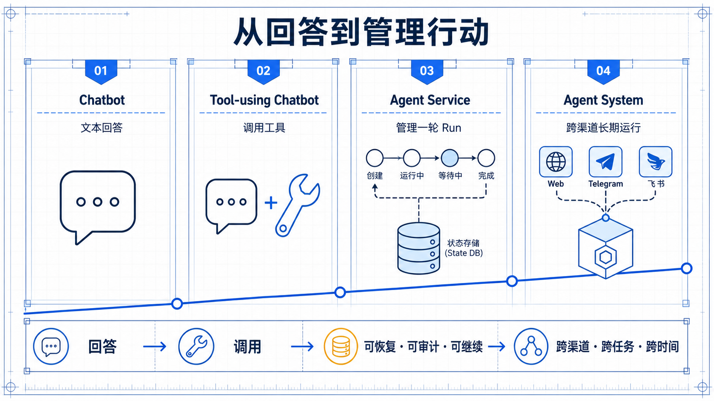
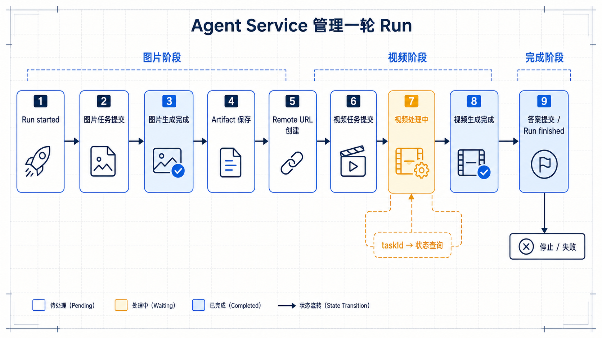
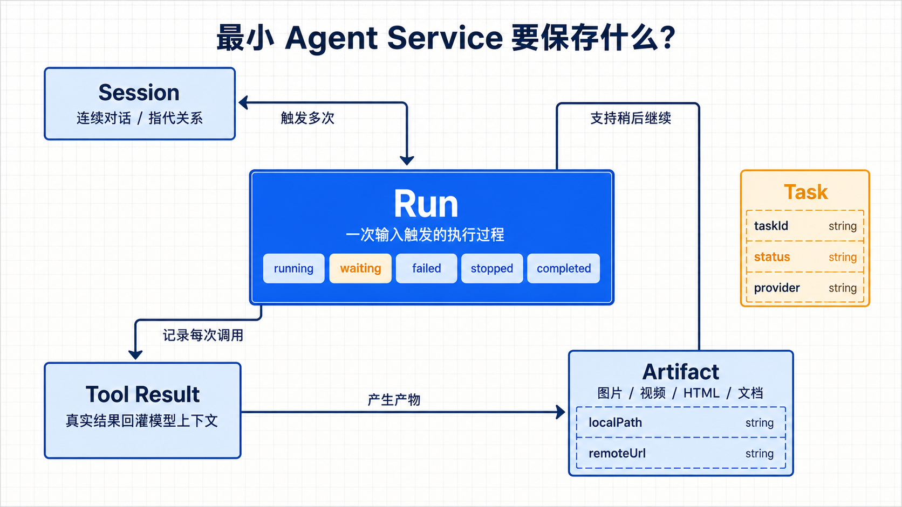
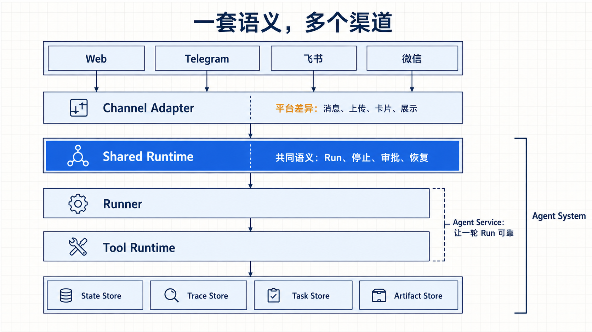
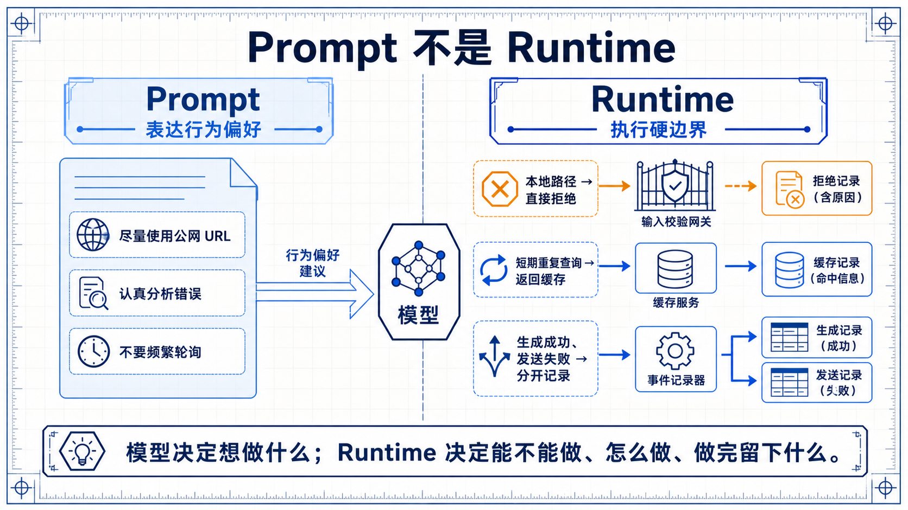

# 02. 从 Chatbot 到 Agent Service：差别不在模型，而在运行时

> 系列来源：本文属于 Agent 开发系列，内容来自 [gusibi/molibot](https://github.com/gusibi/molibot) 的真实开发记录与项目文档整理。


上一篇我们先画了一张地图：一个 Agent 系统不只是模型和工具，还会自然长出入口层、runtime、工具层、状态层、权限层、观测层和后台。

但如果只看概念，这些层还是有点抽象。

所以这一篇先解决一个更具体的问题：Chatbot、Tool-using Chatbot、Agent Service、Agent System 到底有什么区别？

这个问题很重要。

因为很多团队第一次做 Agent，最容易卡在这里：系统明明已经能调用工具了，却还是很难稳定地交给用户用。用户一刷新，状态没了；工具失败后，模型不知道发生了什么；任务执行一半，用户想停止，后台还在跑；生成出来的文件，本地能看到，发到平台却失败。

这时如果继续堆 prompt，通常没用。

问题不在模型，而在运行时。

## 先用一个真实任务来看差别

假设用户发来这样一个需求：

```text
帮我生成一张赛博朋克风格的猫咪海报。
如果效果可以，再用这张图生成 5 秒短视频。
最后把图片和视频都发给我。
```

这个任务很适合用来区分不同系统。

它看起来只是“调用两个工具”：先生成图片，再生成视频。

但真实执行时，马上会出现很多细节：

- 图片生成是同步返回，还是异步任务？
- 图片结果是本地路径，还是公网 URL？
- 视频服务能不能访问本地文件？
- 生成成功但平台上传失败，算不算失败？
- 用户中途说“停一下”，已经提交的视频任务怎么办？
- 后台能不能查到这个任务用了哪个模型、哪个工具、哪个 provider？
- 用户第二天追问“昨天那张图再换个风格”，系统还能找到原始结果吗？

如果这些问题没有回答，你做出来的可能只是一个能演示的工具链，不是一个 Agent 服务。

下面我们按四个层级来看。



## 第一层：Chatbot 只负责回答

最普通的 Chatbot 会怎么处理这个任务？

它会回答一段文字。

可能是这样：

```text
当然可以。你可以先使用图片生成模型生成一张赛博朋克风格猫咪海报，
再把生成结果作为参考图传给视频生成模型。
```

这个回答不一定错。

但它没有做事。

它只是告诉用户“应该怎么做”。用户真正想要的是图片和视频，不是一个流程说明。

Chatbot 的边界很清楚：它生成文本。

它可以解释概念，可以帮你写提示词，可以给你步骤。但它不会保存任务，不会上传文件，不会轮询视频状态，也不会处理平台发送失败。

所以 Chatbot 的系统模型很简单：

```text
User message
-> Model
-> Assistant answer
```

这类系统的优点是简单、稳定、风险低。

因为它不碰真实世界。

缺点也很明显：只要用户要它“做一件事”，它就只能停在建议层。

## 第二层：Tool-using Chatbot 能调用工具，但状态很薄

下一步，很多人会给 Chatbot 加工具。

比如增加两个函数：

```text
imageGenerate(prompt) -> imagePath
videoGenerate(image, prompt) -> videoUrl
```

这样一来，模型就不只是回答了。它可以先调用图片工具，再把图片传给视频工具。

流程可能变成这样：

```text
User message
-> Model decides imageGenerate
-> Runtime calls imageGenerate
-> Model receives result
-> Model decides videoGenerate
-> Runtime calls videoGenerate
-> Model writes final answer
```

到这里，系统已经像 Agent 了。

但“像”不等于“是”。

因为很多工具增强聊天系统只解决了“工具能不能被调用”，没有解决“工具调用如何被管理”。

比如图片工具返回了一个本地路径：

```text
artifacts/2026-06-15/cat-poster.png
```

模型拿到这个路径后，把它当成视频参考图传给云端视频服务。

问题是，云端视频服务看不到你的本地文件。

它需要的是公网 HTTP(S) URL。

于是视频生成失败。

如果 runtime 设计得很薄，这个失败可能只会变成一段错误文字，最后模型总结：

```text
图片已经生成，但视频生成失败。
```

这比纯 Chatbot 强，但还不够。

因为系统没有把关键状态管起来：

- 图片生成结果有没有被保存为 artifact？
- 本地路径有没有转换成可访问的 remote URL？
- 视频任务提交失败，错误原因有没有结构化记录？
- 模型下一步能不能根据失败原因修正参数？
- 用户能不能在后台看到这次失败？

工具增强聊天的问题就在这里。

它有工具，但没有足够的 runtime。

它能把“模型意图”变成一次函数调用，却不一定能把这次调用变成可靠的产品行为。

## 第三层：Agent Service 管理一轮 run

Agent Service 的重点不是“工具更多”，而是开始认真管理一次 run。

还是刚才那个任务。

Agent Service 会把它看成一个有生命周期的执行过程：



```text
Run started
-> image task submitted
-> image completed
-> image artifact saved
-> remote URL created
-> video task submitted
-> video processing
-> video completed
-> final answer committed
-> Run finished
```

这里每一步都应该有状态。

图片生成成功，不只是返回一段文本。系统要保存任务记录、生成结果、远程 URL、本地 artifact、provider 信息和错误诊断。

视频生成也不只是一个函数调用。很多视频服务是异步的。提交任务后，立刻返回的可能只是 taskId。真正的视频 URL，要过几十秒甚至几分钟才能拿到。

所以 Agent Service 要能表达这种状态：

```text
videoTask = {
  id: "task_123",
  status: "processing",
  inputImageUrl: "https://...",
  provider: "xxx",
  createdAt: "...",
  lastCheckedAt: "..."
}
```

这不是为了好看。

没有任务状态，系统就只能让模型在同一轮里不断问“完成了吗”。这会浪费 token，也容易触发 provider 限流。

更稳的做法是：任务提交后先告诉用户“视频正在生成”，状态写入任务表。用户稍后查询，或者系统按策略查询，再返回结果。

这时，Agent Service 和 Tool-using Chatbot 的区别就很清楚了。

Tool-using Chatbot 关注“函数调用成功了吗”。

Agent Service 关注“这次 run 是否可恢复、可审计、可继续”。

## Agent Service 必须保存哪些东西？

一个最小 Agent Service 至少要保存四类东西。



第一类是 session。

session 记录一段连续对话。用户说“刚才那张图再换成黑白风格”，系统要知道“刚才那张图”指的是什么。

第二类是 run。

run 记录一次用户输入触发的执行过程。它有开始、运行中、等待审批、失败、停止、完成等状态。

第三类是 tool result。

工具结果不只是给用户看的，也要回到模型上下文。模型只有看到真实结果，才能继续判断下一步。

第四类是 artifact。

Agent 生成的图片、视频、HTML、文档，都应该作为产物保存。它们可能有本地路径，也可能有 remote URL。两者用途不同，不能混在一起。

可以把这个关系写成伪代码：

```text
run = RunStore.start(sessionId, userMessage)

image = ToolRuntime.execute("imageGenerate", input)
ArtifactStore.save(image.localFile)
RunStore.recordToolResult(run.id, image)

video = ToolRuntime.execute("videoGenerate", {
  imageUrl: image.remoteUrl
})
TaskStore.save(video.taskId)
RunStore.recordToolResult(run.id, video)

SessionStore.commit(finalAnswer)
RunStore.finish(run.id)
```

这段不是某个项目源码，只是表达一个原则：

工具执行不是孤立动作。它要和 run、session、artifact、task 连接起来。

## 第四层：Agent System 把能力扩到多渠道和运营面

Agent Service 解决了一轮 run。

Agent System 要解决的是：很多 run、很多用户、很多渠道、很多工具长期运行。

还是同一个图片加视频任务。

如果用户是在 Web 里发的，系统可以在页面里显示进度条、任务状态、图片预览和视频链接。

如果用户是在 Telegram 里发的，系统要考虑消息长度、图片上传、视频文件大小、失败重试和消息编辑。

如果用户是在飞书里发的，系统可能要用卡片展示进度，用按钮处理审批，用富文本展示最终结果。

用户感知不同，但底层任务语义应该一致。

也就是说，生成图片、生成视频、保存 artifact、记录 trace、等待审批，不应该分别写在 Web、Telegram、飞书各自的逻辑里。

更合理的结构是：

```text
Web / Telegram / Feishu / Weixin
-> Channel Adapter
-> Shared Runtime
-> Runner
-> Tool Runtime
-> State / Trace / Task Store
```



Channel Adapter 负责平台差异。

Shared Runtime 负责共同语义。

这就是 Agent System 和 Agent Service 的差别。

Agent Service 让一轮 run 可靠。

Agent System 让这套可靠性跨渠道、跨任务、跨时间继续成立。

## 为什么差别不在模型？

很多人会把 Agent 能力归因到模型。

模型越强，Agent 越强。

这句话只对一半。

强模型确实能更好地规划步骤、理解错误、选择工具。但模型不能替你解决下面这些问题：

- 服务重启后，running 状态怎么处理？
- 用户点了审批后，工具结果怎么回灌？
- Telegram 上传失败，但生成成功，最终状态怎么算？
- 任务执行一半，用户 stop，哪些资源要清理？
- 同一个工具在不同渠道触发，权限策略是否一致？
- 用户说“继续昨天的任务”，系统怎么找回 artifact？

这些都不是模型能力。

它们是 runtime 能力。

你可以用更强的模型，让它更少犯错。但只要 runtime 没有边界，模型迟早会撞上系统的空洞。

所以这篇的核心判断是：

```text
模型决定“想做什么”。
Runtime 决定“能不能做、怎么做、做完以后留下什么”。
```

Agent 服务的产品边界，更多由 runtime 决定。

## 一个常见误区：把所有东西都塞进提示词

当工具调用不稳定时，很多人的第一反应是改 prompt。

比如：

```text
生成视频时，请一定使用图片的公网 URL，不要使用本地路径。
如果工具失败，请认真分析失败原因。
如果任务还在处理中，请不要重复轮询。
```

这些提示有没有用？

有一点。

但它们不能替代 runtime。

因为模型仍然可能传错参数。更关键的是，runtime 明明可以在执行前直接检查：

```text
if imageUrl is local path:
  reject with clear tool error

if task is processing and checked recently:
  return cached status

if upload failed but generation succeeded:
  return remote URL and mark delivery failed
```

能用代码确定的事情，不要只写进 prompt。

Prompt 适合表达行为偏好。Runtime 才适合表达硬边界。



## 怎么从小版本演进？

这并不意味着你一开始就要做完整 Agent System。

更实际的路径是分阶段。

第一步，先做 Chatbot。

让用户能问，模型能答。这里重点是基本对话体验和上下文组织。

第二步，加少量工具。

工具不要多。先选最核心的两个到四个，打通 schema、调用、结果回灌和错误返回。

第三步，引入 run。

只要工具开始产生副作用，就要记录 run 状态。哪怕一开始只有 `running / completed / failed` 三个状态，也比全靠内存强。

第四步，引入 artifact 和 task。

只要系统生成文件、图片、视频、报告，就不要让它们只存在于模型文本里。产物要有自己的对象和生命周期。

第五步，再接多渠道。

不要每接一个渠道就重写一套执行逻辑。先把共享 runtime 抽出来，让渠道只负责消息适配和展示。

第六步，补权限、trace 和后台。

当系统能做事后，就必须能控制、能审计、能诊断。否则越强越危险。

这条路径的重点是：每一步都解决一个真实问题，不提前堆复杂度，也不假装复杂度不存在。

## 回到开头那个任务

现在再看用户的需求：

```text
帮我生成一张赛博朋克风格的猫咪海报。
如果效果可以，再用这张图生成 5 秒短视频。
最后把图片和视频都发给我。
```

Chatbot 会给你步骤。

Tool-using Chatbot 会尝试调用图片和视频工具。

Agent Service 会把这次执行变成一个可记录、可恢复、可继续的 run。

Agent System 会让这件事在 Web、Telegram、飞书等入口里都保持同一套语义，并能在后台查状态、查错误、查用量。

这就是四者的区别。

不是模型换了。

是系统从“回答问题”走向了“管理行动”。

## 下一篇讲什么？

这一篇把层级分清了。

但 Agent Service 具体怎么落地，还要从一轮 run 开始。

下一篇我们就进入最小闭环：一次用户输入进来，系统如何创建 session，如何启动 run，如何调用模型，如何执行工具，如何把工具结果回灌，最后如何保存和提交答案。

只要这一轮 run 跑清楚，后面的多渠道、审批、记忆和任务，才有地方挂上去。
