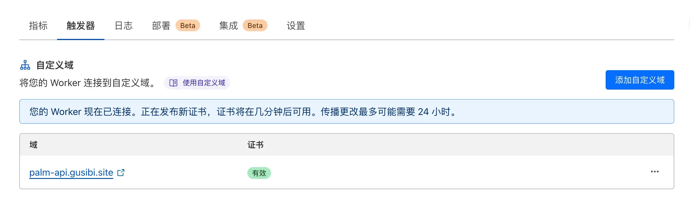

> https://zhile.io/2023/12/24/gemini-pro-proxy.html


## 如何使用 Cloudflare worker 创建 gemini api 代理 

一、在 Cloudflare 中创建一个 worker gemini-api-proxy，保存并部署

```js
export default {
  async fetch(request, env) {
    const url = new URL(request.url);
    url.host = 'generativelanguage.googleapis.com';
    return fetch(new Request(url, request))
  }
}
```

二、添加自定义域名

可以直接使用 worker 触发器中的添加自定义域添加自定义域名。

> 不过这样不能确定使用的是哪个 ip，可能会存在请求时 gemini 提示地区不支持，这里可以自己设置 dns 解析 ip，通过这种方式来避免不支持的问题



以下内存转自 https://zhile.io/2023/12/24/gemini-pro-proxy.html

转到自己在 cf 上域名的控制面板，点击左侧菜单 `DNS` 来添加域名解析。  
这里我使用自己的域名 `gusibi.site`，给它增加了子域名 A 记录：`gemini-api.gusibi.site`


这里有两个要点：  
1. 不要开启小黄云。  
2. ip地址可以使用cf的优选工具选出来的高质量ip。

我这里用了两个我觉得还不错的ip，你们可以直接用，也可以自己去优选。

DNS解析记录操作完毕之后，点击左侧菜单`Workers路由`来让我们设置的域名和worker的路由关系。  
在`Workers路由`界面，点击`添加路由`按钮，参考如下填写：


这里域名换成你刚才设置的那个，Worker也选择你之前创建的。点击`保存`即可。

完成这一步你就可以用你自己的域名来请求gemini了。

## 相关链接 ：

1. [# 我们也要用Gemini Pro](https://zhile.io/2023/12/24/gemini-pro-proxy.html)
