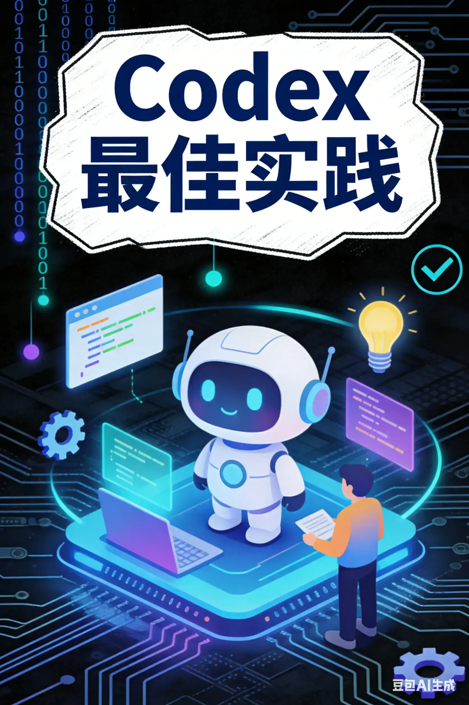
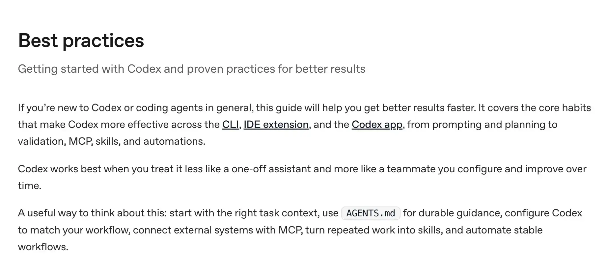
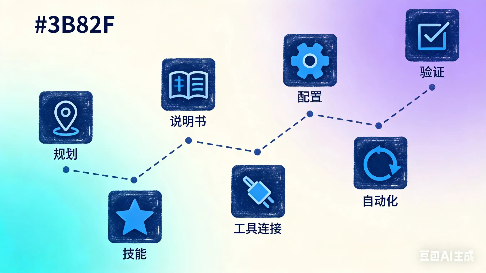

## 一、引言

最近在用 OpenAI 的 Codex APP，官方发布了一份最佳实践指南。我仔细读了一遍，发现里面有很多实用的建议，特别是对于那些刚开始用 AI 编程工具的人。

总结整理了一下这些经验，分享给大家。如果你也在用 Codex（对于其它AI 编程工具也适用），或者对 AI 编程感兴趣，这篇文章应该能帮到你。

## 二、核心四要素

.webp)
想让 Codex 准确完成任务，每次提问最好包含这四个部分：

**目标**：你要改什么或建什么
**上下文**：相关文件、文档、错误信息（用 @ 提及）
**约束**：代码规范、安全要求、团队约定
**完成标准**：测试通过、行为改变、bug 复现消失

任务越复杂，越要提供详细信息。一次说清楚，可以减少很多返工。

## 三、七个实用技巧

### 1. 复杂任务先规划

遇到复杂或模糊的任务，先让 Codex 做规划再动手。

可以用 `/plan` 模式，让它先问清问题再执行。如果你只有个大致想法，可以让它先采访你，把模糊的想法变得具体。

对于大型项目，可以用 `PLANS.md` 模板来管理（建议使用 planning-with-files skill） 。

### 2. 创建 AI 使用说明书

> 可以使用 `/init` 命令初始化 `AGENTS.md` 文件，然后再根据自己的需要更新。

在项目中创建 `AGENTS.md` 文件，写上：
- 项目结构和重要目录
- 运行、构建、测试命令
- 代码规范和审查标准
- "完成"的定义

这样 Codex 会自动读取，不用重复说明。

### 3. 配置个人设置

在 `~/.codex/config.toml` 中设置：

- 默认模型和推理级别
- MCP 服务器连接
- 个人偏好

新手建议保持默认权限，熟悉后再调整。

### 4. 不要只写代码，要验证

让 Codex 完成：
- 编写或更新测试
- 运行测试套件
- 检查代码格式和类型
- 确认最终行为符合预期
- 审查代码 diff

Codex 内置了 `/review` 命令，适合做 PR 审查。

> 如果是对 bug 敏感的项目，建议保留人工 review 步骤，也可以使用不同的 AI review。

### 5. 连接外部工具

需要实时数据时，可以用 MCP 协议连接数据库、API 或内部系统。

原则很简单：只添加真正常用的工具，不要贪多。

### 6. 把重复工作变成 SKILL

经常重复的任务，做成 Skill 文件：
- 日志分类
- 发布说明起草
- PR 审查清单
- 标准调试流程

判断标准：如果同样的提示用三次以上，就该做成技能了。

### 7. 自动化稳定流程

工作流稳定后，可以设置自动化：
- 定期总结提交
- 扫描潜在 bug
- 生成发布说明
- 检查 CI 失败

记住：先手动跑通，再自动化。

## 四、常见错误

使用 Codex 时，要避免这些错误：

- 把长期规则塞在提示词里（应该用 AGENTS.md 或 Skill）
- 不给 Codex 看运行结果（要告诉它如何运行构建和测试）
- 复杂任务跳过规划
- 没搞懂工作流就给最高权限
- 多人同时改同一文件不用 git worktree
- 手动还没跑通就自动化
- 一个线程干所有事（应该一个任务一个线程）

## 五、使用阶段

**新手期**：从简单任务开始，熟悉基本操作
**进阶期**：建立 AGENTS.md 和常用 Skill
**高手期**：自动化 + MCP + 多线程并行

## 六、总结

Codex 的最佳实践可以总结为：先规划、再执行、重验证、常优化。

把这些习惯养成后，Codex 会从一个简单的助手，变成真正可靠的编程搭档。它不是一次性工具，而是需要长期配置和改进的队友。

Codex Best practices 中文版 
Codex Best practices
