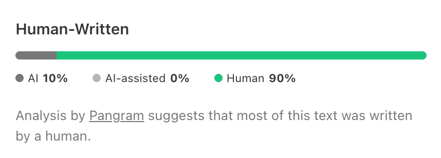

> 原文：[Your coding agents made you a manager](https://x.com/addyosmani/status/2119332146485891501)
> 作者：Addy Osmani（@addyosmani）



原文配图是 Pangram 对这段文字的检测结果截图：人类写作 90%，AI 10%，AI 辅助 0%。跟正文关系不大，附在此处存档。

# 编程 Agent 用久了，你已经在做管理

管理 agent 的本事，和管理团队的本事基本是一套。你不需要先有个管理者的头衔才能学。

整天和编程 agent 待在一起，你就在管理。选任务、写指令、派活、追问、评估结果、决定什么上线，一天里反复做这些。把 agent 用得最好的工程师，不一定是 prompt engineering 最强的那批，而是学会了管理的那批，有意识或者无意识地。

这话可能不中听。我欣赏的很多工程师选 IC 路线，就是想贴着活干，他们见过朋友当了管理者之后消失在日历里。我不是劝你变成那种管理者。这里的"管理"有具体所指：通过让别人做成事，来产出好结果。我也没说 agent 能替代管理者或同事。

你对烂管理者的每一条抱怨，都是一份和 agent 打交道的 bug 报告。想想任务交接。要是你经历过一次烂交接，大概收到过含糊的需求、缺失的背景，或者中途被反复改预期。好消息是，正因为你被交接了这么多年，你知道一次好的交接长什么样。

下面这些小节大致按杠杆大小排序，最有效的习惯放前面。

## 先给它一个能自检的办法

**做法：** 给 agent 一个验证自己工作的机制，测试套件、构建或者截图都行，让它把结果拿给你看，作为证据。

**反例：** 把"看起来做完了"当作确认。这样验证全落到你身上，你成了 agent 的测试套件。

问一个有经验的管理者，他怎么在不读所有产出物的情况下确信团队在做好活，他会讲护栏：CI、代码评审、看板、on-call。没建护栏的管理者，最后自己验所有东西，一个季度内就成了瓶颈。agent 一样。Claude Code 的最佳实践文档写得很清楚：agent 在工作看起来做完的时候停下。没有验证机制，"看起来做完"就是它唯一的验证。有了验证机制，agent 就能干活、跑验证、看到失败、自己改。UI 改动可以真的在浏览器里打开页面，迭代到能用也好看。

验证机制是什么都行，只要能给出明确的通过或失败。测试、构建退出码、linter、diff 脚本、截图都算。跑验证的那条命令，是 CLAUDE.md 里最值钱的一行——CLAUDE.md 是 agent 每个 session 开头都要读的指令文件。有了机制，往工作流里接的方式有几种：

- **要求。** 让它做完跑 auth 测试，跑到过为止。
- **目标。** `/goal` 会让另一个模型在每一轮之后检查条件，长时间后台任务最用得上。
- **强制。** Stop hook 可以拦住这一轮的结束，直到 typecheck 通过。
- **送审。** `/code-review` 把 diff 交给一个没看过你这段对话的新 subagent 评审，就像作者不批自己的 PR。

评审范围可以控制。让它找问题，它总能找到点东西；让它只找正确性问题、忽略风格，它就照做。好管理者也是这样学会提反馈需求的。Claude Code 工具箱里大部分功能都在收紧这个循环。skills、hooks、subagents、MCP 存在的意义，是补上"做事"和"验证做事"之间的缝，让你的注意力只花在 agent 验证不了的地方。有经验的工程管理者做的就是这件事。

## 把上下文说清楚

**做法：** 给一份摘要，讲清 agent 从仓库里看不出来的部分：任务目标、为什么重要、约束、不做什么、成功的标准。

**反例：** 只丢一行任务，真实预期留在自己脑子里；或者反过来，把 agent 读代码就能发现的东西塞满 brief。

有效的管理者会描述想要的结果、约束和目标。他们讲清工作要达成什么，把怎么做留给做事的人。军队把这叫 commander's intent，Netflix 叫 "context, not control"。

和 agent 协作的难点在于，你很难知道它缺哪块上下文。编程 agent 每个任务的第一件事是读你的代码。现在的模型抓目录结构、约定、测试配置，比你描述得快得多。

所以写之前先想：哪些它自己能看出来。代码里读得到、而且它真的会去读的，一个字都不用说。字要花在不在仓库里的东西上——某次会议的决定、某人部署的内部流程、这个任务为什么重要、"这次做完"具体指什么。

拿一个含糊的任务举例，"让 dashboard 快一点"，把它变成 prompt。下面的数字只是示意。

```bash
把 /team dashboard 的 p95 加载时间做到 2s 以内，针对成员 1 万以上的组织。

为什么：企业管理员每天开这个页面，加载慢是他们最大的支持工单来源。

约束：不改 schema；保持 API 响应结构。

不做：UI 改动；整页缓存。

检查：跑 scripts/perf/team.sh，给出前后数字。
```

不必每个任务都这么写。探索性的活，写个笼统的 prompt 完全没问题，边做边细化。要是你还没准备好写 prompt，就让 agent 反过来采访你，直到它能写出 spec；把 spec 存成文件，再开一个新 session 照它来做。这份 spec 后面还能当作评审的依据。

你可能还得给 agent 开别的工具的权限，issue tracker、错误看板、团队聊天。把它当团队里新来的人对待。像 `gh` 这种它本来就认识的 CLI 工具，通常不用交代。

## 让每一次纠正沉淀下来

**做法：** 同一件事纠正超过一次，就写进团队的 CLAUDE.md，或者做成共享 skill。过一段时间回头看，新模型是不是已经不需要这些纠正了。

**反例：** 每个 session 手动纠正同一件事，或者依赖只存在自己机器上的隐性知识。

把 CLAUDE.md 用出价值的团队，更新得比较勤，也会把值得防的错误记下来。有的团队在代码评审里 @claude，让一条反馈变成长期策略。CLAUDE.md 要短。适合放进去的是这几类：

- 怎么验证（确切的命令）
- 代码里容易误导人的地方
- 仓库里不存在的决策
- 你纠正过两次的任何东西

写下来的信息会复利。它比人员换组活得更久，也比模型换代活得更久。

## 能自己判断的就别硬管

**做法：** 默认让 agent 自己判断，只对必须永远做、或者永远不做的那几件事上硬手段，比如 hooks、deny rules。

**反例：** 规则全用大写写；给可选偏好配 hook；新模型早就过了那个阶段，还留着旧模型时代的习惯。

Andy Grove 在《High Output Management》里把这叫 task-relevant maturity：监督的力度该看这个人在这个具体任务上的历史表现，不是他的整体能力。

给新管理者的一条老建议说的是同一件事：给的余地比你舒服的程度多一点，同时兜住，并且让他负责。

Claude Code 把这点说明了：prompts、CLAUDE.md、skills 是请求，模型可以考虑，也可以选择照做；hooks、deny rules、managed settings 是要求，始终强制执行。多数时候你希望 agent 自己拿主意。模型看着真实代码，往往比你事先定的规则更清楚某条指南在当下适不适用。强制手段留给硬要求，比如"不要改生成的 client"、"始终跑 license-header 脚本"。新的终端和 VS Code session 默认以 auto 模式启动，有个分类器会过滤掉危险行为，比如部署到生产、force push 覆盖别人的工作。

指南的建议是双向的。某条 CLAUDE.md 你已经加了强调，agent 还是不买账，那它该变成 hook。某个 hook 表达的是偏好而不是要求，那它该删掉，把决定权还给 agent。跟团队退掉一个不再有用的流程是一回事。换模型的时候也要重新调。指南列了一份可以停掉的习惯：全大写指令、"think harder"（effort 现在是配置项）、"don't be lazy"。在现在的模型上，这些更容易造成规则过度和过劳。对 agent 来说，过度流程就是新的微观管理。

## 动手前先定计划

**做法：** 在 agent 开始写代码前定一个双方认可的计划，读里面的隐含假设，把任务切成互不重叠的并行工作。

**反例：** 放几个 agent 同时做重叠的任务，然后花一下午处理 merge 冲突和重复的决策。

好用的流程是先进 plan mode，把计划迭代到对，再委派编码。计划够好，模型经常一遍就建完。任务大的话，另开一个 session，像 staff engineer 那样把计划看一遍，这是一次设计评审，也是抓错方向最便宜的地方。看计划时找隐含假设——放到 1:1 里，等于问"你哪里不确定"。

拆解本身正在交给 agent。Claude Code 的 `/batch` 会把一个大改动生成 5 到 30 个任务，显示计划，在各自的 worktree（独立的仓库检出）里执行，每个任务开一个 PR。你不用再自己切分工作，只要检查切片之间有没有重叠，并保证共享接口先落地。否则你会得到虚假的并行度。五个 agent 做重叠的任务，不会带来五倍产出，只会带来一个冲突、五个作者。

## 早介入，早重来

**做法：** 开头几分钟盯着，及时给方向。看到它跑偏就纠正。已经纠正两次都失败，就开新 session，写一个更好的 prompt。

**反例：** 第三次、第四次去纠正 agent，而不是去纠正那个请求本身。

有经验的管理者知道，一个能干的人同一件事错好几次，问题可能在上游——指令、上下文、范围。agent 这版很直接：跑偏就按 Esc。纠正两次还是不行，清掉 session，把学到的写进新 prompt。第三次纠正基本只是给模型多塞了些它要反复读、反复处理的信息，包括那些失败的尝试。

便宜的 rollback 也在改变局面。`/rewind` 能把代码和对话回滚到之前的某个点，先试一个更激进的做法就变成低风险。好管理者对员工也这样：撤回去的成本低，就让人试。之后再复盘，能推广的修法写进 CLAUDE.md。

## 交任务，不交判断

**做法：** 活给 agent，重要的事你决定：产品判断、安全边界、什么上线。把每个 diff 当成会被叫起来处理的东西来看。

**反例：** 因为测试是绿的、命名看着合理，就批一个很大的 diff。这不是代码评审，是追认。

没有管理者能说"那是我下属上线的，不是我"。你跑的每个 agent 同理。我自己也掉进去过。我让一个 agent 去调研和竞品的差距，写本地 PR 把这些差距补上。我读了调研，扫了代码，差点就推上去——那些改动给用户加了复杂度，收益很小。我把活派出去了，差点把决策也一起派出去。这个坑很好掉：600 行 diff，命名合理，测试绿，批。

任务该这样分：风格、lint、评审后的跟进、常见 bug、单元测试交给 agent；安全边界、合规、产品决策留给人。

协调也一样。agent 可以跟踪交接，但在互相竞争的请求之间做取舍、推动别人真的承诺下来，仍然是人的活。

你不必在每个改动的内循环里。你要拥有的是外循环：约束是什么、产出你实际读多少、留什么证据、哪些要人签字。改动保持小，因为评审的单位就是理解的单位。

## 设计一条不需要你在场的运行

**做法：** 部署自主任务之前，先定义完成、自检、边界、护栏和人工批准。

**反例：** 睡前启动一个长任务，没有完成的定义也没有停止点，第二天早上发现模型整夜在一个错误的前提上干活。

skip-level 的管理者不管单个工程师的工作，管的是目标、护栏、检查点和 lead。agent 在走一条相似的轨迹。它已经在把任务的一部分交给 sub-agent，也可以按计划、在 CI 失败后、在新 PR 打开后自主运行。前沿是自治系统：能自己启动、自己验证，只在需要决策的时候叫人。

角色从控制 session 变成设计循环。设计一次无人值守的运行，要问自己五个问题——和好管理者把项目交给一个高级工程师、然后去度假之前问的一样：

- 它知道"完成"是什么样吗？（目标条件、spec 文件，或者一个要它转绿的失败测试）
- 它有自检机制吗？（测试套件、Stop hook、评审环节）
- 它的边界在哪？（权限控制、沙箱、worktree，或者它唯一被允许推的那个分支）
- 它的护栏是什么？（轮次上限、花费上限）
- 它在哪产出、谁批准？（一个 PR 或总结，不可逆的操作要人批）

指南里还有两个管理者会认出来的习惯。一是 pilot：先让批处理跑三个文件，迭代 prompt，再跑剩下的。二是任何新东西，先看前几轮，再放心让它无人值守。当成试用期。

## 扩大验证能力，不是扩大注意力

**做法：** agent 的扩张速度，取决于检查、目标和新上下文的评审者能接过多少监督；衡量时把质量也算进去，不只看吞吐。

**反例：** 开超过自己评审能力的 session；用 AI 写了多少代码来衡量成功。

管理者很快就能摸到自己的管理幅度。直属超过一定数量，每个人分到的管理者就少了，质量往下走。agent 一样。我把它叫编排税：过了前几个 agent，每多一个都要比上一个吃掉更多注意力。我多数日子跑四五个后台 agent 加几个本地 session，有些日子这已经太多。

管很多 session 不是靠超级专注，而是把大部分监控交给自我评估、目标和带新上下文的评审者，把注意力留给决策。用通知代替轮询、给后台任务一个统一视图，也有用。agent 的数量没法靠多监控来扩，只能靠需要监控的更少。

然后去衡量系统，而不是活动量。有用的指标：PR 的周期时间、新人的上手时间、revert 或者返工的频率。拿 AI 写代码的百分比当目标没用，你要的是质量和可靠。Grove 那条"衡量要配一个 countermeasure"在这里成立：如果你衡量合并了多少 PR，那就同时衡量 revert 和返工。

## 决定什么不做

**做法：** 问谁需要它、怎么知道它起了作用、什么情况下停，限制 WIP。

**反例：** 把每个看起来可行的想法都塞进 PR，反正做起来便宜。你最后会得到一个团队要评审、要加固、要维护的杂物抽屉。

管理者最重要的一个词，经常是"不"。对着 agent 反而难说不。开工几乎免费，午饭前就能把任何看着合理的想法变成一个 PR。但你手上多了一堆 PR，团队要评审、要加固、要支持、要维护。评审和验证现在才是稀缺资源。

老的管理问题因此比以前更要紧：谁提的？怎么衡量成功？怎么知道什么时候停？如果做起来便宜，难的问题就不是"能不能做"，而是"该不该做"。

## 类比不成立的地方

**做法：** 跟着管理的最佳实践走，同时考虑 agent 模型上的差异：返工便宜、太容易顺从、强项每发布一次模型就换一批。

**反例：** 以为 agent 就是一个初级开发；或者以为能跑五个 agent 就准备管五个人。

这个类比有用，但不完美。做得最好的人清楚它哪里不完美。

- **管人更难，技能不回流。** 管过五个 agent，不等于准备好管五个人。动机、冲突、职业发展、好几个月才建立起来的信任，这些没有对应物。
- **返工几乎免费。** 你可以让 agent 做你绝不会让人做的事。白板上争半天的技术方案，agent 可以建两三个选项出来给你比较。
- **agent 没有经验，只有一个笔记本。** auto memory 只在一台机器上记笔记，不会传到同事的 session 里。它不是你在职业生涯里攒下的经验和判断；这些教训，你得写给整个团队。
- **agent 殷勤，而且自信。** 你让一个好工程师去做错的事，他会顶回来；agent 更可能照做，你也更可能过度信任它。沃顿关于 cognitive surrender 的研究里，参与者多数时候接受了错误的 AI 答案，而且越来越自信。应对这种过度自信的办法之一，是让 agent 反驳自己的答案。
- **你只有一种 agent 原型，而且每几个月就变一次。** 人的团队技能和强项多样。你的 agent 强项和弱项都一样，随每次模型发布而漂移。
- **初级开发还是得你自己训。** agent 接手了初级开发练基本功的那部分活，作为管理者，你就得刻意把这些练习造出来。
- **人的团队仍然重要。** 有时候你花一整天管 agent，没意识到已经挤掉了把团队捏到一起的时间。别这么干。

## 你不需要那个头衔

**做法：** 把力气放在让好软件发生上：设上下文、定义完成、认真评审。

**反例：** 一边跑着 brief 不足、无人检查的 agent，一边用代码行数评价自己。

好的 staff engineer 一直是这样：写设计文档，设好上下文，认真评审，让身边的人变强。agent 让所有工程师第一天就能做这些。它给了你一门管理的速成课：反馈以分钟计，不是以季度计；自己的错能撤回去。这份工作正在从写代码，转向"成为好代码被写出来的原因"。

没人生来就是好管理者，也没人生来就是好工程师，技能还是练出来的。只是有了 agent，练的成本很低。

你不需要想当管理者。把 agent 用得好的工程师，多半是在过程中学会了管理。

试这几条：

- 每个任务都要有一个它能跑的检查。要它给出证据。
- 告诉 agent 它看不见的东西，它看得见的就别说。
- 写代码之前把计划讲一遍。
- 同一件事纠正过两次？记进 CLAUDE.md。反复用的流程？做成 skill。
- 两次纠正都失败？重开，重写 prompt。
- 看 diff 的时候，当成自己会被叫起来处理。
