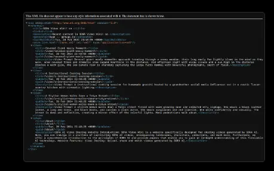
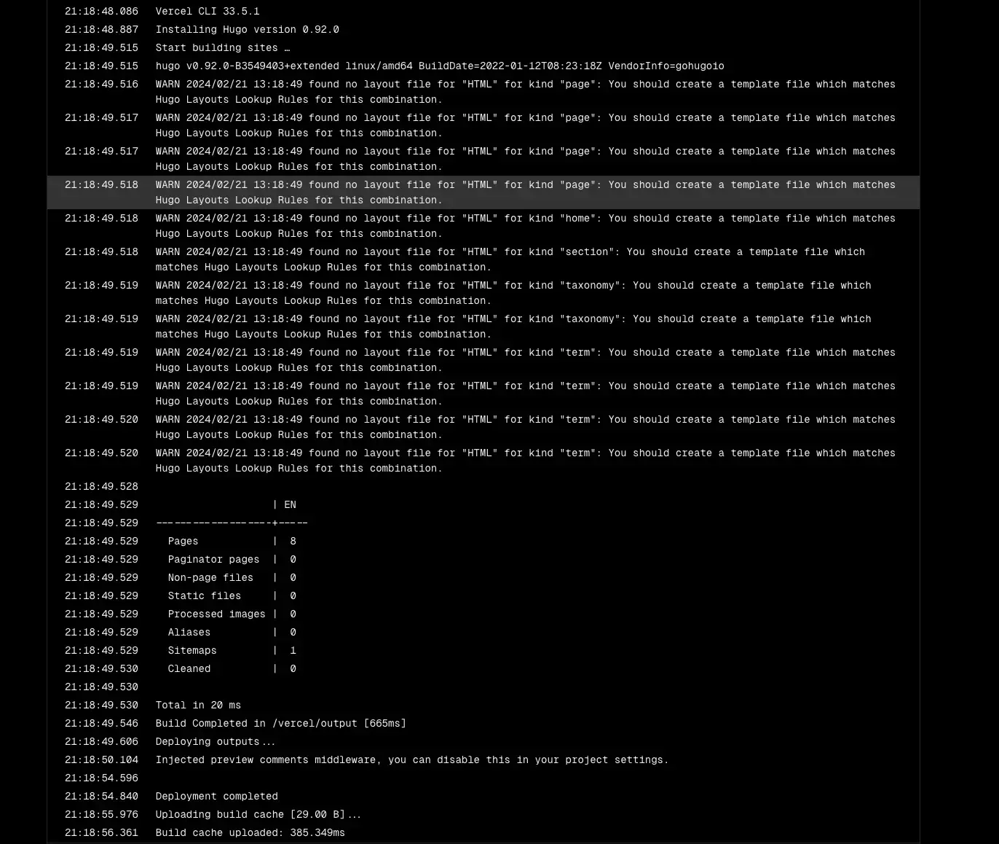
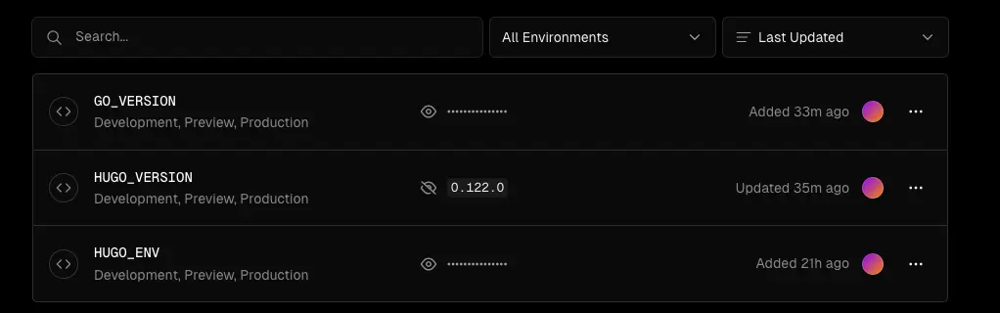
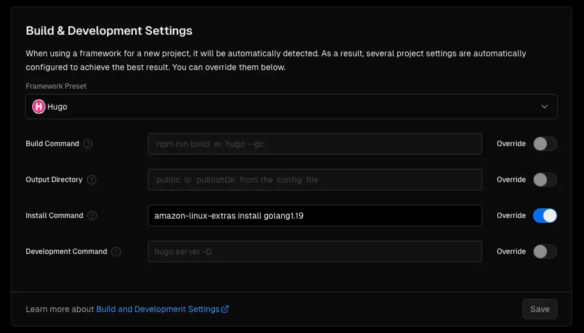
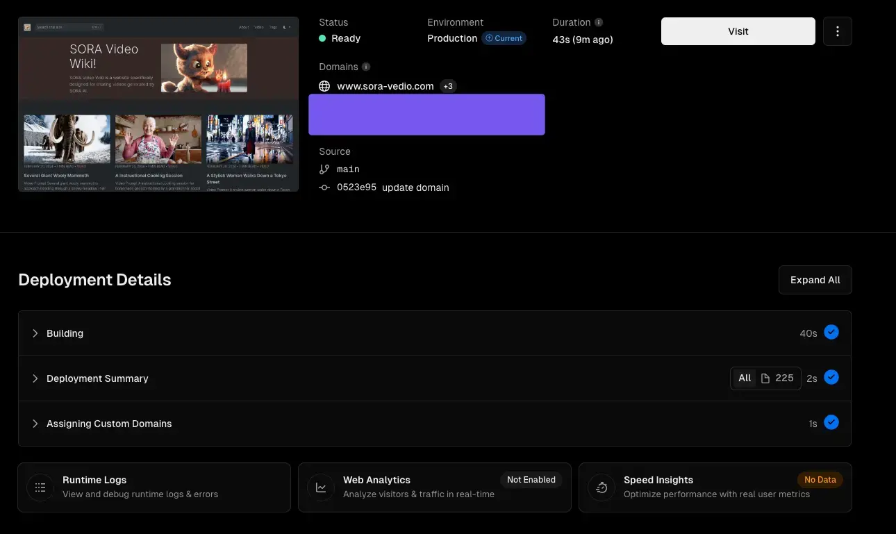

我最近在创建一个 sora video 收集网站，使用 hugo 来开发，同时部署到 Vercel 上。在部署时遇到一些问题，以下是一个简单的记录。

## Install Hugo

你可以查看 Hugo 官网来安装 hugo。在 mac 上，我使用 brew 安装。

```bash
brew install hugo
```

## Build in Local

我使用的是 https://gethinode.com/ ，A clean documentation and blog theme for your Hugo site based on Bootstrap 5.

1. **Create a new site**
    
    ```bash
    hugo new site my-hinode-site && cd my-hinode-site
    ```
    
2. **Initialize the module system**
    
    ```bash
    hugo mod init example.com/my-hinode-site
    echo "module.imports" >> hugo.toml
    echo "path = 'github.com/gethinode/hinode'" >> hugo.toml
    ```
    
3. **Start a development server**
    
    ```bash
    hugo server
    ```

## Deploy with Vercel

代码推到 github 后，使用 vercel 关联 repo 部署 site，部署成功后打开总是一个 xml 页面。



查看部署日志，提示 

```
found no layout file for "HTML" for kind "page": You should create a template file which matches Hugo Layouts Lookup Rules for this combination.
```



我使用官方模板可以正常部署成功也可以访问，开始我以为是模板的问题，找到模板的作者寻求帮助。
https://github.com/gethinode/hinode/discussions/789

但是作者也没有遇到过这个问题。

然后我把 Vercel 官方的模板在本地运行，希望能对比差异，发现运行报错。我突然意识到可能是 hugo 版本的问题。

经过搜索，发现在 Vercel 部署是可以设置 hugo 版本的。

https://discourse.gohugo.io/t/vercel-tips/34766



修改版本之后果然开始真正部署。如果提示
```
Error: failed to load modules: failed to download modules: binary with name "go" not found
```

可以在 Install Command 添加上以下命令来安装 golang。

```
amazon-linux-extras install golang1.19
```



到这里就部署成功了。




## 相关链接 ：

1. https://discourse.gohugo.io/t/vercel-tips/34766
2. https://github.com/vercel/vercel/discussions/5834
3. https://github.com/vercel/vercel/discussions/10889
4. https://vercel.com/docs/deployments/build-image#installing-go-in-the-build-image
