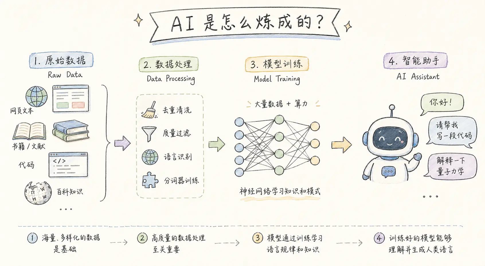
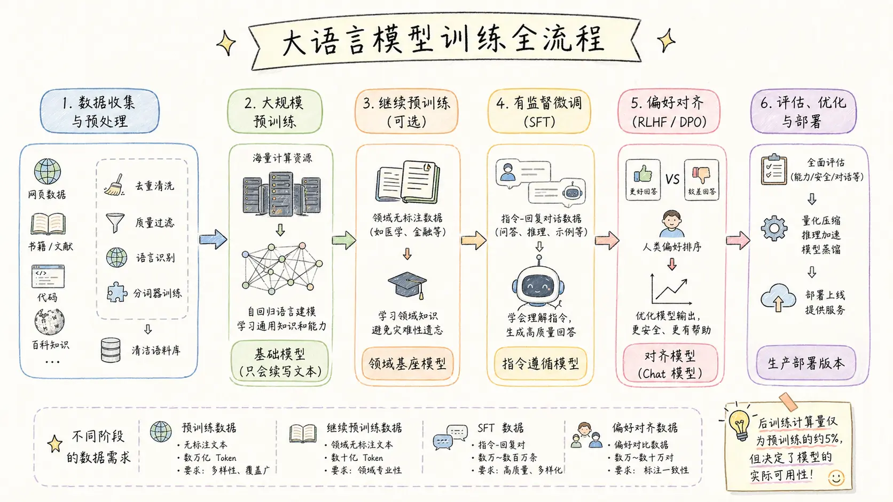
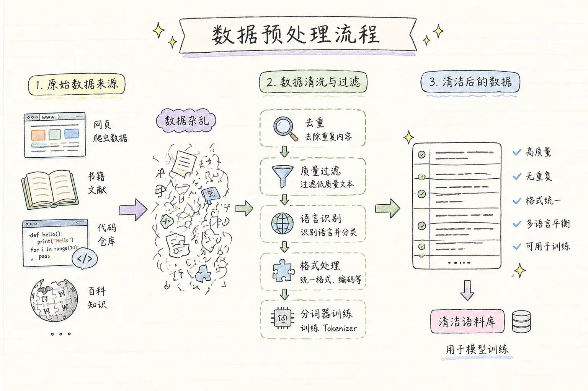
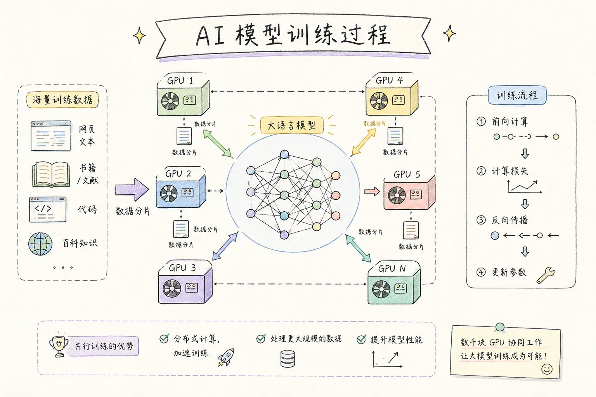
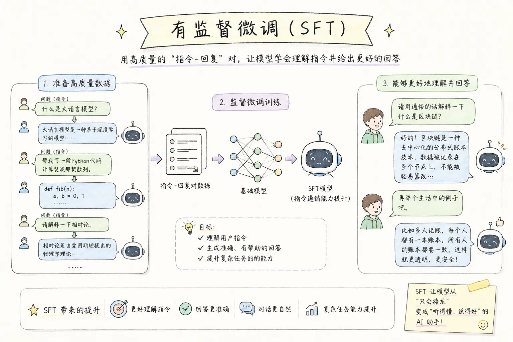
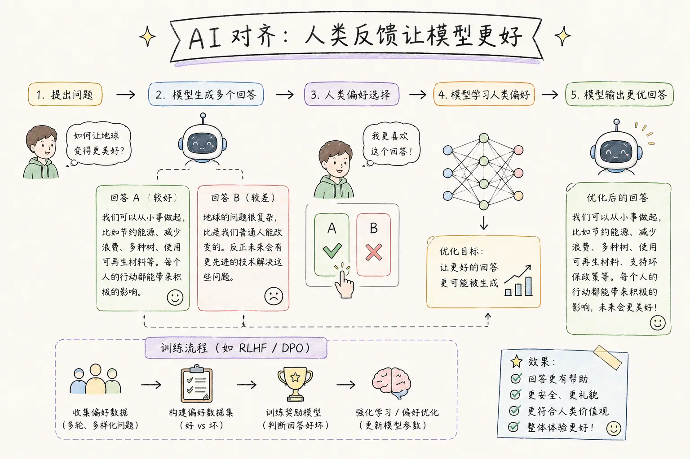
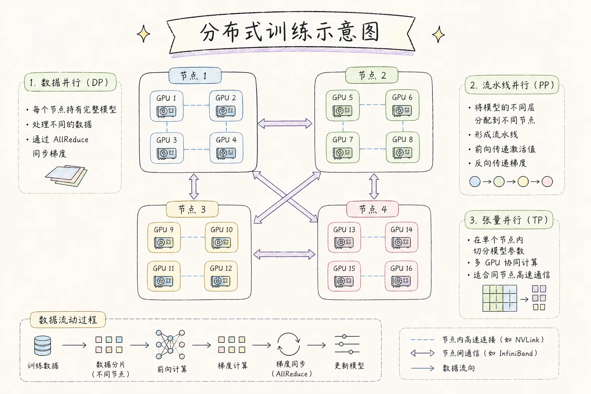

> 从原始数据到智能对话——ChatGPT、DeepSeek、Qwen 这类大模型是怎么"炼"出来的？

***

当你在手机上向 AI 助手提问，它能流畅地回答、写代码、做分析，这背后是一套复杂而精密的训练工程。本文将从工程视角，完整拆解大语言模型（LLM）的训练过程，包括每一步在做什么、需要哪些数据、依赖哪些技术基础设施。

***

## 一、先搞清楚两个大阶段

LLM 的训练通常分为两大阶段：

- **预训练（Pre-training）**：让模型"博览群书"，获得通用知识与语言能力
- **后训练（Post-training）**：让模型"上岗培训"，学会按指令回答、安全礼貌地与用户交流

后训练的计算量只有预训练的约 5%，但它决定了模型的实际可用性，也是近年来研究最活跃的方向。[1]

***



## 二、六大训练步骤详解

### 第一步：数据收集与预处理



一切从数据开始。训练一个现代大语言模型，需要数万亿（Trillions）个 Token 的文本语料。[2]

**数据来源包括：**

- **通用网页文本**：Common Crawl、C4 等互联网爬虫数据集
- **书籍与学术文献**：Books3、ArXiv、PubMed 等
- **代码**：GitHub 公开代码仓库、Stack Overflow 问答
- **百科全书**：多语言 Wikipedia

原始数据质量参差不齐，必须经过严格的清洗流程：

1. **去重**：使用 MinHash / SimHash 去除重复内容，防止模型过拟合
2. **质量过滤**：基于困惑度（Perplexity）、规则过滤低质量内容
3. **语言识别与分类**：按语言比例混合多语言数据
4. **Tokenizer 训练**：使用 BPE（字节对编码）或 SentencePiece 训练分词器

**这一步的产出：** TB 级别的清洁语料库 + 训练好的 Tokenizer。

***

### 第二步：大规模预训练



这是整个流程中计算量最大、成本最高的环节，通常需要数千块 GPU 运行数周甚至数月。

**核心原理：** 自回归语言建模（Autoregressive Language Modeling）——给模型看一段文本，让它预测下一个 Token 是什么。通过在海量文本上反复迭代，模型逐渐学会了语言规律、世界知识、逻辑推理。[3]

**关键技术组件：**

| 组件 | 作用 |
|------|------|
| Transformer 架构 | 多头注意力（Multi-head Attention）+ 前馈网络（FFN） |
| RoPE 位置编码 | 让模型理解 Token 之间的位置关系 |
| RMSNorm 归一化 | 稳定训练过程，替代传统 LayerNorm |
| Flash Attention 2/3 | IO 感知的高效注意力算法，2-4 倍提速 |
| GQA 分组查询注意力 | 减少 KV Cache 占用，提升推理效率 |
| 混合精度训练（BF16） | 节省显存，加速计算 |

**这一步的产出：** 基础模型（Base Model）。它掌握了丰富的知识，但**只会续写文本，不会听指令**。

***

### 第三步：继续预训练（可选）

如果需要打造垂直领域模型（如医疗 AI、金融 AI），可以在通用基础模型上，继续用领域无标注语料进行训练。

**核心挑战是"灾难性遗忘"**（Catastrophic Forgetting）——模型在学习领域知识的过程中，可能忘记之前掌握的通用能力。应对策略是：

- 使用极低的学习率
- 将少量通用数据混入领域数据（Replay 策略）

***

### 第四步：有监督微调（SFT）


这是**后训练的第一步**，也是让模型从"文字接龙"变成"问答助手"的关键。[4]

**做法：** 构建大量"指令 → 回复"对，以对话格式（System Prompt + User + Assistant）继续训练模型。

**数据来源：**

- 人工标注的高质量问答对
- Self-Instruct 自动生成的多样化指令
- Chain-of-Thought 推理示范（提升复杂推理能力）
- 开源数据集：Alpaca、ShareGPT、OpenAssistant 等

**参数高效微调方案（LoRA / QLoRA）** 允许在消费级 GPU 上完成微调，大幅降低了研究门槛。

**这一步的产出：** SFT 模型——能够理解并回答问题，具备初步的指令遵循能力。

***

### 第五步：偏好对齐（RLHF / DPO）



仅有 SFT 还不够——模型可能给出正确但措辞生硬、甚至有害的回复。这一步通过人类反馈，进一步让模型的输出**更有帮助、更安全、更符合人类价值观**。[5]

**经典方案 RLHF（基于人类反馈的强化学习）流程：**

1. 收集人工偏好数据：对同一问题的多个回答进行排名（Chosen vs Rejected）
2. 训练**奖励模型**（Reward Model）：学习什么样的回答是"好"的
3. 使用 **PPO 强化学习**优化策略模型，同时加入 KL 散度惩罚防止过度偏移

**现代替代方案——DPO（直接偏好优化）：** 跳过奖励模型，直接用偏好数据优化策略模型，更简洁稳定，已成为工业界主流。[6]

此外还有 GRPO、SimPO、Constitutional AI 等变体，持续演进。

**这一步的产出：** 对齐模型——安全性增强、拒绝有害请求、输出风格流畅自然。这就是我们每天使用的 Chat 版本模型。

***

### 第六步：评估、安全测试与部署优化

模型训练完成后，还需要全面验证才能上线。

**评测基准：**

- 通用能力：MMLU、HellaSwag、ARC
- 数学推理：GSM8K、MATH
- 代码能力：HumanEval、SWE-bench
- 对话质量：MT-Bench、AlpacaEval
- 安全性：红队测试（Red Teaming）

**部署优化技术：**

- **量化压缩**：GPTQ / AWQ / INT4，显著缩小模型体积
- **推理加速**：vLLM（PagedAttention）、TensorRT-LLM
- **投机采样**（Speculative Decoding）：小模型辅助大模型，提升生成速度
- **模型蒸馏**：将大模型能力迁移到小模型

***

## 三、训练数据全景

不同训练阶段对数据的需求完全不同：

| 阶段 | 数据类型 | 数量级 | 核心要求 |
|------|----------|--------|----------|
| 预训练 | 无标注文本 | 数万亿 Token | 多样性、覆盖广 |
| 继续预训练 | 领域无标注文本 | 数十亿 Token | 领域专业性 |
| SFT | 指令-回复对 | 数万~数百万条 | 高质量、多样化 |
| RLHF/DPO | 偏好对比数据 | 数万~数十万对 | 标注一致性 |

***

## 四、训练基础架构

训练一个前沿大模型，需要一套完整的工程体系支撑。

### 硬件加速器

- **NVIDIA H100**：当前主流训练 GPU，80GB HBM3 显存，支持 BF16/FP8
- **NVIDIA A100**：上一代旗舰，广泛用于中大规模训练
- **Google TPU v5**：Gemini 系列训练所用，专为矩阵运算优化
- **AMD MI300X**：192GB 超大显存，可装载更大模型

### 深度学习框架

- **PyTorch**：事实标准，动态图，原生支持 FSDP 分布式训练
- **DeepSpeed（微软）**：ZeRO 优化器、显存卸载，让单 GPU 训练大模型成为可能
- **Megatron-LM（NVIDIA）**：张量并行与流水线并行，专为超大规模设计
- **JAX / XLA（Google）**：函数式编程，JIT 编译，TPU 训练首选

### 通信与互联

- **NCCL**：NVIDIA 集合通信库，AllReduce 梯度同步核心
- **InfiniBand**：节点间 400Gbps RDMA 高速互联
- **NVLink / NVSwitch**：GPU 间直连，900GB/s 双向带宽，消除 PCIe 瓶颈

***

## 五、分布式训练：如何让数千块 GPU 协同工作



训练千亿参数模型，单卡装不下，需要将计算拆分到成千上万块 GPU 上。[7] 现代 LLM 训练通常采用三种并行策略的组合（**3D 并行**）：

**① 数据并行（DP）**：每块 GPU 持有完整模型，处理不同批次数据，通过 AllReduce 同步梯度。最容易实现，是最基础的并行方式。

**② 流水线并行（PP）**：将不同 Transformer 层分配到不同 GPU，形成流水线。前向传播逐级传递激活值，反向传播逐级传递梯度。

**③ 张量并行（TP）**：在单层内部切分权重矩阵（如注意力头），分布到多块 GPU。需要频繁通信，适合在同节点 NVLink 连接的 GPU 间使用。

***

## 六、一张图总结全流程

```
原始数据
   ↓  清洗、去重、Tokenizer 训练
海量语料（数万亿 Token）
   ↓  自监督预训练（数周 + 数千 GPU）
基础模型（Base Model）
   ↓  继续预训练（可选，领域场景）
领域基座模型
   ↓  SFT 有监督微调
指令遵循模型
   ↓  RLHF / DPO 偏好对齐
对齐模型（Chat Model）
   ↓  量化、蒸馏、推理加速
生产部署版本 ✅
```

***

## 结语

大语言模型的训练是数据工程、模型算法、分布式系统的高度融合。每一步都有大量工程细节和研究前沿。当前领域演进极快——后训练技术（尤其是强化学习对齐）正在成为拉开模型能力差距的关键战场。[6][8]

理解这一流程，不仅有助于更好地使用 AI 工具，也为进入这一领域打下坚实的认知基础。

***

*参考来源：MLOps Community、53AI、redteams.ai、arXiv 分布式训练研究等公开资料*
