# 从 Nuxt SSR 到 Worker + R2：一次解耦内容与代码的架构演进

最近，我为 [OnlinesTool](https://onlinestool.com) 完成了一次较大幅度的架构重构。这篇文章最初是迁移收敛时的设计方案，现在它已经全部上线运行，所以我把它更新成了一份**实战记录**：既保留当时每个阶段的思考与权衡，也补上落地后的真实实现细节、踩过的坑和实测数据。

这个网站最初只是一个纯粹的在线工具站，核心是一批交互型小工具。但为了 SEO 和生态，后来逐步加入了大量**网站目录（Sites）**详情页和 **Blog** 文章。随着内容规模持续膨胀，一个原本简单的技术选型，慢慢演变成了真正的架构问题。

整个演进过程大致走过了三个阶段：


有意思的是，第二个方案其实已经解决了第一个方案的大部分问题，但最终我并没有停在 SSG 这一步。因为当**运行时的问题解决以后，构建时的问题又冒了出来**。本文就完整记录这个过程：每一处的权衡、数据链路、最终的实现细节，以及上线之后真实发生的那些故障与修复——方案收敛只是下半场的开始。

---

## 一、阶段一：Nuxt SSR + Supabase 的困境

### 1.1 初始架构

OnlinesTool 部署在 Cloudflare 上。最初的架构是常见的全栈 SSR：页面由 Nuxt 在服务端渲染，Site 和 Blog 的结构化数据存放在 Supabase（PostgreSQL + PostgREST API）。

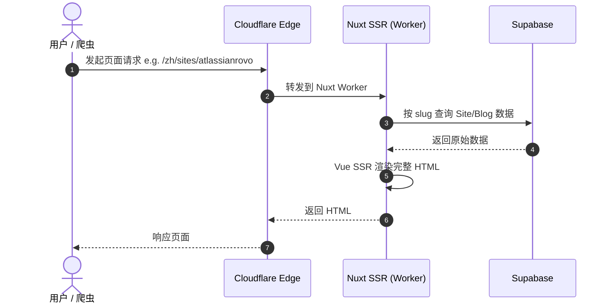

对**开发**来说，这套架构很舒服：数据库里新增一条记录，前端马上就能出页面，完全不用重新构建网站。Blog 也是一样的逻辑，从 CMS 的角度看这套架构没有明显问题。真正的麻烦出现在 Cloudflare Worker 的运行时上。

### 1.2 Error 1102：运行时资源超限

运行一段时间后，网站开始偶发返回 **503**，同时 Cloudflare 提示：

> **Error 1102 — Worker exceeded resource limits**（Worker 超出资源限制）

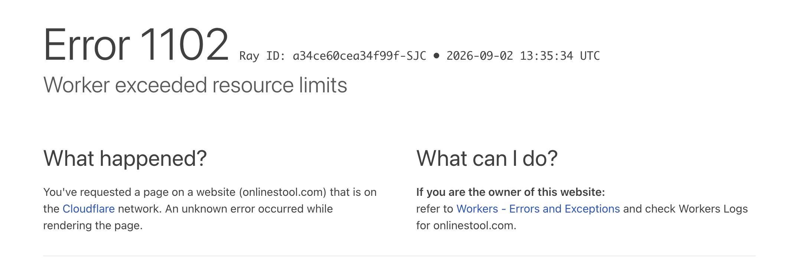

这个报错促使我重新审视了整条请求链路。

一个普通的 Site 页面，本质上只是由一些文本组成：标题、简介、分类、正文、FAQ、相关网站。这些内容**一天甚至好几天都不会变**，但每一次访问，它都要重新走一遍完整链路：

```text
Worker → Supabase → Nuxt SSR → HTML
```

假设某个页面一天有 1000 次访问，而内容一整天都没变——理论上这 1000 次请求返回的 HTML 几乎完全一样，服务器却实打实地重新计算了 1000 次。

更麻烦的是**搜索引擎爬虫**。Googlebot 和 Bingbot 会批量抓取页面，当站点有了几千个 Site 页面后，爬虫可能连续访问 `/sites/a → /sites/b → /sites/c → ...`，一次性把 Worker 的 CPU 上限打满。到了这个阶段，SSR 就不再是"开发方便"的加分项，而是实打实的**运行成本**。

**小结**：这一阶段的核心问题是——静态内容被当成动态内容处理，每次请求都在重复做相同的昂贵计算。

---

## 二、阶段二：全站静态化（SSG），换来 20 分钟的构建

### 2.1 方案：把计算挪到 Build Time

既然这些内容很少变化，就不该在每次访问时现场生成。最自然的解法是**全站静态化**：Site 和 Blog 不再在运行时查 Supabase，而是在构建期提前生成完整的 HTML，推到 Cloudflare CDN。

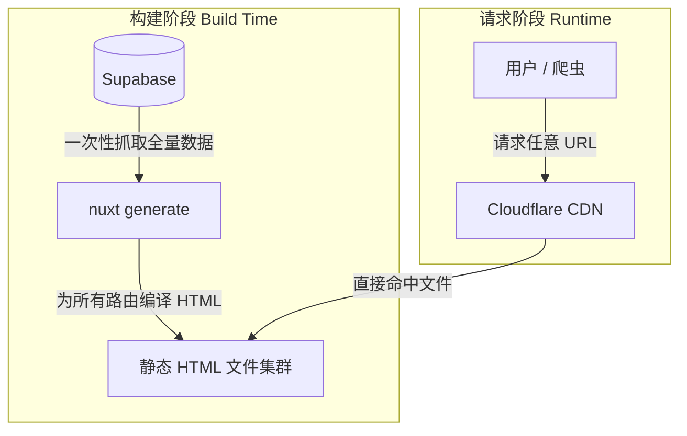

请求链路上原来的 `Supabase / Worker SSR / Database Query` 全部消失了，只剩：

```text
Cloudflare CDN → Static HTML
```

### 2.2 带来的明显收益

1. **稳定性大幅提升**：以前是 `Worker → Supabase → SSR` 的长链路，任一环节抖动页面都可能失败；现在只剩 `CDN → HTML`，几乎不可能因为数据库或渲染出错。
2. **速度极快**：HTML 已经是现成文件，无需现场拼接。
3. **对搜索引擎更友好**：Googlebot 拿到的**第一份响应**就包含完整的 title、description、H1、正文、FAQ、内部链接，不需要执行 JavaScript，也不依赖数据库。
4. **Error 1102 从架构层面消失**：运行时计算基本归零，Worker 资源超限问题随之消失。

### 2.3 新问题浮现：Build 越来越慢

静态化解决了运行时的痛点，但代价很快显现——**全站构建时间失控**。

OnlinesTool 并不只有 Blog，还包含 Tools、Sites、Blogs、Categories、Tags，以及**多语言页面**。按规模粗算：

```text
3000 个 Sites
× 8 种语言
+ Blog + 工具页 + 分类 + 标签
≈ 数万条 URL
```

每发布一篇新 Blog，都要执行一次 `nuxt generate`，然后重新遍历全站所有 Tools、所有 Sites、所有 Blogs、所有 Category、所有语言——**哪怕只是新增了一篇文章，也要全量重来**。最后一次完整构建已经逼近 **20 分钟**。

而且瓶颈不只是时间。一次迁移基线扫描中，Nuxt 产物已经达到约 **7512 条 prerender 路由、21220 个文件、757 MB 总体积**，其中最大单文件约 **45 MB**。内容继续增长时，不仅构建和上传越来越慢，也会逐渐碰到 Cloudflare Static Assets 的文件数量、单文件大小和总体积约束。因此 V3 的目标不是单纯把构建从 20 分钟优化到 10 分钟，而是让内容规模不再决定 Nuxt 产物规模。

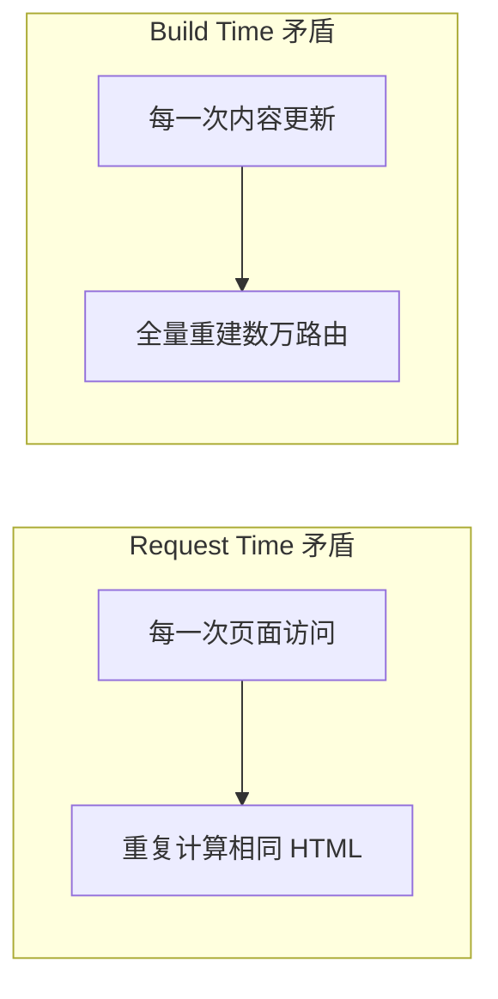

两个问题本质上非常像，只是发生的位置不同：**阶段一是"每一次访问都在重复计算"（Request Time）；静态化后变成"每一次内容更新都在重复计算"（Build Time）。**

**小结**：这一阶段的核心问题是——把发布一篇 Blog 和全站工具代码的重编译绑定在了一起，产生了不必要的全量构建。

---

## 三、阶段三的关键思考：识别生命周期差异

### 3.1 一个 Blog 为什么要重生成 5000 个 Site？

假设我今天发布一篇文章 `/blog/cloudflare-r2-guide`，它实际只会影响：这篇 Blog 自身、Blog 列表页、Blog 的 Sitemap，以及可能几篇相关文章。但当前静态站流程却是：


真正的问题不是 Nuxt 慢，而是：**代码发布和内容发布被绑在了一起**。这两者有着完全不同的变更频率和生命周期，却被塞进了同一条构建流。

### 3.2 把系统拆成两类

深入拆解后发现，OnlinesTool 其实装着两种性质完全不同的东西。

**第一种是产品 / 应用层**（在线工具），例如 Image Resizer、JSON Formatter、DPI Calculator。它们依赖 Vue 组件、状态管理、Canvas、File API、Web Worker、WASM——这是 Nuxt/Vue 最擅长、也最需要的那类东西。

**第二种是内容消费层**，例如 Blog、Sites、Category、Tags。这些页面本质上只是 `Metadata + HTML Content`，没有任何理由必须依赖 Nuxt 的组件渲染体系。

基于这个划分，新的架构把产品逻辑与内容渲染拆成两个**平级**的系统：

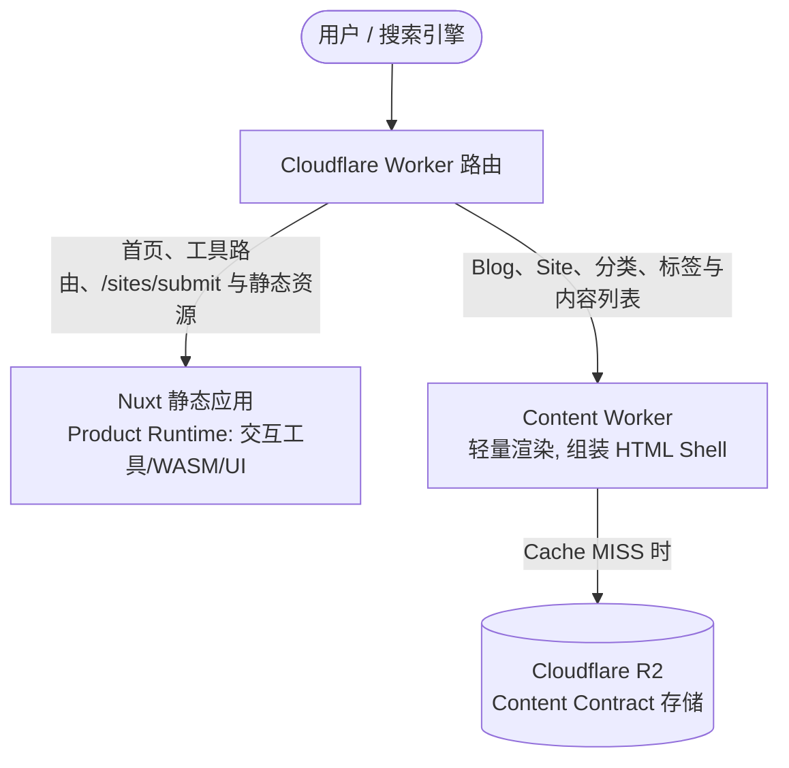

---

## 四、拆分后：Nuxt 只负责工具

新的 Nuxt 职责变得非常简单，只承载：Tools 页面、首页、产品详情、`/sites/submit`、Vue 组件、客户端交互、CSS/JS 打包。Blog、Site、Category、Subcategory、Tag、fallback HTML 以及它们对应的 Nuxt Content payload，都不再进入 Nuxt prerender 和 Static Assets。

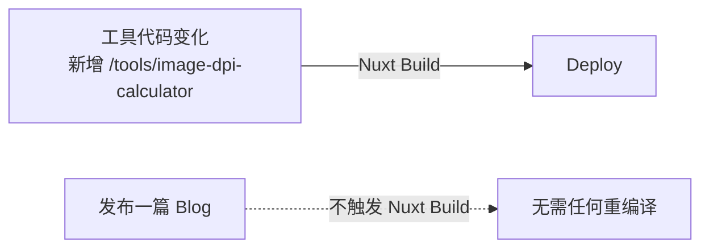

也就是说，只有**产品代码真的变了**（例如新增一个图片处理工具）才需要 `Nuxt Build → Deploy`，这是合理的。而**发布 Blog 不再触发 Nuxt**，两条链路彻底分开。

迁移完成后有一个很直接的验收条件：发布或删除内容前后，Nuxt prerender 路由数和 Static Assets 文件数必须保持不变；产品构建还要持续检查文件数量、单文件大小、总体积和套餐余量，防止内容换了存储位置后又被其他生成逻辑带回静态产物。

---

## 五、内容放进 R2：单个 PublishedDocument

### 5.1 为什么不再拆成 meta.json + content.html

早期设计把一篇文章拆成 `meta.json` 和 `content.html`，但这样每个详情页至少要读取 R2 两次，相关文章如果只保存 slug，还可能引入更多元数据读取。最终 V3 改为每个详情页只存一个 `PublishedDocument`：

```json
{
  "schemaVersion": 1,
  "type": "blog",
  "lang": "zh",
  "slug": "cloudflare-r2-guide",
  "meta": {
    "title": "Cloudflare R2 实践指南",
    "description": "...",
    "canonical": "https://onlinestool.com/zh/blog/cloudflare-r2-guide",
    "date": "2026-09-02",
    "tags": ["Cloudflare", "R2"]
  },
  "bodyHtml": "<p>...</p>",
  "relatedCards": [
    {
      "title": "相关文章",
      "url": "/zh/blog/related-post",
      "description": "..."
    }
  ]
}
```

`bodyHtml` 是经过清洗的正文 HTML；`relatedCards` 是发布时生成的展示快照，而不只是文章 ID。这样 Content Worker 正常情况下只需一次对象读取，不需要在请求时继续查找相关文章元数据。

列表页、分类页、标签页、搜索索引和 Sitemap 仍然是独立对象，但它们与详情文档属于同一个 Release，必须一起生成并原子上线。

### 5.2 一个关键原则：R2 不保存完整页面

R2 **故意不存储**带导航、页脚的整页 HTML，即不保存：Nav、Footer、Sidebar、广告位、Analytics 脚本、完整 HTML Shell。

原因很简单：如果保存完整 HTML，将来只要改一次导航（例如把 `Tools | Sites | Blog` 改成 `Tools | Sites | Blog | About`），就需要**重新生成所有文章**——5000 篇 Blog 就要重新生成 5000 个整页 HTML，等于又退回静态网站的老路。所以 R2 只存与内容版本绑定的数据，外壳与 Layout 交给渲染层动态拼装。修改导航、广告位或主题时只需要部署新的 Worker 和静态资源，不需要重写所有内容对象。

---

## 六、Content Worker：负责组装页面外壳

### 6.1 请求处理流程

于是在内容链路里多了一层——**Content Worker**。它本质上是一个非常轻量的 HTML Server。设计时我原计划用 Hono 组织路由，实际落地时发现内容路由的形态非常收敛（文档、列表、搜索、Sitemap、RSS、重定向、404），于是最终**一个依赖都没引入**：原生 `ExportedHandler` + 一个几百行的自研路由解析器，`run_worker_first` 只接管内容路径，其余请求直接透传给 Nuxt 静态资产。访问 `/zh/blog/cloudflare-r2-guide` 时，它只做少量确定性的工作：

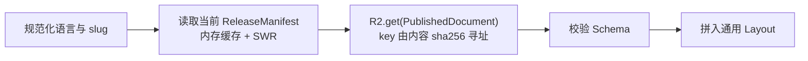

这里有两个设计期没有展开、落地后很关键的细节：

**第一，指针和 Manifest 有 isolate 级内存缓存。** Worker 每个请求都要先解析"当前 Release 是哪一个"，如果每次都去 R2 读 `meta/current-release.json` 再读一遍 Manifest，等于每次请求凭空多两次对象读取。实现里用一个带 TTL 和 SWR（stale-while-revalidate）语义的内存缓存包住指针和 Manifest：TTL 内直接用缓存，过期后先返回旧值、再用 `ctx.waitUntil` 在后台异步刷新。这样既不会拖慢请求，发布新 Release 后也能在一个 TTL 窗口内自动收敛。

**第二，每个响应都带精确的 Cache-Control 头**，这是后面 Edge Cache 能"零代码"接上的前提：

```text
详情页:   public, s-maxage=3600, stale-while-revalidate=86400
列表页:   public, s-maxage=300,  stale-while-revalidate=3600
搜索/XML: public, s-maxage=300
404 页:   public, max-age=60        ← 负缓存,新页面上线后最多 60 秒自动恢复
5xx 页:   no-store                  ← 错误页永远不进缓存
```

最终把各部分组合成一个完整页面返回：

```text
SEO Head + Nav + Article + Sidebar + Ads + Related Posts + Footer
```

### 6.2 为什么这仍然是 SEO 友好的

关键在于：**爬虫在第一次请求拿到的 Response 里就已经是完整正文**，而不是一个空壳再去跑一遍 JS：

```text
不是这样：
HTML Shell → JavaScript → fetch API → 正文

而是：
Content Worker → R2 读取 → 直接返回含正文的完整 HTML
```

所以内容虽然是从 R2 **动态读取**的，但 HTML 始终是**服务端完整生成**的，首屏和 SEO 都不打折扣。

### 6.3 路由、语言与错误语义也是契约

V3 不是简单地用 `/blog/*`、`/sites/*` 两条通配规则接管所有请求。路由表必须明确区分产品资产与内容页面，例如 `/sites/submit` 仍由 Nuxt Static Assets 提供；英语使用无语言前缀 URL，中文、日文、韩文、西班牙文、德文、法文和俄文使用语言前缀；历史 `/en/...` URL 统一重定向到无前缀英语地址。

多语言缺失时也不能含糊处理：

- Site 缺少目标语言时，可以返回英文内容，但状态仍为 200，同时设置 `noindex,follow`，canonical 指向英文 URL，并且不进入该语言 Sitemap。
- Blog 缺少目标语言时直接返回 404，不回退到英文。
- 文档不存在返回 404；R2 故障、Schema 不兼容或模板失败返回 5xx，不能把基础设施错误伪装成内容不存在。

这些规则会直接影响搜索引擎收录，因此与 `PublishedDocument` 一样属于 Content Contract，而不是渲染器里的临时判断。

---

## 七、它不等于回到旧 SSR：两种链路对比

单看"Worker 读数据渲染 HTML"似乎又回到了 SSR，但本质差别巨大。对比两条请求链路的每一步：

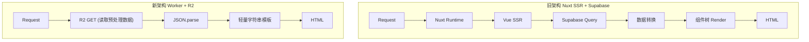

新链路里没有 Vue SSR、Nuxt SSR、Markdown 解析、数据库查询、复杂组件渲染，甚至连 **Markdown 都不在运行时解析**——正文早就预处理成了 HTML。渲染成本从"跑一个前端框架"降到了"读取一个已发布文档并拼字符串"。

---

## 八、核心原则：能发布时做，就不在请求时做

这次架构调整后我提炼出一个很喜欢的准则——**Publish Time 能完成的计算，绝不放到 Request Time**。

以 Markdown 为例：`Markdown → HTML` 的转换没必要每个请求执行一次，文章发布时就能完成。同理，代码高亮（Syntax Highlight）、目录 TOC、相关文章推荐，都应当在发布期算好。

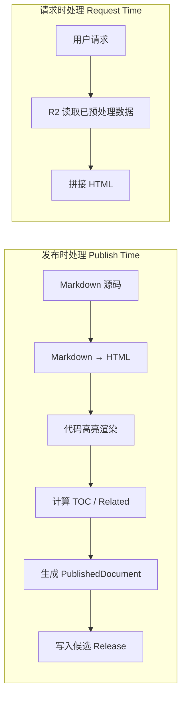

拿"相关文章"举例：如果有 5000 篇 Blog，**不要在每次请求时**扫描 5000 篇、计算相似度、排序、取 Top 5；而应在**发布时**算好，并把渲染所需的卡片快照直接写入 `PublishedDocument`：

```json
{
  "relatedCards": [
    {
      "title": "Post A",
      "url": "/zh/blog/post-a",
      "description": "..."
    }
  ]
}
```

这样相关文章从"运行时的高成本计算和二次查询"变成了文档中的现成数据。

---

## 九、再加一层 Edge Cache：R2 是 Content Origin，不是数据库

当然，如果每个请求都打 R2 也没有必要，最终还要补一层 **Cloudflare Cache**。完整请求路径如下：

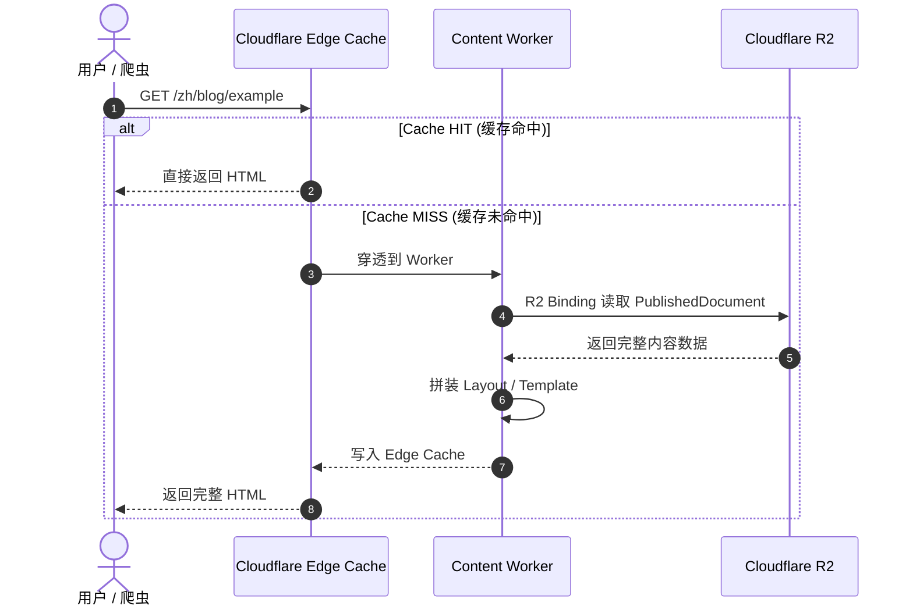

所以在绝大多数情况下，请求路径其实只有：

```text
Browser → Cloudflare Edge → HTML
```

Worker 真正读取 R2 的次数并不多。这也和原来的 Supabase 模式有本质区别：**数据库天然处在请求链路的中心，而 R2 更接近"内容源站（Content Origin）"，不是每个请求都必须访问的数据库。** 理想情况下只有 Cache MISS 才会触达 Worker → R2。

### 9.1 这层缓存后来真的配上了：三段配置实录

上线初期这条设计只停留在纸面——我实测内容页返回的 `cf-cache-status` 一直是 `DYNAMIC`（Cloudflare 默认不缓存 HTML，Worker 响应必须显式用 Cache Rule 打开）。后来用三条 Dashboard 配置把它真正落地，全程零代码：

**第一步：Cache Rule 圈定内容路径。** 一条规则，条件是 URI 路径 `starts with` 下面这些前缀（8 种语言 × blog/sites 是重点，漏了语言前缀就只缓存到了英文站）：

```text
/blog  /sites  /search/  /sitemap  /rss
/zh/blog /zh/sites /ja/blog /ja/sites /ko/blog /ko/sites
/es/blog /es/sites /de/blog /de/sites /fr/blog /fr/sites
/ru/blog /ru/sites /en/blog /en/sites
```

**第二步：边缘 TTL 选"使用缓存控制标头（如果存在），否则绕过缓存"。** 这个选项比"不存在则用默认 TTL"更稳：worker 的每个响应都自带精确的 `s-maxage`（详情页 1 小时、列表 5 分钟）或 `no-store`（错误页），所以没有标头的响应一律不缓存，永远不会有意外的"默认缓存 2 小时"。

**第三步：把浏览器缓存 TTL 从默认 4 小时改成"遵循现有标头"。** 这是个隐蔽的坑：zone 默认会给响应强加 `max-age=14400`，而**发布时的 Purge 只能清 Cloudflare 边缘缓存，清不了访客的浏览器缓存**——等于内容更新后，回访用户最长 4 小时看到旧版本。改成遵循现有标头后，浏览器侧不再被强加缓存时长（`s-maxage` 本来就被浏览器忽略），缓存职责完全收归边缘，由发布管线的 Purge 保证新鲜度。

配置完成后的实测：

```text
$ curl -sI https://onlinestool.com/zh/blog/xxx  (连续两次)
cf-cache-status: MISS      ← 第一次,穿透到 Worker
cf-cache-status: HIT       ← 第二次,边缘直接返回,Worker 零参与
```

配合 Worker 侧已有的 Cache-Control 头，这条链路闭环了：**边缘按 `s-maxage` 缓存，发布时 Purge 精确刷新，浏览器不强缓存**。

---

## 十、内容发布彻底脱离 Build，但不混淆两种事实来源

### 10.1 发布流程的前后对比

走到这一步，最重要的变化出现了——**内容发布不再需要构建，也基本不需要部署**。

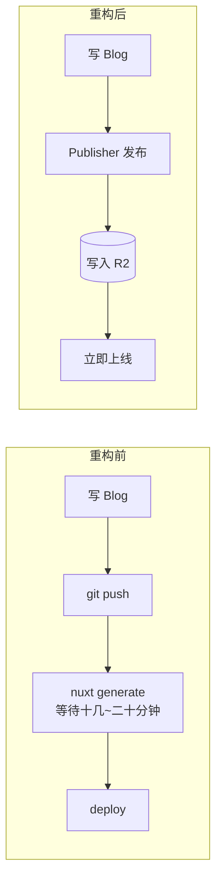

发布一篇 Blog 的完整动作收敛为：Markdown → 校验与清洗 → 生成 `PublishedDocument` → 重建受影响的列表、搜索和 Sitemap → 生成候选 Release → 原子切换当前 Release → 全局刷新缓存。整个过程里 **Nuxt 不 Build、Worker 不 Deploy**，代码一个字都没变，变的只是数据。

### 10.2 R2 是运行时事实来源，Git Markdown 是初期编辑源

这里需要区分两种 Source of Truth：

- **Runtime Source of Truth**：线上请求只认 R2 当前 Release，不依赖 GitHub、Supabase 或 Nuxt 构建产物。
- **Editorial Source of Truth**：V3 初期仍然是 Git 中的 Markdown，由 CLI Publisher 读取并发布。

因此，更准确的说法不是"不再需要 GitHub"，而是：**GitHub 不再参与线上请求和整站构建；内容仍然可以在 Git 中编辑和审阅，然后独立发布到 R2。**

未来可以接入 Codex、CMS 或后台编辑器直接调用 Publisher，但在迁移 Editorial Source of Truth 之前，不能同时让 Git 和 CMS 都成为权威来源，否则同一篇文章会产生覆盖冲突。

V3 初期的链路是：

```text
Research → Write Markdown → Review → CLI Publisher → R2 Release
```

这条链路仍然可以保留 commit / push 作为内容审计方式，但没有 `nuxt generate`，也不需要重新部署 Worker。

### 10.3 但不能让 Agent 随便裸写 R2

虽然技术上 Agent 可以直接 PUT 到 R2，但我不打算这么设计。因为内容发布还涉及：slug 校验、Schema 校验、HTML 清洗、索引更新、搜索索引、Sitemap、Related 计算、Cache Purge、版本管理和 Rollback。如果让每个 Agent 自己处理这些副作用，迟早会出现**数据不一致**。

更好的做法是做一个**统一的 Publisher**，作为**唯一写入口**。它可以是一个库（`publishBlog()` / `publishSite()`），也可以是一个 CLI：

```text
onlinestool-content publish blog article.json
```

这样 Codex 或任何 Agent 都不需要知道 R2 的目录结构，它只需要"生成内容 → 交给 Publisher"，由 Publisher 统一完成校验、构建 Release、原子切换和缓存刷新。公开的 Content Worker 只持有读取权限，不持有内容写入或缓存清理凭证。

### 10.4 发布必须是原子的

如果按顺序覆盖文章、列表、搜索索引和 Sitemap，请求可能在发布途中看到新旧数据混合。V3 不覆盖当前对象，而是先写入一组带版本号的不可变对象：

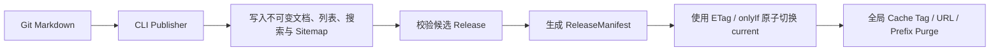

`publishId` 保证重试幂等；ETag 条件写阻止并发发布互相覆盖；回滚只需把 `current` 指回上一份通过校验的 `ReleaseManifest`。如果缓存刷新失败，发布记录进入 `purge_pending` 并自动重试，不能把"R2 已更新"误认为"全球边缘节点已经更新"。

### 10.5 落地实现：Publisher 是一个 Go CLI，跑在 GitHub Actions 里

设计稿里 Publisher 只是"统一写入口"的一个概念，落地时它长成了一个独立的 Go 模块（`onlinestool-content`）：一个 `content-cli` 二进制 + `make publish` + 一条 GitHub Actions 流水线。发布一个 Release 的完整过程是这样的：

**第一段：构建（Build），把内容变成内容寻址的对象。** Markdown 先经过规范化（normalizer）清洗，然后对**每个 artifact** 做一次 JCS（JSON Canonicalization Scheme）规范化再算 `sha256`——文档、列表页、搜索索引、Sitemap 一视同仁。关键的一步是这个：

```go
func objectKeyFor(sha256 string, mediaType v1.MediaType) string {
    hexPart := strings.TrimPrefix(strings.ToLower(sha256), "sha256:")
    ext := "json"
    if mediaType == v1.MediaTypeXML { ext = "xml" }
    return fmt.Sprintf("objects/sha256/%s/%s.%s", hexPart[:2], hexPart, ext)
}
```

也就是说 **R2 对象的物理 key 是内容寻址的**：`objects/sha256/ab/ab03f2….json`。内容不变，key 不变；内容变一个字，key 就变。设计期我在附录里猜测的 key 格式还带着 `releaseId` 和 `revision`（见附录 A.2），落地时推翻了这个想法——内容寻址带来一个非常好用的性质：**"对象是否已存在"可以直接用 HEAD 探测判断，且已存在的对象内容必然和这次要发的一模一样**。这个性质后来救了我两次（增量上传和 Purge 限流，见第十四章）。

**第二段：增量对比（Plan）。** 把新 Bundle 的每个 artifact 和当前 ReleaseManifest 里的记录比对（key、sha256、字节数、revision 全等才算复用），得出四个集合：uploads（要上传的新对象）、reused（复用）、changed（内容变更）、removed（已删除）。一次真实的增量发布日志长这样：

```text
==> Publishing bundle to R2: dist/bundle/content-bundle.json (production=true)
[publisher] bundle validated: 7471 artifacts, source git-markdown/main (dirty=false)
  Artifacts:  7471 total, 13 uploaded, 7458 reused, 0 removed
  Status:     success      ← 全程 90 秒左右,其中构建约 25 秒
```

发布一篇 Blog 的实际写入量就是"这篇文档 + 受影响的列表/搜索/Sitemap"十几个对象，而不是数万次全量重写。

**第三段：原子切换与自检。** 新对象全部写完后生成 `releases/<releaseId>.json`（ReleaseManifest，逻辑 ID → 对象 key 的映射），最后用 **ETag 条件写**把 `meta/current-release.json` 指针切过去——两个并发发布只有一个能成功，另一个被迫基于最新状态重算。切换完成后 Publisher 还会做一次**线上健康检查**（真实请求几个新 URL 确认 200），失败则把 Release 标记为 degraded，CI 直接红。发布记录写入 `meta/published-index.json`，`publishId` 重复提交直接幂等重放；`make rollback RELEASE=rel_xxx` 一条命令回滚。

整条链路跑在 GitHub Actions 的两个 job 里：`test`（Go 测试 + JSON Schema 校验）→ `publish`（构建 + 发布 + 自检），只有 `content/`、`config/` 等内容目录变化才触发。产品代码仓库和内容仓库从此互不知晓对方的存在。

---

## 十一、Content Contract：让框架变成可替换的

把写入收敛到 Publisher 之后，有一个东西变得至关重要——**Content Contract**（内容契约）。也就是内容的数据格式不能和某个具体框架绑死。以 JSON 为例：

```json
{
  "schemaVersion": 1,
  "type": "blog",
  "lang": "zh",
  "slug": "cloudflare-r2-guide",
  "meta": {
    "title": "Cloudflare R2 实践指南",
    "description": "..."
  },
  "bodyHtml": "<p>...</p>",
  "relatedCards": []
}
```

这个单一文档就是详情页的 Content。至于**由谁来渲染它，其实不重要**——设计稿里我打算用 Hono，落地时换成了零依赖的自研路由，将来再换成别的轻量 Renderer 也可以，只要 Content Contract 不变，数据源和发布链就不用跟着框架一起重写。

这或许是我认为这次架构调整**长期最有价值**的一点：Nuxt 不再"拥有"Content。

```text
Product Layer      → Nuxt（只负责工具/产品运行时）
Content Layer      → R2 + Content Contract（内容本体）
Presentation Layer → Worker Renderer（当前为零依赖实现，可替换）
```

框架因此从"网站的载体"降级为"产品层的实现细节"，内容成为一层独立资产。

---

## 十二、为什么最后还是保留 Nuxt，不换 Hugo / Astro？

既然内容已经这么"静态"，为什么不干脆换成 Hugo 或 Astro？

答案是**取决于内容/工具比例**。我也认真想过这个取舍：

- 如果 OnlinesTool 是 `10000 篇 Blog + 0 个工具`，Hugo 很可能是更好的选择。
- 如果从零开始、且首要追求静态页性能，Astro 也非常有吸引力。

但 OnlinesTool 的核心**不是 Blog，而是 Tools**，而且未来会继续增加图片处理、文件处理、Canvas、Web Worker、WASM、复杂表单、本地计算等重度交互功能。这些东西用 Vue/Nuxt 开发非常舒服，没有必要为了内容系统把整个产品层一起重写。

新架构恰好化解了这个矛盾——用最合适的工具做最合适的事：

```text
Nuxt   做它擅长的 Tool
Worker 做它擅长的 Content 渲染
R2     做它擅长的 Storage
```

这也是对"内容系统要不要换静态站生成器"问题的一个务实回答。

---

## 十三、最终架构全貌

部署形态最终只有一个公开的 Cloudflare Worker：同一个 Worker 同时绑定 Nuxt 的产品静态资产和 Content Runtime，再由显式路由表决定请求去向。这里的"双引擎"是职责分离，不是两个互相独立的公开站点。

把请求与发布两条链路拼在一起，最终形态如下：

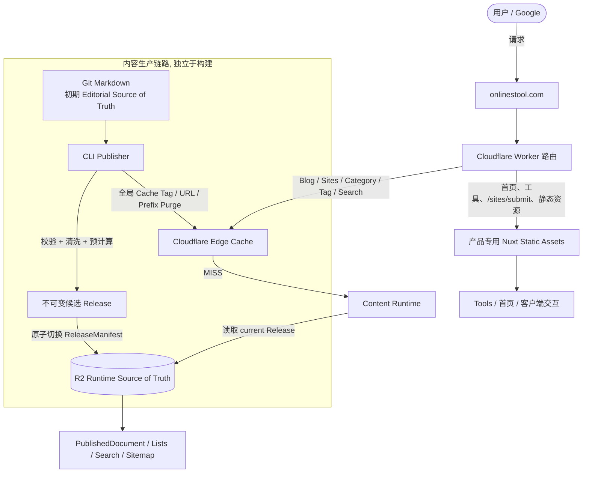

发布时，文档、Site/Blog 列表、Category、Subcategory、Tag、`search/sites.<lang>.json` 和 Sitemap 必须属于同一个 Release。新页面上线时还要清理可能存在的负缓存 404；删除或改 slug 时则要同时处理旧 URL、重定向和所有引用它的聚合对象。

最关键的分界线可以浓缩成四句话：

```text
Code ≠ Content
Build ≠ Publish
Content Publish ≠ Deploy
Layout ≠ Article
```

---

## 十四、上线实战：CI 发布链路上的四次翻车

设计方案再完整，上线后的第一周照样给我上了一课。发布流水线（GitHub Actions → R2）连续翻车四次，每次报错都不在你想的地方。记录下来，权当给后来者的排障手册。

### 14.1 第一次：`tls: handshake failure`，凶手是一个 1 字符的 secret

CI 第一次跑 `make publish` 就挂了，日志很有迷惑性：

```text
runner DNS failed for ***.r2.cloudflarestorage.com
pinning 172.64.66.1 in /etc/hosts      ← 我加的错误兜底
remote error: tls: handshake failure
StatusCode: 0, RequestID: , HostID:
```

我一开始以为是 GitHub runner 的 DNS 抽风，还写了个"DNS 解析失败就用 DoH 查出 IP 写进 /etc/hosts"的兜底脚本——**这是个反面教材**。真正的问题是：`*.r2.cloudflarestorage.com` 是一条**通配 DNS 记录**，我随手编了个 `totally-random-xyz.r2.cloudflarestorage.com` 去 DoH 查询，照样返回 Cloudflare 的 IP。这意味着：**账号 ID 填错了，域名照样"解析成功"**，错误的 SNI 在 Cloudflare 边缘没有对应主机，直接被拒成 `handshake failure`——根本走不到返回 403 那一步。pin IP 更是彻底的无效操作，pin 住的就是这条通配记录的答案。

最后是新加的凭据格式校验把真相揪了出来：

```text
Error: CLOUDFLARE_ACCOUNT_ID must be the 32-char hex Cloudflare account id (got 1 chars)
```

GitHub secret 里那个账号 ID，只有一个字符。**教训：永远不要让"DNS 能解析"看起来像"配置正确"；给 secret 加格式断言，错误信息里带上长度。**

### 14.2 第二次：错误码本身就是进度条

账号 ID 修正后，错误变成了这样：

```text
api error InvalidArgument: Credential access key has length 1, should be 32
```

这次是 `R2_ACCESS_KEY_ID` 也只有 1 个字符。但这其实是个**好消息**：请求已经真实到达了 R2 的 S3 API 并返回了带错误码的 HTTP 400——DNS、TLS、HTTP 三层全部打通，剩下的是纯粹的凭据问题。`Access Key ID` 固定 32 位、`Secret Access Key` 固定 64 位，去 R2 的 API Token 页面重新生成一对就好。排障时学会读错误码的"层级"很重要：`handshake failure` 说明请求没进门，`InvalidArgument` 说明已经进门被拦下，完全不是一个阶段的问题。

### 14.3 第三次：purge 401，以及一个隐藏的套餐门槛

发布成功后，缓存清理开始报 401（Cloudflare API code 10000，Authentication error）。这里有两个坑：

1. **Purge 缓存需要单独的 API Token 权限**：Zone → Cache Purge → Purge，区域圈定到自己的域名，和 R2 的 token 完全是两回事；
2. **本地 `.env` 里的旧 token 也未必有效**——我拿 `GET /user/tokens/verify` 一验，早就失效了。所有凭据都该用这个接口验一遍再用。

另外还有一个设计期没意识到的门槛：**按 Cache Tag 清理是 Enterprise 套餐功能**，普通套餐只能按 URL 清理（每次最多 30 个）。设计稿里轻描淡写的"Cache Tag / URL / Prefix Purge"，落到套餐上就是完全不同的可用性。

### 14.4 第四次：purge 429，全量清理在 7000 篇内容面前崩了

Token 修好后，新的报错是：

```text
cache purge batch 26 failed: purge returned status 429:
{"code":1134,"message":"Unable to purge, rate limit reached..."}
```

排查后发现是个规模问题：发布逻辑把**整个 bundle 的所有 cache tags 和 URL** 都塞进了清理列表——站点涨到 7471 个 artifact 后，每次发布就是 7500+ 个 tag、按 30 个/批切分出 250+ 个 API 请求，第 26 批就撞上了 Cloudflare 的 zone 级限流。

修复分两层。**语义层**：purge 列表从"全站"缩到"本次真正变更的 artifact"——这正好用上了 10.5 节的内容寻址：key 不变 ⇒ 内容字节级相同 ⇒ 不可能过期，所以"变更集 + 删除集"就是 Purge 集合的严格下界，全量清理本来就是在清不存在的东西。**工程层**：批间加 250ms 节流，遇到 429 读 `Retry-After` 做有界退避，而不是直接判死。修完后的发布 purge 请求从 250+ 个降到个位数。

### 14.5 附赠一个：health check 403，是 Cloudflare 拦了我的 CI

发布后的自检偶尔报 403，把 Release 标成 degraded。但我用浏览器和 curl 访问同一批 URL 都是 200。最后发现：**Cloudflare 的 Bot 防护按 IP 信誉拦截了 GitHub runner 的数据中心网段**，跟内容本身毫无关系。修复是让自检识别 `cf-mitigated: challenge/block` 响应头——这是 Cloudflare 官方的"这是安全拦截，不是应用故障"信号，带这个头的 403 不算发布失败；真正的 404/5xx 依然会让 CI 变红。

### 14.6 四次翻车修复汇总

| 症状 | 真相 | 修复 |
| :--- | :--- | :--- |
| `tls: handshake failure` | 账号 ID secret 只有 1 字符，通配 DNS 掩盖了错误 | 修 secret + 凭据格式断言 |
| `InvalidArgument: access key length 1` | Access Key ID 也只有 1 字符（但网络层已通） | 重新生成 R2 API Token 密钥对 |
| purge 401 | Token 缺 Cache Purge 权限 | 专用最小权限 token |
| purge 429 (code 1134) | 每次发布全量清理 7500+ 条目 | 缩到变更集 + 节流 + 退避 |
| health check 403 | Cloudflare 按 IP 信誉拦截 runner | 识别 `cf-mitigated` 头 |

这四次的共同点：**每一次都是配置或规模问题，架构本身一次都没有错。** 但如果没有格式校验、增量对比、退避重试这些"防御性"细节，每一次都会以最难受的方式暴露。

---

## 十五、这次升级给我的一点点启发

一开始，我只是想解决一个 Cloudflare 1102 错误；后来把 SSR 改成静态站，解决了运行时 CPU，却又带来了 20 分钟的构建；最后才意识到：**真正的问题既不是 SSR，也不是 SSG，而是让不同生命周期的东西绑在了一起。**

工具代码的改动是一种生命周期，Blog 内容的更新是另一种生命周期，页面 Layout 的变化又是第三种生命周期——把它们全部塞进同一次 `nuxt generate`，本身就是一种不必要的耦合。

所以我最终没有继续去优化"怎么让 nuxt generate 更快"，而是换了个问题：**为什么发布一篇 Blog，需要运行 nuxt generate？** 问题一变，架构也就变了。

有时候性能优化最有效的方式，不是让一段代码跑得更快，而是让它**根本不用运行**。

---

## 附录 A：性能收益实测——先给结论，再用数据说话

架构迁移完成后，还有一个需要用数据回答的问题：

> 从 `Worker → Supabase` 切到 `Worker → R2`，到底能省多少 CPU？能快多少？

**直觉**上 R2 应该更快，但细想会发现没那么简单。Cloudflare Worker 的 **CPU Time 只统计 JavaScript 真正执行的时间**，等待远程请求（如 `Worker → fetch Supabase → 等数据库返回`）的大量时间属于网络与 I/O 等待，不一定计入 Worker CPU。

所以，如果只是把数据源 `Supabase → R2` 而**其余逻辑完全不变**（仍走 `R2 → Nuxt SSR → Vue SSR → 数据转换 → HTML`），CPU 占用大概率**不会出现数量级下降**。

真正值得期待的，是**整个请求模型一起改变**。对比：

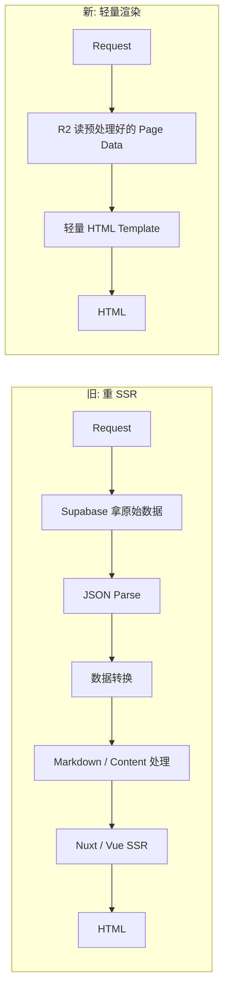

也就是说，这次优化真正移除的是：**Nuxt SSR、Vue SSR、Markdown 解析、代码高亮、Related 排序、复杂数据转换、数据库查询层**。所以更准确的说法是：**R2 本身不是 CPU 优化的全部原因，真正的优化来自「R2 + Publish Time 预计算 + 轻量 Renderer + Edge Cache」的组合。**

### A.1 对响应时间的影响可能更直接

单看响应延迟，R2 的链路优势明显：

```text
Supabase:  Worker → HTTPS → Supabase API → PostgREST → PostgreSQL → Response
R2:        Worker → R2 Binding → Object
```

所以我的预期是 **Wall Time / TTFB 会明显下降**；而 **CPU Time 下降多少需要实测**——尤其是如果旧架构主要的 CPU 消耗来自 Nuxt/Vue SSR，那么移除 SSR 的收益应该远大于单纯把 Supabase 换成 R2。

### A.2 最终方案：详情页默认只读一个对象

设计早期曾考虑在 `blog/foo/` 下分开放 `meta.json` 和 `content.html`，这样一个详情页至少需要两次读取：

```text
R2 GET meta.json  +  R2 GET content.html
```

最终 V3 没有采用这个格式，而是把详情页合并成单个不可变的 `PublishedDocument`。落地时连 key 格式也推翻了设计稿的猜测——最终采用的是**纯内容寻址**，key 里只有内容的 sha256，没有 releaseId、没有 slug、也没有 revision：

```text
objects/sha256/ab/ab03f25a….json        ← 前两位 hex 做一层目录
```

slug、语言、releaseId 这些信息全部收进 `ReleaseManifest` 的逻辑 ID 映射里。这样做的好处是**天然去重**：8 种语言里两篇内容完全相同的文档（哪怕逻辑 ID 不同）共享同一个物理对象；增量发布时"对象已存在"可以直接用 HEAD 判断，且存在即同内容。

每个 `PublishedDocument` 对象里直接保存 metadata、经过清洗的正文和相关文章卡片快照：

```json
{
  "schemaVersion": 1,
  "meta": {
    "title": "...",
    "description": "...",
    "canonical": "...",
    "tags": ["..."]
  },
  "bodyHtml": "<p>...</p>",
  "relatedCards": []
}
```

于是运行时只需要**一次读取**：

```text
R2 GET PublishedDocument → Schema Check → Template → HTML
```

列表、分类、搜索和 Sitemap 继续使用独立对象，但由 `ReleaseManifest` 固定到同一个版本。这既减少详情页读取次数，也避免发布过程中出现新文档搭配旧索引的混合状态。

### A.3 最理想的情况：连 R2 都不访问

因为最终 HTML 会进入 Cloudflare Edge Cache，第一次请求是 Cache MISS（Worker → R2 → Render → 缓存），后续请求都是 Cache HIT，直接返回 HTML。所以理想情况下只有 Cache Miss 才触达 `Worker → R2`，这也是下面"Cache HIT / MISS 分开测"的原因。这一层后来真的配上了（见 9.1），实测同一 URL 连续请求 `MISS → HIT`，命中的请求完全不触碰 Worker。

### A.4 观测指标对比表

架构上线后，我用 Cloudflare Worker 指标面板记录了部署前后各一段窗口（过去 24 小时视图，跨越新旧架构切换点）：

| 指标 | 旧架构 | 新架构（上线后 24h 实测） | 变化 |
| :--- | :--- | :--- | :--- |
| Worker CPU P50 | 高（SSR 渲染为主） | **1,427 ns** | 数量级下降 |
| Worker CPU P99 | 尖刺反复到 ~600 μs+ | **226,886 ns（≈227 μs）** | 尖刺消失 |
| Worker CPU P99.9 | 尖刺反复到 ~1.8 ms | **360,829 ns（≈361 μs）** | 尖刺消失 |
| Wall Time P50 | 待记录 | ~0.05 ms（Worker 侧） | — |
| Wall Time P99 | 待记录 | ~3.75 ms（Worker 侧） | — |
| TTFB | 待记录 | 待外部拨测补充 | — |
| Cache Hit Rate | 无（未配 Cache Rule） | 已开启，`MISS → HIT` 实测正常 | 从 0 到有 |
| R2 Read Latency | — | 仅 Cache MISS 时触达 | 大幅减少 |
| 5xx 数量 | 偶发 1102/503 | **0**（内部/脚本异常/内存全部为 0） | 归零 |
| Error 1102 | 24h 窗口内 2,758 次 | **0**（切换点之后完全归零） | 归零 |
| 单页面响应大小 | 待记录 | 待记录 | — |

这张表里最有说服力的是错误构成：那个 24 小时窗口里的 2,758 个错误**全部**是"已超出 CPU 时间限制"（也就是本文第一章的 Error 1102），而且全部集中在旧架构下线的时刻之前——切换点之后，请求数照常波动，错误曲线是纯平的一条零线。

### A.5 我目前的三个假设

在拿到真实数据前，先记录我的判断：

1. **假设一**：`Supabase → R2` 会明显降低 Wall Time、TTFB 和外部网络依赖，但单这一项对 CPU 的影响可能没有想象中大。 ✅ **验证**：CPU 的数量级下降确实不是 R2 单独带来的。
2. **假设二**：真正大幅减少 CPU 的是 `Nuxt SSR → 轻量 Renderer`，因为运行时不再执行 Vue SSR、Markdown 解析、复杂 Content Processing 和 Related 排序。 ✅ **验证**：残留的 Cache MISS 请求 CPU 只有微秒级，渲染成本只剩"读一个对象 + 拼字符串"。
3. **假设三**：最大的性能收益可能来自 `最终 HTML → Cloudflare Cache`——Cache HIT 时，数据库、R2、Renderer 理论上都应退出主请求链路。 ✅ **验证**：Cache Rule 配好后同一 URL 实测 `MISS → HIT`，HIT 请求零 Worker 参与。

### A.6 结论交给数据后，数据说话了

所以这次优化真正值得观察的，不是"R2 比 Supabase 快多少"，而是：

> **把"远程动态数据库 + 重 SSR"，换成"预计算内容 + Object Storage + 轻量 Renderer + Edge Cache"后，整条请求链路到底能轻多少？**

现在数据回来了，结论比预期更干净：CPU 超限错误从 24 小时 2,758 次归零，残留请求的 CPU 时间压缩到微秒级（P50 ≈ 1.4 μs），5xx 归零。回头看，A.5 的三个假设全部成立，且它们是**乘法关系**——预计算把单次请求的 CPU 压到微秒级，Edge Cache 把大部分请求直接挡在 Worker 外面，发布链路的增量与节流保证规模化后不再产生新的故障面。三者缺一，效果都会打折：没有预计算，MISS 时依然昂贵；没有 Cache Rule，微秒级也要乘以全站流量；没有增量和节流，发布端会先于请求端崩掉。

唯一还挂在待办上的，是外部拨测的 TTFB 数据和搜索接口的 JSON 二次序列化优化——后者目前没有出现在任何指标里，等它出现再说。
