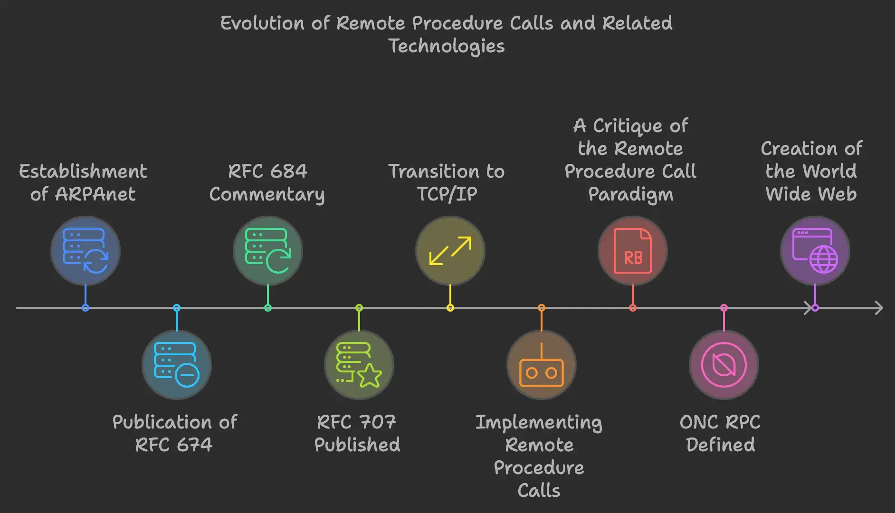

> The 40-Year Evolution of RPC: From Simple Procedure Calls to Modern Microservices

# The 40-Year Evolution of RPC: From Simple Procedure Calls to Modern Microservices

## Executive Summary

Remote Procedure Call (RPC) has been a fundamental paradigm in distributed computing for over four decades. This article traces its evolution from simple client-server communications to modern microservices architecture, examining key developments, challenges, and the ongoing debate between developer convenience and system correctness. Through this historical lens, we'll understand why RPC remains relevant in today's cloud-native world.

---
# The Evolution of RPC: From ARPAnet to Modern Microservices

> "Does developer convenience really trump correctness, scalability, performance, separation of concerns, extensibility, and accidental complexity?" - Vinoski (2008)

## Outline
- RPC Basic Introduction
- RPC Development History

## RPC Introduction

Remote Procedure Call (RPC) is a design paradigm that enables communication between two entities through a generic request/response mechanism over a communication channel. The definition of RPC has undergone significant changes and evolution over the past thirty years, making it a broad taxonomic term encompassing all RPC-style systems that have emerged over forty years. Through decades of development, RPC's definition has evolved from a simple client-server design to a set of interconnected services. While initial RPC implementations were designed as tools for offloading computation to servers in distributed systems, years of evolution have built a language-agnostic application ecosystem. The RPC paradigm has become part of the driving force behind creating truly revolutionary distributed systems, spawning various communication schemes and protocols between different systems.

The simplest RPC implementation is shown in Figure 1. In this case, the client (or caller) and server (or callee) are separated by a physical network. The system's main components are the client routine/program, client stub, server routine/program, server stub, and network routines. A stub is a small program that typically serves as a substitute (or interface) for a larger program. The client stub exposes the functionality provided by server routines to the client routine, while the server stub provides client-like programs to server routines. The client stub receives input parameters from the client program and returns results, while the server stub provides input parameters to the server program and retrieves results. The client program can only interact with the client stub, which provides the interface for the remote server.

This stub also serializes the input parameters sent from the client routine to the stub. Similarly, the server stub provides the client interface for the server routine and handles data serialization sent to the client.

When the client routine executes a remote procedure, it calls the client stub, which serializes the input parameters. This serialized data is sent to the server using OS network routines (TCP/IP). The server stub then deserializes the data and provides it to the server routine with the given parameters. The return values from the server routine are serialized again and sent back to the client through the network, where the client stub deserializes them and presents them to the client routine. This remote procedure is typically hidden from the client routine and appears as a local procedure to the client. RPC services also require a discovery service/host resolution mechanism to bootstrap communication between client and server.

**Complete RPC Framework**

In a typical RPC use case, it includes components such as service discovery, load balancing, fault tolerance, network transport, and serialization, where "RPC protocol" specifically defines how programs perform network transport and serialization.

## The Development History of RPC

### November 1969: Establishment of ARPAnet

In 1969, the Advanced Research Projects Agency (ARPA) of the U.S. Department of Defense began establishing a network named ARPAnet. Initially, it had only four nodes, connecting the large computers at four universities: UCLA, UC Santa Barbara, Stanford University, and the University of Utah. One reason for selecting these four nodes was to test network compatibility between different types of hosts.

### 1974: Jon Postel and Jim White Published RFC 674

Procedure calls can be traced back to the Procedure Call Protocol Documents Version 2 (RFC 674) published by Jon Postel and Jim White in 1974. This protocol attempted to define a general method for solving communication problems between multiple compute nodes in the NSW project.

After the protocol was published, it sparked significant controversy, and in 1975, RFC 684 was published as an annotation to RFC 674.

### 1975: RFC 684 Published as Commentary to RFC 674

RFC 684 is not an independent protocol; it mainly discusses the controversies of RFC 674. The discussion can be summarized in the following points:

- RFC 674 believed that procedure calls should be primitive operations, operating at the operating system's bottom layer
- A primitive is an instruction for calling core-layer subroutines in the operating system. The difference from general broad instructions is that it is non-interruptible and always appears as a basic unit.
- Local calls and remote calls are different; remote calls may fail and might not be recoverable after failure.
- Asynchronous message passing, or explicitly declaring when synchronous waiting for message return is needed, should be a better model.

From these points, concerns about this programming paradigm became an eternal topic in RPC's 40-year history, namely:

- How to recover from failures or errors? Retry, throw exceptions?
- Sequential operations are very difficult. For instance, in a series of synchronous requests, how to ensure failed requests are re-executed and requests remain in order?
- RPC requests are synchronous models; methods wait for responses after being called, but because requests are synchronous, it becomes very difficult to prioritize high-priority requests when system load is high.
- Synchronization is more oriented towards one-to-one calls and returns, rather than asynchronous characteristics of single requests and multiple returns. Moreover, low-priority, preemptible background tasks are unlikely to be implemented in procedure calls.

> At this time, the protocol was still based on ARPANET, before the Internet existed, yet they were already discussing issues of inter-distributed system calls.

### 1976: RFC 707 Published

> Due to the cost differences between remote and local calls, application programmers must use remote resources cautiously, even though the RTE will greatly simplify the mechanism for using remote resources. Like virtual memory, the procedure call model provides great convenience and powerful capabilities, while at the same time there should be reasonable vigilance against potential abuse.

RFC 707 summarized the ideas of RFC 684 and discussed resource sharing issues with services such as TELNET and FTP, where each service provided different interfaces for interaction, requiring operators to know specific protocols for interacting with that service. In response to this issue, the authors proposed a new idea: rather than needing to know all available commands and protocols on remote computers, could we define a universal interface that accepts parameters and follows a call/response model to execute a remote procedure?

### January 1, 1983: ARPA Network Changed its Core Protocol from Network Control Program to TCP/IP

On January 1, 1983, the ARPA network changed its core protocol from Network Control Program to TCP/IP protocol, and the seeds of the Internet began to sprout.

### 1984: Paper "Implementing Remote Procedure Calls" Published

RPC is the abbreviated form of Remote Procedure Call. Birrell and Nelson's paper "Implementing Remote Procedure Calls" published in ACM Transactions on Computer Systems in 1984 gave RPC its classic interpretation. RPC refers to a process on computer A calling a process on another computer B, where the calling process on A is suspended while the called process on B begins execution, and when the value returns to A, A's process continues execution. The caller can transmit information to the callee using parameters, and can later receive information through returned results. This process is transparent to developers. In the following years, RPC was considered the most suitable paradigm for building distributed operating systems.

> RPC (Remote Procedure Call) is a communication mechanism between multiple processes built on top of Socket. Unlike complex Socket communication methods, RPC's original intention was to design a universal framework for remote communication. This framework could automatically handle complex details such as communication protocols, object serialization, and network transmission. Furthermore, it hoped that after developers used this framework, the code for calling an interface on a remote machine would "look no different" from local method calls, thus greatly reducing the development difficulty of distributed systems and enabling programmers unfamiliar with network programming to develop distributed systems relatively easily.

This is the RPC architecture diagram from the paper, showing that user, user-stub, and one instance of RPCRuntime execute on the caller's machine; server, server-stub, and another instance of RPCRuntime execute on the callee's machine. When the user initiates a remote call, it actually executes a completely normal local call, which will call the corresponding program in the user-stub. The user-stub is responsible for placing the specification and parameters of the target program in one or more packages (packing) and requesting the RPCRuntime to reliably transmit these packages to the callee's machine. Once these packages are received, the RPCRuntime on the callee's machine delivers them to the server-stub. The server-stub unpacks them and calls the corresponding program in the server as if executing a completely normal local call.

Meanwhile, the calling process on the caller's machine will be suspended and wait for the return of result packages. When the call in the server completes, it returns the results to the user-stub for packaging, then the result packages will be transmitted back by RPCRuntime to the suspended process on the caller's machine (RPCRuntime is responsible for retransmission, acknowledgment, packet routing, and encryption). These packages will be unpacked by the user-stub and returned to the user. Apart from the impact of inter-machine binding or communication failures, the call appears as if the user directly called the program on the server. Indeed, if the user and server code are placed on the same machine and directly bound together (without stubs), the program would still work.

### 1987: "A Critique of the Remote Procedure Call Paradigm" Published

In 1987, Tanenbaum and Renesse published the article "A Critique of the Remote Procedure Call Paradigm," discussing RPC model's conceptual issues, implementation technical issues, handling of client and server crashes, cross-system issues, performance, and other aspects, and analyzed existing problems.

> A universal paradigm should not require programmers to limit themselves to a subset of the chosen programming language, or force them to adopt a certain programming style (for example, don't use pointers across the board because RPC can't handle them)

In this critique, the authors gave an example:

> Suppose two programmers are working on a project. Programmer 1 is writing the main program. Programmer 2 writes a set of procedures called by the main program. RPC was never mentioned, and both programmers assumed all their code would be compiled and linked into a single executable binary program, running on standalone computers, not connected to any network.

> At the last minute, after all the code had been thoroughly tested, debugged, and documented, both programmers resigned and left the country, and the code was deployed to run on a distributed system full of surprises. The main program and procedure code run on different computers.

> Our argument is that because RPC tries to make remote procedure calls look exactly like local procedure calls but cannot do so perfectly, many errors may occur during the call. While many problems can be solved by modifying the code, this loses transparency. Once we acknowledge that true transparency is impossible and programmers must know which calls are remote and which are local, we face the question: are partially transparent mechanisms really better than mechanisms specifically designed for remote access without attempting to make remote computing look local?

At the same time, several other issues were discussed:

#### Two Generals' Problem
> Networks are unreliable, and it's impossible to guarantee that data can be transmitted through the network 100% correctly.

#### Parameter Issues
> Parameter marshaling, parameter ordering, parameter passing, etc. Especially the passing of pointer-type parameters.
> Modern RPC typically uses ----------------------

#### Global Variables
> Since RPC can be used like local calls, are global variables universal?

#### Performance Issues

#### Exception Handling
> Usually when the main program calls a procedure, if the code is correct, that procedure will eventually return to the caller. If the machine crashes, both the main program and the procedure die, and the entire program must be rerun. Thus, basically there are two modes of operation: the entire program works or the entire program fails.

> RPC introduces another failure mode: the client works fine, but the server crashes. What should be done if a main program calls a procedure but there's no response? In some systems, the client would hang forever.

> Another possibility is to have the client stub start a timer when sending messages to the server. If there's no response after a certain interval, it tries again and again. After n retries, if it still fails, then it returns an error code indicating the service is unavailable.

#### Idempotency Issues

### 1988: RFC 1057 Published, ONC RPC Defined as Standard RPC Specification

> Sun Microsystems was the first company to provide commercial RPC libraries and RPC compilers. In the mid-1980 s, Sun provided RPC and received support in Sun Network File System (NFS). The protocol was promoted as a standard primarily by Open Network Computing, led by Sun and AT&T. This was a very lightweight RPC system that could be used in most POSIX and POSIX-like operating systems, including Linux, SunOS, OS X, and various BSD release versions. Such systems were known as Sun RPC or ONC RPC. Eventually Sun succeeded, and Sun RPC became the first RPC standard.

> ONC RPC provided a compiler that required a remote procedure interface definition to generate client and server stub functions. This compiler was called rpcgen. Before running this compiler, programmers had to provide interface definitions. Interface definitions containing function declarations were grouped by version numbers and identified by a unique program code. This program code enabled clients to identify the required interface. Version numbers were very useful, as clients could still connect to a new server even if they hadn't updated to the latest code, as long as the server still supported the old interface.

#### RPC Call Flow

1. Service consumer (client) calls the service using local call method.
2. Client stub receives the call and is responsible for assembling the method, parameters, etc. into a message body that can be transmitted over the network.
3. Client stub finds the service address and sends the message to the server.
4. Server stub receives the message and decodes it.
5. Server stub calls the local service based on the decoded results.
6. Local service executes and returns results to the server stub.
7. Server stub packages the return results into a message and sends it to the consumer.
8. Client stub receives the message and decodes it.
9. Service consumer gets the final results.

#### Service Discovery

ONC RPC implements service discovery through a portmapper on the server side. The server registers with the portmapper at startup, and since the portmapper's port is known to everyone, clients can find the server through the portmapper.

As the earliest RPC framework, ONC RPC still had many issues:

1. **Strict Protocol Format Requirements**: The compression format between client and server must be **completely consistent**.
2. **Inflexible Protocol Modifications**: Both client and server need to make modifications; if only one side makes modifications, RPC will have errors. This leads to version update issues, where each version update basically couples the client and server, requiring simultaneous changes. If the server is not running, the client cannot connect to the remote procedure for calls. Administrators must ensure the server is started before any client attempts to connect to the server. If a new service or interface is added to the system, clients cannot discover it. This requires that those developing the client and server need to be the same group of people, or at least have close communication.
3. **Function-Oriented**: Object-oriented languages began to rise in the late 1980 s, but the function-oriented ONC RPC didn't provide any support for features like remote object instantiation from remote classes, tracking object instances, or providing support for polymorphism.
### 1989: Tim Berners-Lee Created the World Wide Web

In 1989, Tim Berners-Lee invented the World Wide Web. In September of the following year, he developed the first web browser. By Christmas 1990, Tim Berners-Lee had created all the tools needed to run the World Wide Web: Hypertext Transfer Protocol (HTTP), Hypertext Markup Language (HTML), the first web browser, the first web server, and the first website, achieving the first communication between HTTP client and server. He was awarded the 2016 Turing Award for this achievement.

By 1995, the Internet had been fully commercialized in the United States.

### 1991: OMG Released CORBA 1.0

> OMG was established in 1989 as a non-profit organization, focusing on developing technically advanced, commercially viable, and vendor-independent software interconnection specifications, promoting object-oriented model technology, and enhancing software portability, reusability, and interoperability. At its founding, members included industry-renowned hardware and software vendors such as Unisys, Sun, Cannon, Hewlett-Packard, and Philips. Currently, the organization has over 800 members.

CORBA (Common Object Request Broker Architecture) is an abstraction for object-oriented languages, developed in C++, allowing communication between different address spaces running on different machines in different languages. CORBA relies on using Interface Definition Language (IDL) to specify interfaces for remote object classes; this IDL is used to generate interfaces for remote system objects on local machines. These IDLs would be used to generate mappings between the abstract interfaces provided by IDL and actual implementations in languages like C++ and Java.

CORBA attempted to provide several benefits for application developers: **language independence, operating system independence, architecture independence, static types mapping from abstract types in IDL to machine and language-specific implementations of these types, and object transport, where objects could migrate across connections between different machines**. CORBA's promise was that through the use of mappings, remote calls could appear as local calls, distributed system-related exceptions could be mapped to local exceptions, and handled by local exception handling mechanisms.

### 1994: "A Note on Distributed Computing" Published

Jim Waldo and others published a paper titled "A Note on Distributed Computing." This paper discussed in detail why extending the RPC model to objects was problematic.

In this paper, the authors argued that ignoring the differences between local and distributed computing was dangerous, and it also discussed a unified object view, listing four major issues in dividing these objects for distributed computing in RPC: communication latency, resolving space separation, partial failures, and concurrency issues (caused by accessing the same remote object through two concurrent client requests). Most of these problems (except partial failures) have an inherent connection with distributed computing itself, but for RPC systems, partial failures mean that RPC systems are not always available.

The authors also believed that the challenge of distributed computing is not about how to operate online or offline, **and every 10 years, we try to unify local computing and remote computing, and each time we encounter the same problems: remote computing and local computing are different**.

The authors believed that the main issues with remote computing include:

#### Latency

The most obvious difference between local calls and remote calls should be the latency issue: if latency is ignored, it will directly affect software performance. He pointed out that "relying on steady growth in underlying hardware speed" is wrong, and using "real bullets" is not always possible for testing. Performance analysis and relocation are very important, and designs that are optimal at one point may not remain optimal.

#### Partial Failure

In local computers, failures can be detected, and the main program has sufficient control. However, this is not the case for distributed computing: remote components may fail, and if partial failure occurs, it cannot be distinguished from connection failure or remote processor failure.

Waldo believed that if we want to achieve a unified object model, there are only two paths:

1. View all objects as local objects
2. View all objects as remote objects

> **But the most important question is not "Can you make remote method calls look like local method calls?" but rather "What is the cost of making remote method calls identical to local method calls?"**

This is an issue that cannot be ignored.

---

> Up to this point, we've seen that discussions about RPC have mostly been about design, implementation, object-orientation, performance, and how to solve distributed problems. One thing seems to have been ignored, which is usability. Why? Is it because programmers at that time liked complex technology?
> My former boss once shared during a presentation that he believed not all developers are qualified programmers. Qualified programmers should be like Linus, Dennis, and Tim, who try to change the world and work hard for it. In the early days of the Internet, there were fewer developers, and programmers were a relatively niche elite group, with this type of programmer occupying a larger proportion. When protocols were being established, more consideration was given to how to maximize computer performance, and usability might not have been in the first priority range.
> However, by the late 90 s, the Internet had begun to popularize, and with the rise of web development, developers grew exponentially. At this time, development frameworks needed to consider not just the user experience of a small group but the user experience of the majority.

### 1996: HTTP/1. x Version Released

In 1996, HTTP/1.0 was released, greatly enriching HTTP's transmission content. Besides text, it could also send images, videos, etc., laying the foundation for Internet development.

Compared to HTTP/0.9, HTTP/1.0 had the following main features:

- Requests and responses support HTTP headers, added status codes, and response objects begin with a response status line
- Protocol version information needs to be sent along with requests, supports HEAD, POST methods
- Supports transmission of content types other than HTML files

A few months after HTTP/1.0 was released, HTTP/1.1 was published. HTTP/1.1 was more of a refinement of HTTP/1.0

### 1997: OMG Released CORBA 2.0

In December 1994, CORBA 2.0 specification was already published. The specification hoped to solve the serious problem of "incompatibility between products developed by different vendors according to the CORBA specification," but it wasn't until 1997 that CORBA 2.0 was officially released, and ultimately it failed. As for the reasons for CORBA's failure, Michi Henning, a technical expert from the CORBA camp and promoter of CORBA technology who later joined the anti-CORBA camp, made the following profound summary in his book "The Rise and Fall of CORBA."

- **Massive and Complex Specifications**: Many features were never implemented, not even conceptually proven; some technical features were impossible to implement, and even if implemented, could not provide portability.
- **CORBA's Learning Curve was Steep**: The platform had a steep learning curve, complex technology, was not easy to use correctly, and these factors led to long development cycles and were error-prone. Early implementations were often full of bugs and lacked quality documentation, and experienced CORBA programmers were scarce.
- **Programming Development was Too Complex**: Experienced CORBA developers found writing practical CORBA applications quite difficult. Many APIs were complex, inconsistent, and even felt mysterious, requiring developers to focus on many details. In comparison, the simplicity of component models, such as EJB from the same era, made programming much simpler.
- **Expensive**: When using commercial CORBA products, developers generally needed to spend thousands of dollars on developer licenses. Additionally, deploying CORBA products, like deploying Oracle databases, required clients to pay enterprise license fees, and these fees might be linked to the number of applications deployed on the CORBA platform, making it too expensive for many potential clients.
- **Sun and Java Became CORBA's Biggest Competitors**: Commercial companies turned to Sun's Java and the emerging Web, and began building e-commerce infrastructure based on Web browsers, Java, and EJB.
- **The Rise of XML Technology Accelerated CORBA's Decline**: In the late 1990 s, XML became the new silver bullet in the computer industry, and almost everything defined as XML was considered good. After abandoning DCOM, Microsoft didn't leave the e-commerce market to competitors, didn't participate in a war it couldn't win, but instead used XML to open up a new battlefield.

### 2002: ZeroC Ice Released

> The initial group of technical experts who participated in CORBA were dissatisfied with CORBA's design and started from scratch to create a new RPC - namely ZeroC Ice, whose initial slogan was "Rebellious Ice." It has continued to this day, developing into a powerful microservice architecture platform.

### 1999: SOAP Released

In 1998, XML 1.0 was released and recommended by W 3 C (World Wide Web Consortium) as a standard description language. The same year, Microsoft and DevelopMentor released SOAP (Simple Object Access Protocol), which was subsequently submitted to W 3 C as a standard. SOAP **is a strictly defined information exchange protocol** that uses XML as a new object serialization mechanism for RPC, **used to package remote calls and returns into machine-readable formatted data in Web Services.**

#### Protocol Conventions

SOAP's protocol conventions use WSDL (Web Service Description Language), which is a Web service description language. With this, client-side and server-side developers don't need to communicate face-to-face; as long as they use the WSDL-defined format, when the client knows the WSDL file, they know how to package requests and call services.

#### Transport Protocol

SOAP is transported using HTTP, with information containing Header and Body. SOAP's requests and replies are both placed in messages for transmission.

SOAP messages are XML-based and have the following main elements:
- Envelope: Required element, defines that the XML document is a SOAP message
- Header: Optional element, contains header information
- Body: Required element, contains all calling and response information
- Fault: Optional element, provides information about errors that occurred during message processing

#### Service Discovery

SOAP's service discovery uses **UDDI** (Universal Description, Discovery, Integration), which acts as a registry center where service providers publish WSDL files to the registry center, and users can search in this registry center.

SOAP is strictly speaking a variant of XML-RPC (XML Remote Procedure Call) technology. An XML-RPC request message is an HTTP-POST request message with its request message body based on XML format. The client sends XML-RPC request messages to the server, calling remote methods on the server and running remote methods on the server side. After the remote method completes execution, it returns a response message to the client, with its response message body also based on XML format. Remote method parameters support numbers, strings, dates, etc., and also support list arrays and other complex structure types. SOAP was the first truly successful open RPC standard that solved multi-language and multi-platform support.

However, SOAP also has many shortcomings:

1. Low efficiency. Because messages are based on XML, message content has a lot of redundancy in format definition besides data, and the serialization and deserialization parsing speed for XML is also slow.
2. It departed from its simple origins, beginning to add layer upon layer of additional concepts beyond simple method calls: adding exception handling, transaction support, security, and digital signatures, making people feel that SOA had become a complex protocol.

This again aligns with Waldo's classic conclusion:

**The cost of trying to make remote calls behave like local calls cannot be ignored.**

After this, people began to gradually abandon the procedural, layered concepts in the SOAP standard and started turning towards simpler REST transmission methods.

### 2000: Roy Thomas Fielding Published His Doctoral Dissertation on RESTful Architecture

In 2000, Dr. [Roy Thomas Fielding](http://en.wikipedia.org/wiki/Roy_Fielding) first introduced the term REST in his doctoral dissertation "[Architectural Styles and the Design of Network-based Software Architectures](https://www.ics.uci.edu/~fielding/pubs/dissertation/top.htm)".

> REST provides a set of architectural constraints that, when used as a whole, emphasizes the scalability of component interactions, generality of interfaces, independent deployment of components, and intermediary components to reduce interaction latency, while enforcing security and encapsulating legacy systems.
>   ---- Roy Fielding

REST is not a protocol but rather an inter-process communication mechanism that uses the HTTP protocol. REST is very simple, requiring no client stub code and server stub code, and can be integrated and implemented in all languages. HTTP REST slowly invaded most of RPC's application territory as an "anomaly," and while it led to the extinction of the once-prevalent XML-RPC, it also promoted orthodox RPC technology to enter a new development stage, pursuing higher performance and increasing support for multiple languages and platforms. This became the goal of more and more open-source RPC frameworks, with typical representatives being new open-source frameworks like Thrift and Apache Avro, which are being used by more and more companies in big data systems, large distributed systems, and mobile internet applications.

-------

**In 2008, Vinoski raised our opening question in his paper: "Does developer convenience really trump correctness, scalability, performance, separation of concerns, extensibility, and accidental complexity?"**

Let's look at the 2020 language rankings to possibly find some answers:

This chart shows developers' most loved languages in 2020:

This chart shows the most popular languages in 2020:

Why is Rust, with its steep learning curve and complex design, developers' favorite?

Why can JavaScript, which is easy to learn and use but has various language deficiencies, become the most popular language?

**Does developer convenience really trump correctness, scalability, performance, separation of concerns, extensibility, and accidental complexity?**

**From developers' choices, the answer should be YES!**

We can see that since the late 90 s, we entered the era of web development, with Web 1.0, Web 2.0, and Web 3.0 appearing successively. Request/response solutions based on HTTP (XML, REST) began to become popular and captured most of the market. RPC also gradually began to be abandoned by developers and entered a period of silence.

Of course, RPC didn't disappear but continued to grow in specific domains. For example, Sun Microsystems' Network File System (NFS) was built on RPC and was one of the earliest widely adopted distributed file systems.

With the exponential expansion of the Internet, microservice architecture began to become the industry's "silver bullet," and distributed systems began to become ubiquitous. The drawbacks of HTTP-based RESTful began to magnify:

1. Only supports request/response style communication
2. Challenging to obtain multiple resources in a single request
3. Sometimes difficult to map more operations to HTTP verbs
4. Messages based on JSON or XML have serious redundancy and low performance

And RPC, which was born for distributed computing, also began to re-enter developers' vision.

### 2008: Google Open-sourced Protocol Buffer

Protocol Buffers is a lightweight and efficient structured data storage format that can be used for structured data serialization and is very suitable for data storage or RPC data exchange format. It can be used in fields such as communication protocols and data storage as a language-independent, platform-independent, extensible serialized structured data format.

Protocol Buffers' main advantages compared to XML and JSON:
- Smaller: Serialized data volume is about 1/3 of JSON, 1/6 of XML
- Faster: Serialization speed is about 7 times faster than JSON, 20 times faster than XML
- Simpler: IDL is clearer and simpler, generated code is easier to use
- Stricter: Strong type definitions, errors can be found at compile time

### 2008: Facebook Open-sourced Thrift

Thrift is a cross-language service deployment framework, initially developed by Facebook in 2007 and entered the Apache open-source project in 2008. Thrift defines RPC interfaces and data types through an intermediate language (IDL, Interface Definition Language), and then generates code in different languages through a compiler (currently supports C++, Java, Python, PHP, Ruby, Erlang, Perl, Haskell, C#, Cocoa, Smalltalk, and OCaml), with the generated code responsible for implementing the RPC protocol layer and transport layer.

> Unlike Protocol Buffer, Thrift is not just a data serialization tool but a complete RPC framework. Another difference is that Protobuf standardized a single binary encoding method, but Thrift includes multiple different serialization methods (which Thrift calls protocols).

### 2015: HTTP/2.0 Released

Although HTTP/1.1 had already optimized many aspects and, as the most widely used protocol version currently, could meet many network needs, as web pages became increasingly complex and even evolved into independent applications, HTTP/1.1 gradually revealed some problems:

- Having to establish new connections for each data transmission, which is particularly unfriendly to mobile devices
- Content transmission in plain text, lacking security
- Large header content with little change between requests, causing waste
- Keep-alive bringing performance pressure to servers

Between 2010 and 2015, Google demonstrated an alternative way of exchanging data between clients and servers through experimenting with the SPDY protocol. It addressed the focal issues of browser and server-side developers, clarifying the increase in response numbers and solving complex data transmission issues. SPDY eventually evolved into HTTP/2.0 and was released in 2015.

- Using Binary Framing Layer: Added a binary framing layer between the application layer and transport layer to break through HTTP/1.1's performance limitations, improve transmission performance, and achieve low latency and high throughput without changing HTTP semantics, methods, status codes, URIs, and header fields. On the binary framing layer, HTTP/2.0 divides all transmitted information into smaller messages and frames, encoding them in binary format, where HTTP/1. x header information is encapsulated in Headers frames and request body in Data frames.

- Multiplexing: For HTTP/1. x, even with keep-alive enabled, requests are sent serially, not utilizing bandwidth efficiently even when sufficient bandwidth is available. HTTP/2.0 adopted multiplexing, allowing multiple requests to be sent in parallel, improving bandwidth utilization.

- Data Stream Priority: Since requests can now be sent concurrently, what happens when the browser is waiting for critical CSS or JS files to complete page rendering while the server is focused on sending image resources? HTTP/2.0 allows setting priority values for data streams, determining how clients and servers handle different streams with different priorities.

- Server Push: In HTTP/2.0, servers can send content beyond what was requested to clients. For example, when requesting a page, the server will directly push related files like logos and CSS to the client without waiting for requests, as the server anticipates the client will need these resources. This is equivalent to combining all resources within one HTML document.

- Header Compression: Uses header tables to track and store previously sent key-value pairs, avoiding resending identical content in every request and response.

We can see that HTTP/2.0's new features are very similar to SPDY, as HTTP/2.0 was actually designed based on SPDY and can be considered an upgraded version of SPDY.

### 2015: Google Open-sourced gRPC

In 2015, Google open-sourced the **gRPC** framework. gRPC uses Protocol Buffers as its serialization solution and uses HTTP/2 rather than the common TCP for transport medium. gRPC is a multiplexed, bidirectional streaming RPC protocol. In general RPC mechanisms, the client initiates a connection to the server, and only the client can make requests while the server can only respond to incoming requests. However, in bidirectional gRPC streams, although the initial connection is initiated by the client (called endpoint 1), once the connection is established, both the server (called endpoint 2) and endpoint 1 can send requests and receive responses. This greatly simplifies the development of two endpoints communicating with each other (such as in grid computing). Since the two data streams are independent, this also eliminates the hassle of creating two separate connections between endpoints (one from endpoint 1 to endpoint 2, and another from endpoint 2 to endpoint 1).

In recent years, several new RPC frameworks have emerged:
- Dubbo: High-performance RPC framework open-sourced by Alibaba
- Motan: Cross-language RPC framework open-sourced by Sina Weibo
- Tars: RPC framework open-sourced by Tencent, supporting multiple languages
- brpc: Industrial-grade RPC framework open-sourced by Baidu

---

## Summary

Looking at RPC's development over more than forty years, we can draw several important conclusions:

#### Technical Evolution
- From initial simple procedure calls to supporting object-oriented distributed computing
- From proprietary protocols to open standards (CORBA, SOAP), then to lightweight protocols (Protocol Buffers, Thrift)
- From synchronous call models to supporting asynchronous, streaming, and multiple communication modes
- Serialization methods evolved from text format (XML) to binary format, pursuing higher performance

#### Design Philosophy
- "Making remote calls as simple as local calls" has always been RPC's goal
- But as Waldo pointed out in "A Note on Distributed Computing," this goal has inherent contradictions
- The essential characteristics of distributed computing (latency, partial failure, concurrency) cannot be completely masked
- Need to find balance between usability and the complexity of distributed computing

#### Development Trends
- Service-oriented and microservice architectures drive RPC frameworks toward greater usability
- Asynchronous programming models receive more attention to handle high-concurrency scenarios
- Service governance, monitoring, and tracing capabilities continue to strengthen
- Cross-language and cross-platform support becomes standard
- Cloud-native era requires better containerization and cluster deployment support

#### Insights
- Technical solutions need to find balance between ideal and reality
- Development experience and usability are often more important than theoretical perfection
- Successful technical solutions are usually products of pragmatism
- The fundamental problems of distributed computing will exist for a long time, requiring reasonable handling at the application level

This history tells us that technical evolution is often not linear, but progresses in a spiral through the collision of different ideas. RPC, as infrastructure for distributed computing, will continue to evolve with changes in technical scenarios, but its core issues and trade-offs will always exist. Understanding these essential issues is key to better using and improving RPC technology.

Reference Links:
* [CORBA](https://baike.so.com/doc/6881614-7099104.html)
* [Chinese Version of Implementing Remote Procedure Calls](https://www.jianshu.com/p/91be39f72c74)
* [I Finally Understood RPC Framework After a Week](https://developer.51cto.com/art/201906/597963.htm)
* [Detailed Explanation of RPC Principles](https://www.cnblogs.com/metoy/p/4321311.html)
* [Understanding Rest and Rpc](https://www.cnblogs.com/houkai/p/9772111.html)
* [Can Someone Explain What is RPC Framework in Simple Terms?](https://www.zhihu.com/question/25536695)
* [What is Rpc](https://www.jianshu.com/p/052913a386b7)
* [What is Rpc](https://www.jianshu.com/p/7d6853140e13)
* [Microservice Communication](https://developer.ibm.com/zh/articles/j-cn-java-and-microservice-3/)
* [Tracing the Origins: A Brief History of Microservice Pattern Development](https://developer.ibm.com/zh/articles/cl-evolution-microservices-patterns/)
* [https://thrift.apache.org](https://thrift.apache.org/)
* [http://avro.apache.org](http://avro.apache.org/)
* [https://insights.stackoverflow.com/survey/2020#overview](https://insights.stackoverflow.com/survey/2020#overview)

## 相关链接 ：

1. 
